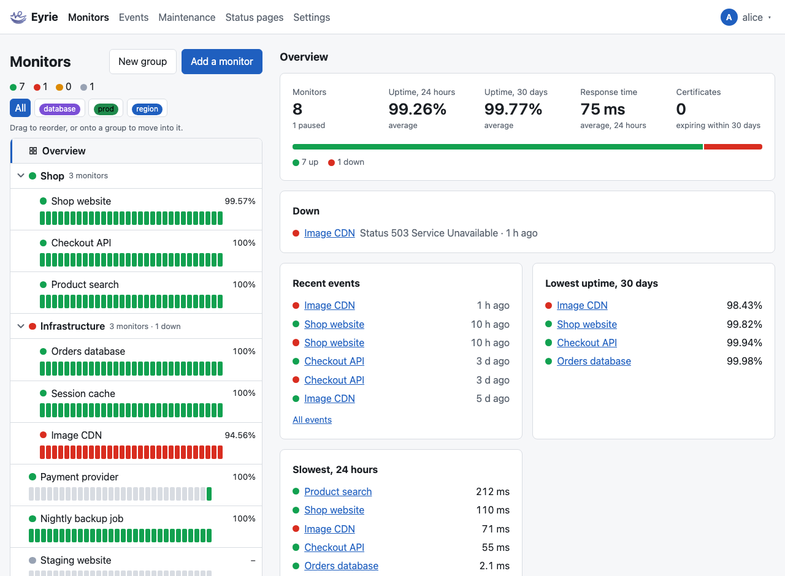

# Eyrie

Eyrie is a self-hosted uptime and infrastructure monitor: it checks your
websites, servers, databases and services, tells you when one goes down,
and publishes status pages. It is a single Go binary with its web app built
in, and keeps its data in SQLite or, for large installations, PostgreSQL.



- **Monitors** for websites (HTTP(S), keywords, JSON, or in a real
  browser), TCP ports, ping, DNS, WebSockets, mail (SMTP), time (NTP),
  RADIUS, SNMP, SIP, SFTP, gRPC, Docker containers, game servers, Tailscale
  nodes, system services, PM2 processes, probes around the world
  (Globalping), databases (PostgreSQL, MySQL and MariaDB, SQL Server,
  Oracle, MongoDB, Redis) and message brokers (MQTT, RabbitMQ, Kafka);
  pushes from jobs, manual monitors and groups. A live dashboard, uptime
  history, tags.
- **Agents** on other hosts that report what runs there: Docker
  containers, Docker Swarm services, Kubernetes workloads and Proxmox VE
  containers and VMs, signed and read-only.
- **Notifications** to ntfy, Gotify, Pushover, Telegram, Discord, email
  and signed webhooks, with certificate expiry warnings. Down alerts can
  carry an analysis of the failure by Claude (an API key or your Claude
  subscription) or a model on your own server, such as Ollama (off by
  default).
- **Maintenance windows** (once, weekly, monthly, every N days or by cron)
  that silence the monitors they cover.
- **Public status pages** built from tags and monitors, with uptime,
  incidents on a timeline and maintenance, and **status badges**.
- **Accounts** with roles, two-factor sign-in, single sign-on (OpenID
  Connect) and read-only API tokens; **Prometheus metrics**.
- **Encrypted backup files**, made by hand or every day, that restore into
  SQLite or PostgreSQL.

## Quick start

Each release is published as a multi-arch image (amd64, arm64) at
`ghcr.io/zjcochran/eyrie`. Start it with the `compose.yaml` in this
repository:

```sh
docker compose up -d
```

Eyrie listens on port 8080; open it and create the first account, an
admin. Its data (the SQLite database and the key that
encrypts stored secrets) is in the `eyrie-data` volume, mounted at `/data`.
See [Installation](docs/user/installation.md), including PostgreSQL.

## Versions

Eyrie is at 0.x and has not been widely tested yet: any release may
still change things. From 1.0.0 it follows semantic versioning, and
upgrades within a major version keep your data, configuration, backup
files, the HTTP API, push URLs, webhooks and metrics working. See
[Upgrades and compatibility](docs/user/upgrading.md).

## Documentation

Everything is in [docs/](docs/README.md): installation, upgrades and
compatibility, monitors, maintenance windows, status pages, backup and
restore, notifications, alert analysis, using the web app, single sign-on,
configuration, the HTTP interface, security, the data model, testing and
CI, development.

Eyrie is written from scratch; it is not a fork of Uptime Kuma, Peekaping
or any other monitor.

## License

Copyright the Eyrie contributors. Licensed under the
[GNU Affero General Public License v3.0 or later](LICENSE)
(`AGPL-3.0-or-later`). Every page links to the source of the running
version, as the AGPL requires; set `EYRIE_SOURCE_URL` if you run a modified
version.
