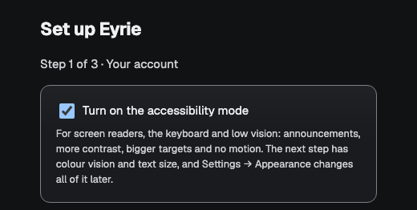
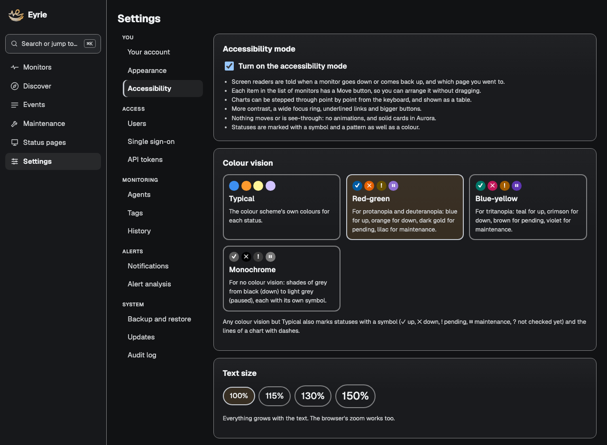
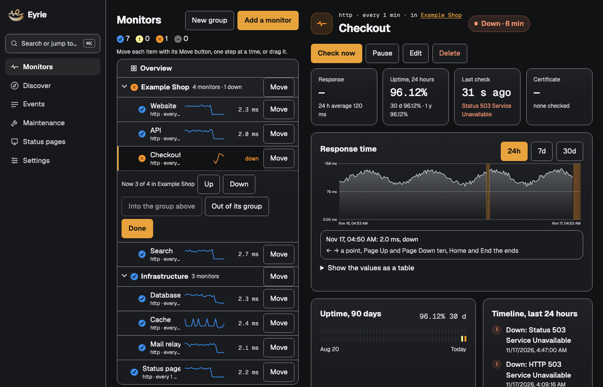
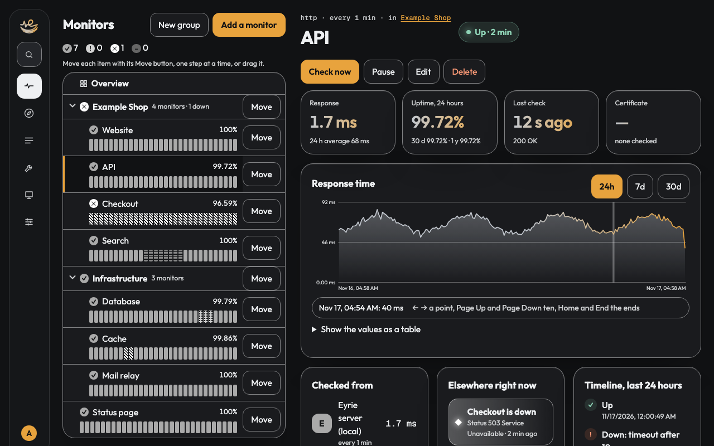

# Accessibility

Eyrie can be used with a screen reader, from the keyboard alone, with low
vision and with any colour vision. Some of this is always on, for everyone.
The rest is chosen by each person, in **Settings → Accessibility**:

- the **accessibility mode**, which turns on everything below under
  [The accessibility mode](#the-accessibility-mode);
- a **colour vision**, which changes the status colours and adds symbols
  and patterns ([Colour vision](#colour-vision));
- a **text size** ([Text size](#text-size)).

The three choices belong to the account, like the rest of
[Appearance](web-ui.md#appearance): they apply on every device the account
signs in on, the moment they are chosen. Each person sets their own; one
account's choices never change what another sees.

## Turning it on at setup

The first step of [setup](web-ui.md#first-start-setup), before the admin
account exists, starts with **Turn on the accessibility mode**. Ticking it
applies the mode to the setup pages at once, and **Create the admin
account** keeps it for the new account. The second step, **How Eyrie
looks**, starts with the same choices as **Settings → Accessibility**, so
the colour vision and text size can be chosen there too.

Later, any account turns any of it on or off in **Settings →
Accessibility** (also in the account menu, under **Accessibility**, and
in **Search or jump to**).

## Before signing in

The browser remembers the last signed-in account's accessibility choices
(in its local storage, under `eyrie.access`), so the sign-in page, and setup
after a restore, are shown the same way. Nothing else about the account is
kept there. In a private window, or with site data cleared or blocked, the
sign-in page is shown without them; they come back on signing in.

## Always on

For everyone, whatever they choose:

- **A skip link.** The first press of Tab on any signed-in page shows
  **Skip to the page**; Enter moves focus past the menus to the page
  itself.
- **Statuses in words.** Every status dot is read as its status (up, down,
  pending, in maintenance, not checked yet, paused), and its tooltip says
  it too. A dot beside its status in words is skipped, so the status is not
  read twice.
- **Heartbeat bars in words**, read as, for example, "Last 30 checks: 28
  up, 2 down. The latest was up."
- **Charts in words.** A response-time chart is read as its period and its
  lowest, average, highest and latest values, and how many of its points
  were down: "Response time, Jan 2, 10:00 to Jan 3, 10:00: lowest 18 ms,
  average 24 ms, highest 140 ms, latest 21 ms; down at 2 points." A chart
  of several lines (a NAS's volumes or disk temperatures) is read as its
  period and each line's latest value.
- **Dialogs.** When one opens (Search or jump to, an event's details,
  the notes of an update, a newer release), focus moves into it, Tab and
  Shift+Tab stay inside it, Escape closes it, and focus goes back to where
  it was.
- **Labels.** Every field has a label, every icon-only button a name, and
  every group of choices a name.
- **Messages.** Errors, changes saved and tests sent are read out as they
  appear on the page.
- **High-contrast modes.** In Windows' high-contrast (forced colours)
  mode, status dots keep their colours, gain a ring and show their
  symbols, and the down checks of a heartbeat bar keep their hatching, so
  they do not vanish with the backgrounds.
- **Reduced motion.** Aurora's drifting colour stands still on a device
  set to reduce motion.
- **Search or jump to** (⌘K, or Ctrl+K on Windows and Linux) reaches every
  monitor, group and page from the keyboard: ↑ and ↓ choose, Enter opens,
  Escape closes.

Everything can be done from the keyboard. Before the accessibility mode,
the one exception was arranging the list of monitors, which needed dragging;
the mode adds buttons for it (below).

## The accessibility mode

Off by default. Turning it on changes these, for that account only:

### Announcements

Screen readers are told, through a live region:

- **When a monitor changes status**, as it happens:
  - "Web is down: connection refused." — said at once, interrupting
    (assertive), since something needs attention;
  - "Web is up again." / "Web is out of maintenance and up." /
    "Web is pending: timeout." / "Web is in maintenance." — said when the
    reader is idle (polite).

  Only changes are said, never every check, and a monitor's first check is
  said only when it is down. The message is the check's own (as in
  [Events](monitors.md)), shortened to 200 characters. Announcements come
  while Eyrie is open in a tab, on any page.
- **Which page you went to**, by its heading, after following a link in
  the app: "Web" for a monitor, "Settings: Accessibility" for a settings tab.
- **Where an item went** after it is moved with its buttons (below).

### Arranging the list without dragging

For admins, each monitor and group in the list on the left has a **Move**
button. It opens a row of buttons under the item, which say where the item
is now ("Now 2 of 5 in Shop"):

| Button | Moves the item |
| --- | --- |
| **Up** | Above the item before it. The first item in a group goes just above the group, out of it. |
| **Down** | Below the item after it. The last item in a group goes just below the group, out of it. |
| **Into the group above** | Into the group just before it, at the end. Only when the item before it is a group. |
| **Out of its group** | Out of its group, just below the group. Only in a group. |
| **Done** | Closes the buttons (so does Escape). |

A button that cannot move the item is disabled, as is every button while a
move is being saved. A group never moves into itself or a group inside it.
After a move, focus stays on the same button (or the first one that can
still be used) and the new place is said, so the item can be moved again
straight away. Each move is saved at once, as a drag is. Dragging still
works too.

The buttons are not shown while the list is filtered by a tag, since
nothing can be arranged then.

### Charts point by point, and as tables

Below every chart (a monitor's response time, a NAS's volumes and
temperatures):

- A **point-by-point control** (a slider for screen readers), reached with
  Tab. It shows and says the point it is on: its time and value, and
  "down" for a check that was down; for several lines, every line's value
  at that time. The chart's cursor and tooltip follow it.

  | Key | Goes to |
  | --- | --- |
  | ← or ↓ | The point before |
  | → or ↑ | The point after |
  | Page Down / Page Up | Ten points back / on |
  | Home / End | The first / the last point |

  It starts on the latest point.
- **Show the values as a table**: every point shown on the chart (at most
  200, as the chart draws), with its time, value and whether it was down;
  for several lines, a column for each.

### Contrast, focus, links and targets

- **More contrast.** Secondary text is 85% of the way from the background
  to the text colour, the quietest text 75% and borders and grid lines
  50%, in every colour scheme, by day and by night.
- **A wide focus ring**: 3 pixels in the text's colour, 2 pixels from the
  element, with a 6-pixel band in the background's colour around it, so it
  shows on every colour.
- **Underlined links** in the pages' text, not told apart by colour alone.
- **Bigger targets.** Buttons, fields, menus and drop-down lists are at
  least 2.75 rem (44 pixels at the usual text size) high, and checkboxes
  and radio buttons 1.25 rem.

### Nothing moves, nothing is see-through

- No animations, no transitions and no smooth scrolling, whatever the
  device is set to.
- In Aurora, solid cards in place of frosted glass, and no drifting colour
  behind them. Chart tooltips are solid in every layout.

### Symbols and patterns

As with any colour vision but Typical (below): every status dot shows its
symbol, the heartbeat bars their patterns, and the lines of a chart with
several lines their own dashes.

## Colour vision

How the statuses (up, down, pending, maintenance, not checked yet) are
coloured. The colour scheme's other colours stay as they are.

| Choice | For | Up | Down | Pending | Maintenance | Not checked yet, paused |
| --- | --- | --- | --- | --- | --- | --- |
| **Typical** (the default) | | the colour scheme's green | its red, orange or pink | its amber | its own (slate, violet, blue or lime) | its grey |
| **Red-green** | protanopia, deuteranopia (and their milder forms) | blue `#005ba3` | orange `#e66100` | dark gold `#6b5200` | lilac `#8f6fd1` | grey `#7a7a7a` |
| **Blue-yellow** | tritanopia | teal `#00796b` | crimson `#c2185b` | brown `#a15c00` | violet `#5e35b1` | grey `#767676` |
| **Monochrome** | achromatopsia (no colour vision) | grey `#5e5e5e` | black `#000000` | dark grey `#3b3b3b` | mid grey `#7a7a7a` | light grey `#959595` |

The colours above are by day. By night they are lighter, to stand out on a
dark background:

| Choice | Up | Down | Pending | Maintenance | Not checked yet, paused |
| --- | --- | --- | --- | --- | --- |
| **Red-green** | `#3d8ff0` | `#ff9a2e` | `#fff599` | `#d1c4ff` | `#6e6e6e` |
| **Blue-yellow** | `#4db6ac` | `#ff5c8d` | `#ffb74d` | `#b39ddb` | `#8c8c8c` |
| **Monochrome** | `#aaaaaa` | `#ffffff` | `#d4d4d4` | `#868686` | `#666666` |

Each set was checked with a simulation of the colour vision it is for
(Machado, Oliveira and Fernandes, 2009, at full strength): as that vision
sees them, every two statuses are at least 8 apart (the distance in the
OKLab colour space, times 100; 8 is about where two small dots are easily
told apart), and every status colour has a contrast of at least 3:1 with
the background, as WCAG asks of graphics.

They apply wherever a status is shown in colour: the dots, the heartbeat
bars, the down marks on a chart, Bento's ring and tiles, and the overview's
days.

With any choice but Typical, colour is never the only sign:

- **Symbols** in every status dot: ✓ up, ✕ down, ! pending, ⏸
  maintenance, ? not checked yet, – paused. The dots grow from 0.7 to 1.05
  rem to fit them.
- **Patterns** in the heartbeat bars: down checks hatched diagonally,
  pending ones dotted, maintenance striped across; up checks plain.
- **Dashes** on charts of several lines (a NAS's volumes, its disks'
  temperatures): each line has its own pattern of dashes, the first one
  solid, shown in the legend too.

Public status pages keep their own colours, since their visitors are not
signed in. Their status dots, heartbeat bars and charts are still read in
words (see [Always on](#always-on)).

## Text size

**100%** (the default), **115%**, **130%** or **150%** of the browser's own
text size. Everything is sized from the text, so the whole app grows with
it: menus, buttons, the list, charts' labels. It adds to the browser's
zoom and its own text size setting rather than replacing them, so they
still work too.

## What it does not do

- Announcements come only from the tab Eyrie is open in, and only while it
  is open. To hear of a monitor going down otherwise, use a
  [notification channel](notifications.md).
- The accessibility mode changes only the web app, not notifications,
  badges or public status pages.
