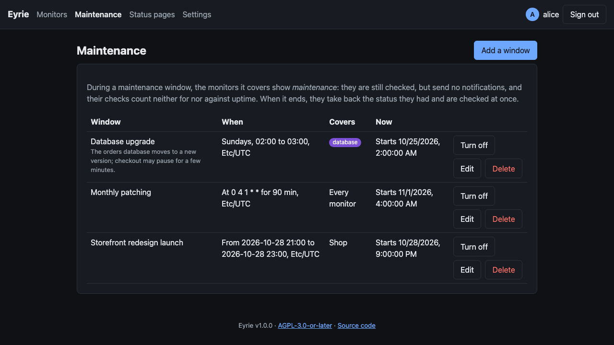

# Maintenance windows

A maintenance window is a time when work on your systems is expected, such
as an upgrade every Sunday night. During it, the monitors it covers:

- show the status **maintenance** (violet);
- are still checked, and their checks are kept in the history as
  maintenance;
- send no notifications, and their alerts carry no
  [analysis](alert-analysis.md);
- count neither for nor against uptime, nor towards the average response
  time.

When the window ends, each monitor takes back the status it had before it
began, without a notification, and is checked at once (a push monitor has
its interval to push). So a monitor that was up and is still up after the
work says nothing; one that is down after it goes down and notifies as
usual, after its retries. A monitor that was down before the window and
comes back up during it notifies that it is back up.

The status from before is kept in the database, so restarting Eyrie during a
window changes nothing.

Windows are on the **Maintenance** page, at the top. Everyone can see them;
admins add, change, turn off and delete them.

## What a window covers

- **Every monitor**, or
- the **monitors** ticked, and the monitors with one of the **tags** ticked
  (see [Tags](monitors.md#tags)).

Covering a group covers its members, and their members. A monitor covered by
several windows that are on shows the first one's title, by title.

Turning a window off (**Turn off**) ends it at once; turning it back on
starts it again if its schedule says it is on.

## Schedules

| Schedule | On |
| --- | --- |
| While turned on | Whenever the window is turned on, until it is turned off. |
| Once, between two times | From the start to the end. |
| On days of the week | On the days ticked, from one time of day to another. |
| On days of the month | On the days ticked (1 to 31, or the last day), from one time of day to another. A month without the day (31 April) is skipped. |
| Every so many days | Every N days from its first day (1 to 3650), from one time of day to another. |
| At the times of a cron expression | At each time of a cron expression, for a number of minutes (1 to 44640, 31 days). |

A daily window whose end is at or before its start, such as 22:00 to 02:00,
ends the next day. Recurring schedules can be limited to a range of days
(**From the day**, **Until the day**, both included); every so many days
needs its first day.

Times are in the window's **time zone**, an IANA name such as `Etc/UTC`
(the form offers every name your browser knows, and starts with its own). A window at 02:30
stays at 02:30 local time across daylight saving changes. On the day the
clocks go forward past a window's time, it starts when they reach it (at
03:00 if they jump from 02:00 to 03:00); a cron run at such a time is
skipped, as cron does. When the clocks go back, a time that happens twice
is the first one.

Windows that overlap or follow each other without a gap are one stretch of
maintenance for the monitors they cover.

### Cron expressions

Five fields, separated by spaces: minute (0 to 59), hour (0 to 23), day of
the month (1 to 31), month (1 to 12, or `jan` to `dec`) and day of the
week (0 to 7, 0 and 7 being Sunday, or `sun` to `sat`). Each field is `*`,
a value, a range (`1-5`), a list (`1,15`), or a step (`*/15`, `10-20/5`,
`3/6` from 3 to the end). When both the day of the month and the day of
the week are given, a day matching either matches, as in cron.

| Expression | Runs |
| --- | --- |
| `0 3 * * sun` | Sundays at 03:00 |
| `30 2 1 * *` | The first of each month at 02:30 |
| `0 */6 * * *` | Every six hours |
| `0 22 * * mon-fri` | Weekdays at 22:00 |

## The list

Each window shows when it is on, what it covers and where it stands now:
**On** (until when, if it ends), **Starts** (when), **Over** (it will not be
on again), or **Turned off**.
