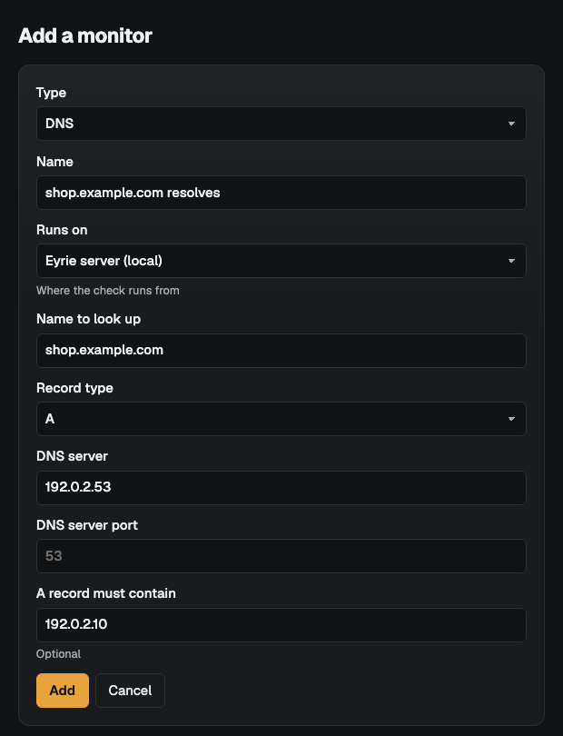

# DNS

Asks a DNS server for a name's records, and is up when it answers with
them. Use it to check that your DNS server answers, that a domain
resolves, or that a record points where it should.

## Before you start

- Decide which server to ask: your own DNS server (to check that it
  works), your domain's authoritative server (to check what it publishes),
  or a public resolver such as `1.1.1.1`, the default (to check what the
  world sees).
- Try the query from where the check runs, for example `dig @192.0.2.53
  shop.example.com A`. The server must accept queries from Eyrie's
  address: many internal servers answer only their own networks.

## Add the monitor

1. On **Monitors**, click **Add a monitor**.
2. **Type**: **DNS**. **Name**: such as `shop.example.com resolves`.
3. **Name to look up**: such as `shop.example.com`. For a PTR record, an
   IP address: Eyrie asks for its reverse name.
4. **Record type**: A by default.
5. **DNS server** and **DNS server port**: leave them empty for `1.1.1.1`
   on port 53.
6. **A record must contain** (optional): text that one of the records
   must contain, such as the address it must point to, `192.0.2.10`.
7. Set the [settings every type has](../monitors.md#settings-every-type-has),
   then click **Add**.

## Settings

| Setting | Default | Meaning |
| --- | --- | --- |
| Name to look up | | A DNS name, or an IP address for PTR |
| Record type | A | A, AAAA, CAA, CNAME, MX, NS, PTR, SOA, SRV or TXT |
| DNS server | `1.1.1.1` | The server asked |
| DNS server port | 53 | |
| A record must contain | | Optional; one record of the type must contain this text |

The query goes over UDP, and again over TCP when the answer is truncated.

## Check that it works

The message lists the records: `A 192.0.2.10, 192.0.2.11`, or
`MX 10 mail.example.com`.

## When it is down

| Message | What to do |
| --- | --- |
| `the DNS server answered NXDOMAIN` | The name does not exist on that server. Check the spelling, and that the record is published. |
| `the DNS server answered REFUSED` | The server will not answer Eyrie: allow Eyrie's address, or ask another server. |
| `No A record for shop.example.com` | The name exists but has no record of that type: an `AAAA`-only name, or a `CNAME` (ask for CNAME instead). |
| `No A record contains "192.0.2.10": A 192.0.2.99` | The records are not what you expected: the record changed, or the expected text is wrong. |
| A message with `did not answer in time` | The server did not answer: it is down, or a firewall blocks port 53 from Eyrie. |
