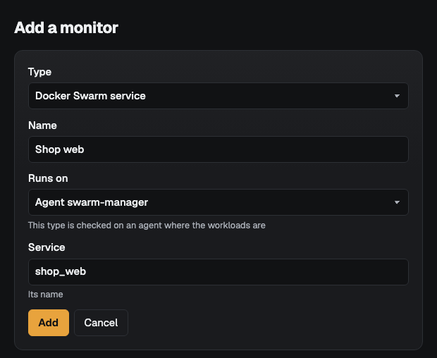

# Docker Swarm service

Follows a Docker Swarm service, and is up while every task it wants runs.
Checked on an [agent](../agents.md) on a swarm manager.

## Before you start

Run an agent on a manager node with `EYRIE_AGENT_PLATFORM: swarm`, as
[Agents → Docker Swarm](../agents.md#docker-swarm) shows:

1. In Eyrie, open **Settings → Agents**, type a name under **Add an agent**, click **Add**, and copy the token it shows.
2. Deploy the agent's stack on a manager, with the token.
3. Wait until the agent is **online** under **Settings → Agents**. It
   reports every service of the swarm.

## Add the monitor

1. On **Monitors**, click **Add a monitor**.
2. **Type**: **Docker Swarm service**. **Name**: such as `Shop web`.
3. **Runs on**: the swarm's agent.
4. **Service**: its name, such as `shop_web` (a stack's services are
   named `<stack>_<service>`). The field suggests the services the agent
   reports.
5. Set the [settings every type has](../monitors.md#settings-every-type-has),
   then click **Add**.

[Discovery](../discovery.md) adds monitors for many services at once.

## Settings

| Setting | Meaning |
| --- | --- |
| Service | The service's name |

It has no response time. A report from the agent that changes the service
checks it at once, so a service that loses a task is down within seconds,
not at the next interval. A service re-created under the same name is
still followed.

## Check that it works

The message is `3 of 3 tasks running`.

## Its page

- **At the top**: State and Stack, with the uptime and the last check.
- **Service**: everything the last check found: its tasks, name, stack, and the tasks ready and wanted.
- **Chart**: tasks running.

With every page's outages of the last 30 days, its uptime by day and its status changes ([A monitor's page](../monitors.md#a-monitors-page)).

## When it is down

| Message | What to do |
| --- | --- |
| `2 of 3 tasks running` | A task failed or cannot be placed: `docker service ps <service> --no-trunc` says why. |
| `Scaled to 0` | The service wants no tasks: `docker service scale` it up, or pause the monitor. |
| `No service shop_web` | The swarm has no service by that name: check the stack's prefix, or the agent's platform (`EYRIE_AGENT_PLATFORM: swarm`). |
| `A Docker Swarm service monitor is checked on an agent` | **Runs on** is Eyrie: choose the swarm's agent. |
| The agent is offline, or its status shows an error | See [Agents → When something is wrong](../agents.md#when-something-is-wrong). |
