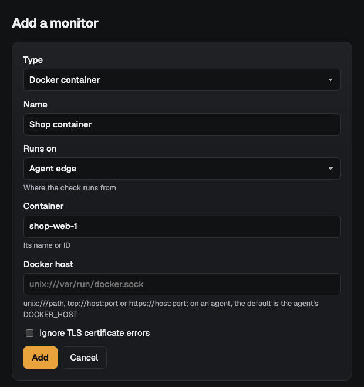

# Docker container

Asks a Docker engine about a container, and is up while it runs (and is
healthy, if it has a health check). Use it for every container you want
to know has stopped, crashed or turned unhealthy.



## Before you start

Eyrie needs to reach the Docker engine where the container runs. Choose
one:

- **The same host as Eyrie**: mount the Docker socket into Eyrie's
  container, read-only, as in the
  [installation](../installation.md#with-sqlite-the-default) examples:

  ```yaml
      volumes:
        - /var/run/docker.sock:/var/run/docker.sock:ro
  ```

- **Another host**: run an [agent](../agents.md#docker) there with the
  socket mounted, and choose it under **Runs on**. The agent also tells
  Eyrie which containers exist, so the form suggests their names. This
  is the way to follow containers on many hosts.
- **A Docker engine with its API on the network** (`tcp://host:2375` or
  `https://host:2376`): give it as **Docker host**. Client certificates
  are not supported.

Whoever can use the Docker socket controls the host. To hold Eyrie or the
agent to reading, put a Docker socket proxy that allows only `GET` in
front of the socket, and give its address as **Docker host** (or the
agent's `DOCKER_HOST`). See [Security](../../technical/security.md#monitor-checks).

## Add the monitor

1. On **Monitors**, click **Add a monitor**.
2. **Type**: **Docker container**. **Name**: such as `Shop container`.
3. **Runs on**: Eyrie, or the agent on the container's host.
4. **Container**: its name (as `docker ps` shows it) or ID. On an agent,
   the field suggests the containers it reports. Use the name: an ID
   changes when the container is re-created.
5. **Docker host**: leave it empty for the socket (or the agent's
   `DOCKER_HOST`).
6. Set the [settings every type has](../monitors.md#settings-every-type-has),
   then click **Add**.

[Discovery](../discovery.md) adds monitors for many containers at once.

## Settings

| Setting | Default | Meaning |
| --- | --- | --- |
| Container | | Its name or ID |
| Docker host | `unix:///var/run/docker.sock`, or the agent's `DOCKER_HOST` | `unix:///path`, `tcp://host:port` or `https://host:port` |
| Ignore TLS certificate errors | off | For an `https://` Docker host |

Up while the container runs and, if it has a health check, is healthy or
still starting. Exited, dead, paused, restarting and unhealthy containers
are down.

## Check that it works

The message is `Running`, `Running, healthy` or `Running, health check
starting`.

## Its page

- **At the top**: State, Health and Restarts, with the uptime and the last check.
- **Container**: everything the last check found: its state, name, image, when it started (or stopped, with its exit code), whether it was killed for running out of memory, its restarts, and with a health check its health, failed checks in a row and what the last one said.
- **Chart**: none: how long Docker took to answer says nothing about the container.

With every page's outages of the last 30 days, its uptime by day and its status changes ([A monitor's page](../monitors.md#a-monitors-page)).

## When it is down

| Message | What to do |
| --- | --- |
| `Exited (exit code 1)` | The container stopped. `docker logs <container>` says why. |
| `Running, unhealthy` | It runs, but its own health check fails: `docker inspect --format '{{json .State.Health}}' <container>` shows the last results. |
| `Restarting`, `Paused`, `Dead` | As Docker says. A container that keeps restarting crashes at start: see its logs. |
| `No container shop` | Docker has no container by that name: check the spelling, the host (or agent), and whether it was renamed. Compose names containers `<project>-<service>-1` unless `container_name` is set. |
| A message starting `Cannot reach Docker:` with `no such file or directory` | The socket is not mounted into Eyrie's (or the agent's) container. |
| A message starting `Cannot reach Docker:` with `permission denied` | Eyrie cannot open the socket. Eyrie's image runs as root, so this happens when it runs as another user; run it as root, or give that user the socket's group. |
