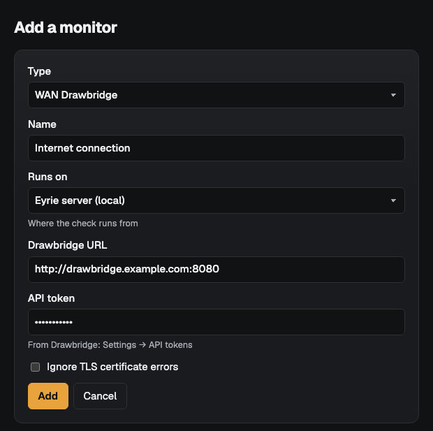

# WAN Drawbridge

Follows [WAN Drawbridge](https://github.com/zjcochran/wan-drawbridge),
which watches which ISP an internet connection is on and stops chosen
containers while it is on a metered backup. The monitor is **down while
Drawbridge has failed over**, so Eyrie alerts when the connection moves
to the backup ISP, and again when it is back.



## Before you start

1. In Drawbridge, as an admin, open **Settings → API tokens**, type a
   name (such as `Eyrie`) and click **Create token**.
2. Copy the token: it starts with `dbt_` and is shown only once. It can
   only read Drawbridge's status.
3. Check that Eyrie (or the agent under **Runs on**) reaches Drawbridge:

   ```sh
   curl -H "Authorization: Bearer dbt_..." http://drawbridge.example.com:8080/api/status
   ```

## Add the monitor

1. On **Monitors**, click **Add a monitor**.
2. **Type**: **WAN Drawbridge**. **Name**: such as `Internet connection`.
3. **Drawbridge URL**: where Drawbridge's web interface is, such as
   `http://drawbridge.example.com:8080`.
4. **API token**: the token from step 1.
5. Set the [settings every type has](../monitors.md#settings-every-type-has),
   then click **Add**.

## Settings

| Setting | Default | Meaning |
| --- | --- | --- |
| Drawbridge URL | | `http://` or `https://`; a URL ending in `/api/status` is shortened to the rest |
| API token | | Required, a [secret setting](../monitors.md#secret-settings) |
| Ignore TLS certificate errors | off | For an `https://` URL |

Eyrie reads Drawbridge's `/api/status`. The monitor is down while its
state is `failover` (on a backup ISP) or `failback_pending` (back on the
primary, waiting before it fails back), as Drawbridge's own health check
counts it. It is up in every other state, including a pending failover
and a failover test. The response time is the request's.

## Check that it works

The message is Drawbridge's state, the ISP in use and since when: `On
primary, on <primary ISP> since 2026-10-14 15:17 UTC`.

## When it is down

| Message | What to do |
| --- | --- |
| `Failover, on <backup ISP> since 2026-10-14 15:17 UTC (primary: <primary ISP>)` | The connection is on the backup ISP: Drawbridge has stopped the containers it was told to. It is up again once Drawbridge fails back. |
| `Failback pending, on <primary ISP> since …` | The primary is back; Drawbridge waits before it fails back. |
| `Drawbridge refused the API token (401 Unauthorized)` | The token is wrong or was revoked: make a new one in Drawbridge, and type it in the monitor. |
| `Drawbridge answered 404 Not Found` (or another code) | The URL is not Drawbridge's, or a proxy in front of it answers: check the URL. |
| `Drawbridge's answer is not its status` | Something else answers at that URL, such as a login page of a proxy. |
| `Timed out`, connection or certificate errors | As for [HTTP(S)](http.md#when-it-is-down). |
