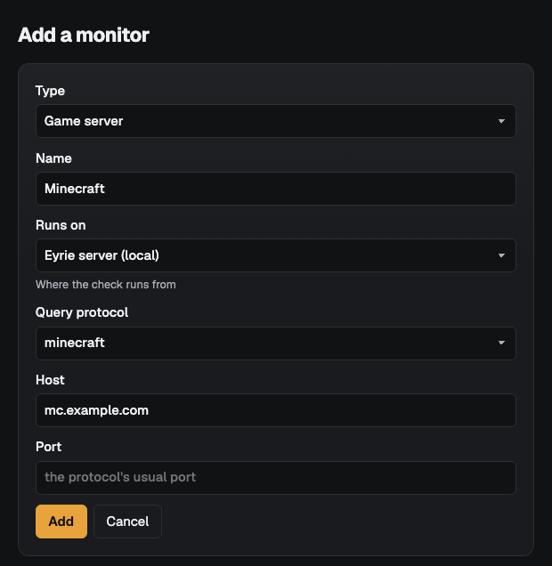

# Game server

Asks a game server for its status in one of several query protocols, and
is up when it answers: Minecraft (Java and Bedrock), Valve's games, and
games on the Quake II and Quake III engines.

## Before you start

- Find out which **protocol** your game speaks (below) and its **query
  port**. For Minecraft Java Edition, the server list ping must be on
  (`enable-status=true` in `server.properties`, the default). For Bedrock,
  the server's UDP port.
- Open the port to Eyrie (or the agent) in the server's firewall: TCP for
  Minecraft Java, UDP for the others.

| Protocol | Usual port | For |
| --- | --- | --- |
| `valve` | 27015 | Source and GoldSrc games and others that answer Steam's `A2S_INFO` |
| `minecraft` | 25565 | Minecraft Java Edition (the server list ping, over TCP) |
| `minecraft-bedrock` | 19132 | Minecraft Bedrock Edition (RakNet's unconnected ping) |
| `quake2` | 27910 | Quake II and games on its engine |
| `quake3` | 27960 | Quake III Arena and games on id Tech 3 |

## Add the monitor

1. On **Monitors**, click **Add a monitor**.
2. **Type**: **Game server**. **Name**: such as `Minecraft`.
3. **Query protocol**, **Host**, and **Port** (empty: the protocol's usual
   port).
4. Set the [settings every type has](../monitors.md#settings-every-type-has),
   then click **Add**.

## Settings

| Setting | Default | Meaning |
| --- | --- | --- |
| Query protocol | `valve` | One of the table above |
| Host | | The game server |
| Port | the protocol's usual port | |

Uptime Kuma uses the GameDig library, which knows hundreds of games by
name; Eyrie speaks these protocols itself.

## Check that it works

The message gives the server's name, game, map and players, as far as the
protocol tells them: `Shop Server · harbor · 5/24 players`.

## Its page

- **At the top**: the players, the response time, the uptime and the last check.
- **Server**: everything the last check found: the server's name, game and map, as far as the protocol tells them, and its players.
- **Chart**: players, and the response time.

With every page's outages of the last 30 days, its uptime by day and its status changes ([A monitor's page](../monitors.md#a-monitors-page)).

## When it is down

| Message | What to do |
| --- | --- |
| `Timed out` | No answer: a wrong port or protocol, a firewall, or the server is down. |
| `The server's answer is not a status`, `… is not a RakNet pong` and the like | Something answered, but not in that protocol: check the protocol and the port. |
| A message with `connection refused` | Minecraft Java: nothing listens on that TCP port. |
