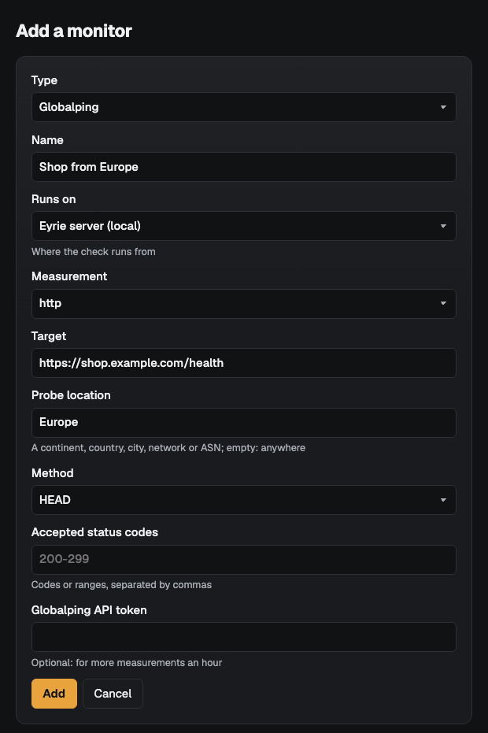

# Globalping

Measures from one of [Globalping](https://globalping.io)'s probes around
the world: a ping, or an HTTP request. Use it to see your site as
visitors elsewhere see it, from outside your own network.

## Before you start

- Eyrie needs to reach `api.globalping.io` over HTTPS.
- Without a token, Globalping allows a limited number of measurements an
  hour from Eyrie's address; each check is one. That suits a few monitors
  checked every few minutes. For more, sign up at globalping.io and make
  an API token in its dashboard.
- The target must be public: probes are on the internet, not in your
  network.

## Add the monitor

1. On **Monitors**, click **Add a monitor**.
2. **Type**: **Globalping**. **Name**: such as `Shop from Europe`.
3. **Measurement**: `ping` or `http`.
4. **Target**: a host to ping, such as `shop.example.com`, or for `http`
   a URL, such as `https://shop.example.com/health`.
5. **Probe location**: where the probe is, in Globalping's own words: a
   continent (`Europe`), a country, a city, a cloud region, a network or
   an ASN (`AS64496`). Empty: any probe.
6. For `ping`, **Packets**; for `http`, **Method** and **Accepted status
   codes**.
7. **Globalping API token**, if you have one.
8. Set an interval of a few minutes, the other [settings every type
   has](../monitors.md#settings-every-type-has), then click **Add**.

## Settings

| Setting | Default | Meaning |
| --- | --- | --- |
| Measurement | `ping` | `ping` or `http` |
| Target | | A host for `ping`, a URL for `http` |
| Probe location | any | A continent, country, city, network or ASN |
| Packets | 3 | `ping`: 1 to 16; up when one is answered, with the average as the response time |
| Method | HEAD | `http`: HEAD, GET or OPTIONS |
| Accepted status codes | `200-299` | `http` |
| Globalping API token | | Optional, a [secret setting](../monitors.md#secret-settings) |

For `http`, the response time is Globalping's total time, and the
certificate's expiry is recorded for HTTPS.

## Check that it works

The message names the probe: `3 of 3 replies from shop.example.com,
pinging from <city>, <country> (AS<number> <network>)`, or `200 OK from
<city>, …`.

## When it is down

| Message | What to do |
| --- | --- |
| `0 of 3 replies from …` or `Status 503 … from …` | The target failed from that probe. Compare with a probe elsewhere: a failure from one region only points at the network between. |
| `No Globalping probe matches the location` | Globalping has no probe there now: use a wider location, such as the country instead of the city. |
| `The Globalping API answered 429 Too Many Requests …` | Too many measurements this hour: check less often, or add an API token. |
| `Timed out waiting for Globalping` | The measurement did not finish within the monitor's timeout: raise it. |
