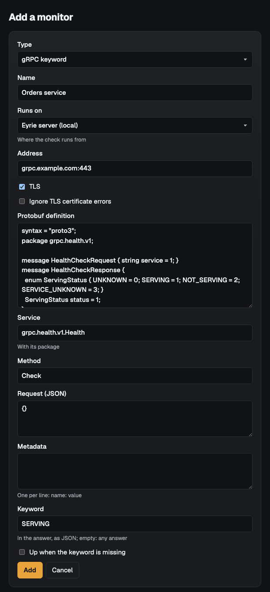

# gRPC keyword

Calls one method of a gRPC service, and looks for a keyword in the answer.
Use it for gRPC services, for example their standard health check.



## Before you start

- Know the service's address (`host:port`) and whether it uses TLS.
- Have the `.proto` definition of the service and of every message the
  method uses, in one text. Eyrie does not read imports, so paste the
  imported types in too (`google.protobuf.Empty` is known).
- Choose a unary method: streaming methods cannot be checked. Many
  services have the standard health check:

  ```protobuf
  syntax = "proto3";
  package grpc.health.v1;

  message HealthCheckRequest { string service = 1; }
  message HealthCheckResponse {
    enum ServingStatus { UNKNOWN = 0; SERVING = 1; NOT_SERVING = 2; SERVICE_UNKNOWN = 3; }
    ServingStatus status = 1;
  }
  service Health {
    rpc Check(HealthCheckRequest) returns (HealthCheckResponse);
  }
  ```

  With it: **Service** `grpc.health.v1.Health`, **Method** `Check`,
  **Request** `{}` and **Keyword** `SERVING`.

## Add the monitor

1. On **Monitors**, click **Add a monitor**.
2. **Type**: **gRPC keyword**. **Name**: such as `Orders service`.
3. **Address**: such as `grpc.example.com:443`. Tick **TLS** if the
   service uses it.
4. **Protobuf definition**: paste the `.proto` text.
5. **Service** (with its package) and **Method**.
6. **Request (JSON)**: the request message as JSON, `{}` for an empty one.
7. **Metadata**: headers the service needs, one per line, such as
   `authorization: Bearer …`.
8. **Keyword**: text that must be in the answer; empty: any answer is up.
9. Set the [settings every type has](../monitors.md#settings-every-type-has),
   then click **Add**.

## Settings

| Setting | Default | Meaning |
| --- | --- | --- |
| Address | | `host:port` |
| TLS | off | HTTP/2 over TLS; off, cleartext HTTP/2 (h2c) |
| Ignore TLS certificate errors | off | As for HTTP(S) |
| Protobuf definition | | The `.proto` text, at most 256 KiB |
| Service | | Its full name, with the package: `shop.v1.Health` |
| Method | | A unary method, such as `Check` |
| Request (JSON) | `{}` | By field name or JSON name |
| Metadata | | One per line, `name: value`, sent as headers |
| Keyword | | Must be in the answer as JSON; empty, any answer is up |
| Up when the keyword is missing | off | As for HTTP(S) keyword |

Eyrie reads the definition itself: messages (nested too), enums, `oneof`,
`map` and `repeated` fields, services. The answer is turned into JSON with
field names in lowerCamelCase, enums by name, 64-bit integers as strings
and bytes in base64; the keyword is searched in that text.

## Check that it works

The message is `OK, "SERVING" found`, or with no keyword, `OK:` and the
start of the answer.

## When it is down

| Message | What to do |
| --- | --- |
| `"SERVING" not found in {"status":"NOT_SERVING"}` | The answer does not contain the keyword: the service reports a problem, or the keyword is wrong. |
| `UNAVAILABLE: …`, `UNIMPLEMENTED: …` and other gRPC statuses | The service answered with an error. `UNIMPLEMENTED` usually means a wrong service or method name. |
| `Status 404 Not Found` (or another HTTP status) | Something that is not a gRPC server answered, such as a proxy that does not pass HTTP/2 on. |
| A message with `unknown type … (imports are not read)` | A type the method uses is not in the definition: paste it in. |
| A message with `has no method` | The service or method is not in the definition as written: check the package and the names. |
| `Timed out`, connection errors | Check the address, and that **TLS** matches the server: a TLS server does not answer cleartext, nor the other way round. |
