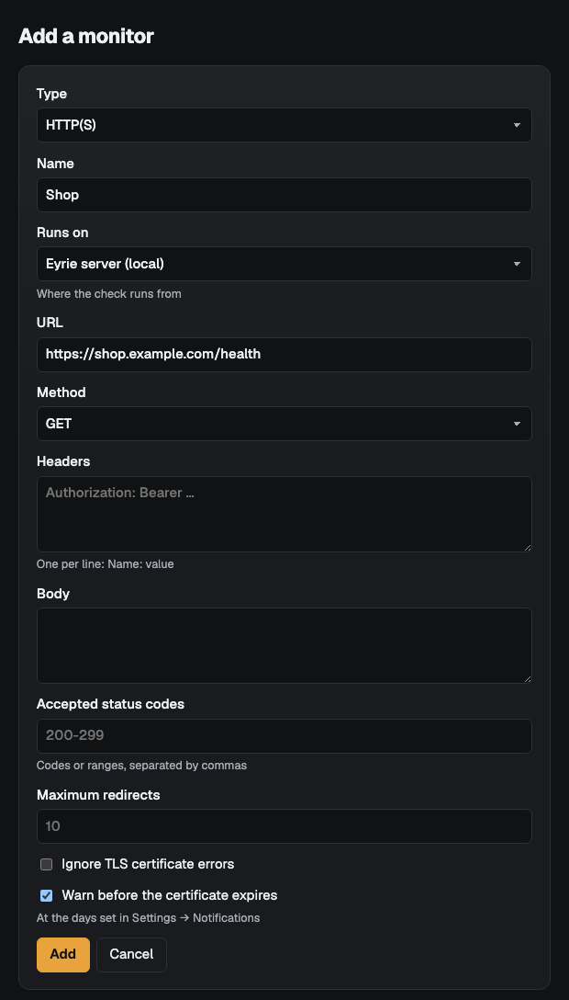

# HTTP(S)

Requests a web page or an API endpoint, and is up when the answer's status
code is one you accept. Use it for websites, health endpoints and APIs.

## Before you start

- Find a URL that answers quickly and says whether the service works: a
  health endpoint such as `https://shop.example.com/health` is better
  than a home page full of images.
- Eyrie must reach the URL from where the check runs: the host Eyrie runs
  on, or the [agent](../agents.md) you choose under **Runs on**. Try it
  from there first, for example `curl -I https://shop.example.com/health`.
- If the endpoint needs a sign-in, have the header ready, such as an API
  key or `Authorization: Bearer …`. Headers are stored as typed (they are
  not secret settings), so give Eyrie a key that can only read.

## Add the monitor

1. On **Monitors**, click **Add a monitor**.
2. **Type**: **HTTP(S)**. **Name**: what people will see, such as `Shop`.
3. **URL**: the address, starting with `http://` or `https://`.
4. Change the other settings only if you need to (see below). For most
   pages, the defaults are right: `GET`, status codes `200-299`, up to 10
   redirects.
5. To be warned before the certificate expires, tick **Warn before the
   certificate expires**. The days are set in **Settings → Notifications**
   ([Certificate warnings](../notifications.md#certificate-warnings)).
6. Set the [settings every type has](../monitors.md#settings-every-type-has)
   (interval, retries, notification channels, tags, group), then click
   **Add**.

The monitor's page opens and the first check runs at once.

## Settings

| Setting | Default | Meaning |
| --- | --- | --- |
| URL | | `http://` or `https://` |
| Method | GET | GET, HEAD, POST, PUT, PATCH, DELETE or OPTIONS |
| Headers | | One per line, `Name: value` |
| Body | | Sent as is |
| Accepted status codes | `200-299` | Codes or ranges, separated by commas, such as `200-299, 301` |
| Maximum redirects | 10 | From 0 to 20. Redirects beyond it fail the check ("more than N redirects"). |
| Ignore TLS certificate errors | off | Accept expired, self-signed or wrongly named certificates |
| Warn before the certificate expires | off | Notify at the days set in Settings → Notifications; see [Certificate warnings](../notifications.md#certificate-warnings) |

The request has `User-Agent: Eyrie/<version>`. Every check opens a new
connection. The response time is from sending the request to the end of
the body (at most 1 MiB of it is read). For HTTPS, the expiry of the
server's certificate is recorded and shown.

## Check that it works

The message is the status, such as `200 OK`, and the response time shows
on the monitor's page. **Check now** on the page checks again at once.

## Its page

- **At the top**: Status and Protocol, with the uptime and the last check.
- **Response**: everything the last check found: its status, where redirects ended, the protocol, the content type and size of the body, the server, and for HTTPS the TLS version and whom the certificate is for and from.
- **Chart**: response time; the certificate's days left.

With every page's outages of the last 30 days, its uptime by day and its status changes ([A monitor's page](../monitors.md#a-monitors-page)).

## When it is down

| Message | What to do |
| --- | --- |
| `Status 503 Service Unavailable` (or another code) | The server answered with a code outside **accepted status codes**. If that code is normal for this URL (a login page answering `401`, a redirect you do not follow), add it, such as `200-299, 401`. |
| `Timed out` | No full answer within the monitor's timeout. Check that the server is up and reachable from where the check runs, or raise **Timeout**. |
| A message with `connection refused` | Nothing listens at that host and port. Check the port in the URL and that the service runs. |
| A message with `no such host` | The host name does not resolve where the check runs. Check the spelling, or the DNS of Eyrie's host or agent. |
| A message with `certificate` or `x509` | The certificate is expired, self-signed or for another name. Fix the certificate, or tick **Ignore TLS certificate errors** for a server you trust. |
| `more than 10 redirects` | The URL redirects in a loop, or more often than **Maximum redirects**. Use the final URL. |
