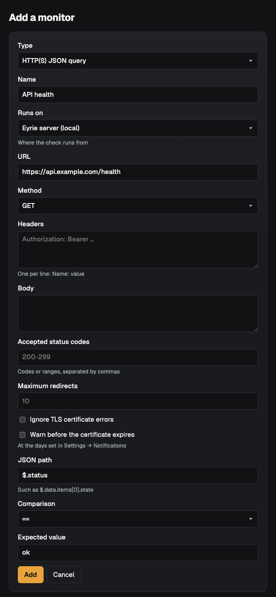

# HTTP(S) JSON query

An [HTTP(S)](http.md) check whose answer must be JSON with a value that
compares as you want: a health endpoint's `status` must be `ok`, a queue's
length must be below 100, a version must contain `2.`.



## Before you start

- Look at the JSON the endpoint answers, for example with
  `curl -s https://api.example.com/health`:

  ```json
  {"status": "ok", "checks": {"db.primary": {"ok": true}}, "queue": {"length": 3}}
  ```

- Write the path to the value you want to check (see below), and the value
  it should have.
- Everything in [HTTP(S) → Before you start](http.md#before-you-start)
  applies too.

## Add the monitor

1. On **Monitors**, click **Add a monitor**.
2. **Type**: **HTTP(S) JSON query**. **Name**: such as `API health`.
3. **URL**: the endpoint's address.
4. **JSON path**: the value to check, such as `$.status`.
5. **Comparison** and **Expected value**: such as `==` and `ok`.
6. Change the HTTP(S) settings only if you need to: they are the same as
   for [HTTP(S)](http.md#settings).
7. Set the [settings every type has](../monitors.md#settings-every-type-has),
   then click **Add**.

## Settings

Every [HTTP(S) setting](http.md#settings), and:

| Setting | Default | Meaning |
| --- | --- | --- |
| JSON path | | Required. The value to check |
| Comparison | `==` | `==`, `!=`, `<`, `<=`, `>`, `>=` or `contains` |
| Expected value | | What the value is compared with |

### Writing the path

The path names one value: object keys separated by dots, array indexes in
brackets, keys with other characters in brackets and quotes, with an
optional `$` or `$.` in front. For the example above:

| Path | Value |
| --- | --- |
| `$.status` or `status` | `ok` |
| `checks["db.primary"].ok` | `true` |
| `$.queue.length` | `3` |
| `$.data.items[0].state` | the first item's `state`, in an answer with an array |

- Strings are compared as they are; other values as JSON (`true`, `null`,
  `3`, `{"a":1}`).
- `==`, `!=`, `<`, `<=`, `>`, `>=` compare as numbers when both sides are
  numbers, otherwise as text; `contains` looks for the expected text in
  the value.

Uptime Kuma uses JSONata here; Eyrie's paths are the common subset, without
JSONata's functions and filters.

## Check that it works

The message shows the value found: `$.status is ok`.

## Its page

- **At the top**: the response time, the uptime, the last check and the certificate's days left.
- **Response**: everything the last check found: the value at the path and what it must be, and its status, where redirects ended, the protocol, the content type and size of the body, the server, and for HTTPS the TLS version and whom the certificate is for and from.
- **Chart**: response time, and the value when it is a number; the certificate's days left.

With every page's outages of the last 30 days, its uptime by day and its status changes ([A monitor's page](../monitors.md#a-monitors-page)).

## When it is down

| Message | What to do |
| --- | --- |
| `$.status is degraded, not == ok` | The value is not what you expected: the service reports a problem, or the expected value is wrong (strings are compared exactly, `OK` is not `ok`). |
| A message with `nothing at` | The path names nothing in the answer. Check it against the JSON, key by key; keys with dots need brackets and quotes. |
| `the response is not JSON` | The URL answered something else, such as an HTML error or login page. Check the URL and any sign-in header. |
| `Status …`, `Timed out`, connection or certificate errors | As for [HTTP(S)](http.md#when-it-is-down). |
