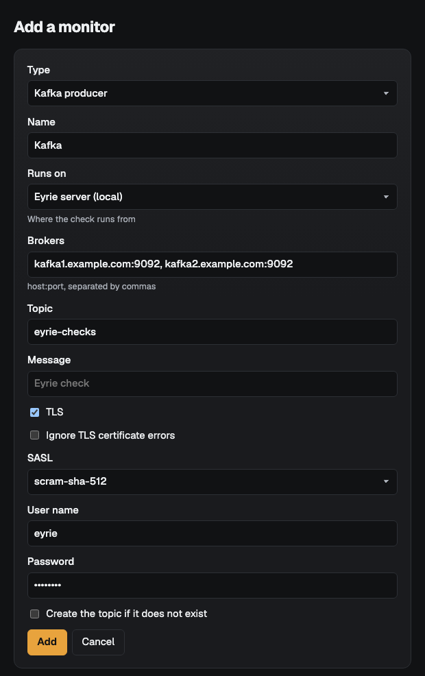

# Kafka producer

Sends a message to a Kafka topic, and is up when the cluster acknowledges
it. Use it to know that a Kafka cluster takes messages.



## Before you start

1. **Make a topic for the checks**, such as `eyrie-checks`: every check
   adds a message to it. Keep it small with a short retention:

   ```sh
   kafka-topics.sh --bootstrap-server kafka.example.com:9092 --create \
     --topic eyrie-checks --partitions 1 --config retention.ms=3600000
   ```

2. If the cluster uses SASL, **make a user** (SASL/PLAIN or SCRAM) that
   may write to that topic only; with ACLs:

   ```sh
   kafka-acls.sh --bootstrap-server kafka.example.com:9092 --add \
     --allow-principal User:eyrie --operation Write --operation Describe --topic eyrie-checks
   ```

3. Note the brokers' `host:port` as clients reach them: the address the
   brokers advertise (`advertised.listeners`) must be reachable from Eyrie
   (or the agent) too.

## Add the monitor

1. On **Monitors**, click **Add a monitor**.
2. **Type**: **Kafka producer**. **Name**: such as `Kafka`.
3. **Brokers**: such as `kafka1.example.com:9092, kafka2.example.com:9092`.
4. **Topic**: the topic from step 1.
5. **TLS**, **SASL** and its **User name** and **Password**, as the
   cluster needs.
6. Set the [settings every type has](../monitors.md#settings-every-type-has),
   then click **Add**.

## Settings

| Setting | Default | Meaning |
| --- | --- | --- |
| Brokers | | `host:port`, separated by commas, 1 to 20 |
| Topic | | Letters, digits, dots, dashes and underscores |
| Message | `Eyrie check` | At most 10000 characters |
| TLS | off | |
| Ignore TLS certificate errors | off | |
| SASL | none | `plain`, `scram-sha-256` or `scram-sha-512` |
| User name, Password | | For SASL; the password is a [secret setting](../monitors.md#secret-settings) |
| Create the topic if it does not exist | off | Lets the cluster create it automatically, if it allows that |

AWS IAM and Kerberos are not supported.

## Check that it works

The message is `Sent to eyrie-checks, partition 0, offset 1234`.

## Its page

- **At the top**: Partition and Offset, with the uptime and the last check.
- **Message sent**: everything the last check found: the topic, partition, offset and brokers.
- **Chart**: the time until the cluster acknowledged the message.

With every page's outages of the last 30 days, its uptime by day and its status changes ([A monitor's page](../monitors.md#a-monitors-page)).

## When it is down

| Message | What to do |
| --- | --- |
| A message with `UNKNOWN_TOPIC_OR_PARTITION` | The topic does not exist: create it, or tick **Create the topic if it does not exist**. |
| A message with `TOPIC_AUTHORIZATION_FAILED` | The user may not write to the topic: add an ACL. |
| A message with `SASL` or `authentication` | The SASL mechanism, user name or password is wrong. |
| `Timed out` | Eyrie reached no broker, or reached one but not the address it advertises. Check `advertised.listeners`. |
