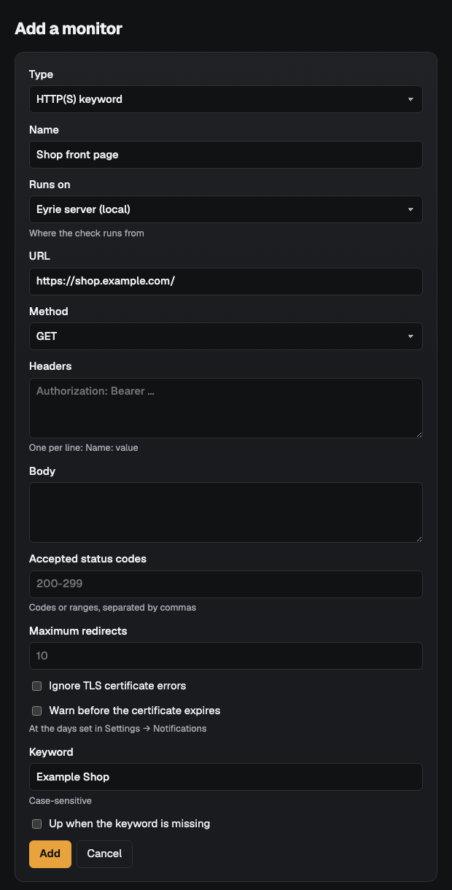

# HTTP(S) keyword

An [HTTP(S)](http.md) check whose answer must also contain a word, or must
not. Use it when a page answers `200 OK` even while it is broken, for
example a page that shows "Database error" with a status of 200.

## Before you start

- Open the page in a browser and choose a word or phrase that is there
  only when it works, such as the shop's name in its footer, or `"status":"ok"`
  in an API's answer. Look at the page's source (the HTML), not only what
  the browser shows: the keyword is searched in the raw answer.
- Or choose text that appears only when it fails, such as `Maintenance`
  or `Error`, and tick **Up when the keyword is missing**.
- Everything in [HTTP(S) → Before you start](http.md#before-you-start)
  applies too.

## Add the monitor

1. On **Monitors**, click **Add a monitor**.
2. **Type**: **HTTP(S) keyword**. **Name**: such as `Shop front page`.
3. **URL**: the page's address.
4. **Keyword**: the text to look for. It is case-sensitive.
5. Tick **Up when the keyword is missing** if the text means a failure.
6. Change the HTTP(S) settings only if you need to: they are the same as
   for [HTTP(S)](http.md#settings).
7. Set the [settings every type has](../monitors.md#settings-every-type-has),
   then click **Add**.

## Settings

Every [HTTP(S) setting](http.md#settings), and:

| Setting | Default | Meaning |
| --- | --- | --- |
| Keyword | | Required. Searched, case-sensitive, in the first 1 MiB of the body |
| Up when the keyword is missing | off | The body must not contain the keyword |

The status code must be accepted as well: a `500` page is down even if it
contains the keyword.

## Check that it works

The message is `Keyword "Example Shop" found`, or with **Up when the
keyword is missing**, `Keyword "Maintenance" not found, as wanted`.

## Its page

- **At the top**: the response time, the uptime, the last check and the certificate's days left.
- **Response**: everything the last check found: whether the keyword was found, and its status, where redirects ended, the protocol, the content type and size of the body, the server, and for HTTPS the TLS version and whom the certificate is for and from.
- **Chart**: response time; the certificate's days left.

With every page's outages of the last 30 days, its uptime by day and its status changes ([A monitor's page](../monitors.md#a-monitors-page)).

## When it is down

| Message | What to do |
| --- | --- |
| `Keyword "Example Shop" not found in "<!doctype html>…"` | The message quotes the first 50 characters of the body. Compare the quoted body with what you expected. The page may have changed, show a cookie banner or a login page to a client without cookies, or send different text to Eyrie's `User-Agent`. Choose a keyword that is in the raw HTML. |
| `Keyword "Maintenance" found, but it must not be` | The failure text is on the page: the service reports a problem. |
| `Status …`, `Timed out`, connection or certificate errors | As for [HTTP(S)](http.md#when-it-is-down). |
