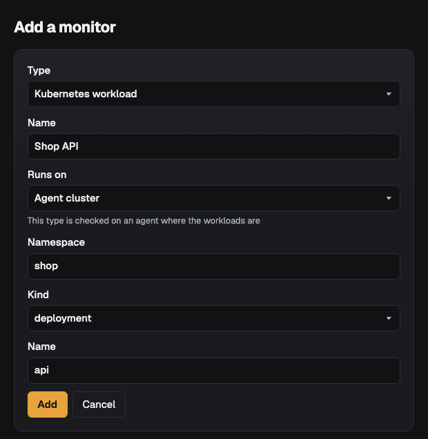

# Kubernetes workload

Follows a Kubernetes Deployment, StatefulSet or DaemonSet, and is up while
every replica it wants is ready. Checked on an [agent](../agents.md) in
the cluster.

## Before you start

Run the agent in the cluster, as [Agents → Kubernetes](../agents.md#kubernetes)
shows:

1. In Eyrie, open **Settings → Agents**, type a name under **Add an agent**, click **Add**, and copy the token it shows.
2. Create the secret with Eyrie's URL and the token, and apply
   `deploy/kubernetes/eyrie-agent.yaml`. Its ServiceAccount may only list
   Deployments, StatefulSets and DaemonSets.
3. Wait until the agent is **online** under **Settings → Agents**.

## Add the monitor

1. On **Monitors**, click **Add a monitor**.
2. **Type**: **Kubernetes workload**. **Name**: such as `Shop API`.
3. **Runs on**: the cluster's agent.
4. **Namespace** (`default` if empty), **Kind** (`deployment`,
   `statefulset` or `daemonset`) and **Name**. The name field suggests the
   workloads the agent reports.
5. Set the [settings every type has](../monitors.md#settings-every-type-has),
   then click **Add**.

[Discovery](../discovery.md) adds monitors for many workloads at once.

## Settings

| Setting | Default | Meaning |
| --- | --- | --- |
| Namespace | `default` | |
| Kind | `deployment` | `deployment`, `statefulset` or `daemonset` |
| Name | | The workload's name |

Up while every replica it wants is ready; for a DaemonSet, every pod it
schedules. It has no response time, and a report that changes the
workload checks it at once.

## Check that it works

The message is `3 of 3 ready`.

## When it is down

| Message | What to do |
| --- | --- |
| `2 of 3 ready` | A pod is not ready: `kubectl -n <namespace> get pods` and `kubectl describe pod` say why (crashing, pending, failing its readiness probe). |
| `Scaled to 0` | The workload wants no replicas. |
| `Scheduled on no nodes` | A DaemonSet whose node selector or tolerations match no node. |
| `No deployment web in default` | No such workload: check the namespace and the kind, and `EYRIE_AGENT_NAMESPACES` if the agent is limited to some. |
| `A Kubernetes workload monitor is checked on an agent` | **Runs on** is Eyrie: choose the cluster's agent. |
| The agent is offline, or its status shows an error | See [Agents → When something is wrong](../agents.md#when-something-is-wrong). |
