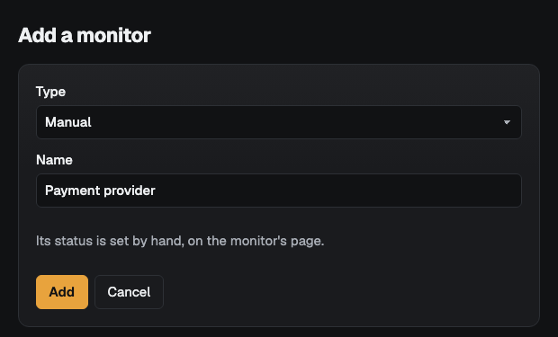
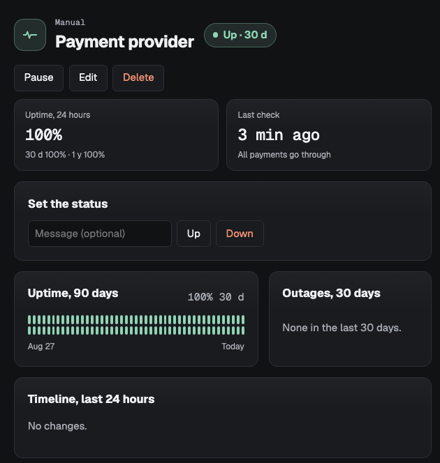

# Manual

Eyrie does not check anything: an admin sets the monitor **up** or
**down**, with an optional message. Use it for what nothing can check,
such as a supplier's outage, and to show such things on a [status
page](../status-pages.md).

## Add the monitor

1. On **Monitors**, click **Add a monitor**.
2. **Type**: **Manual**. **Name**: such as `Payment provider`.
3. Set the [notification channels](../notifications.md), tags and group
   as for any monitor, then click **Add**.

It has no interval, timeout or retries.

## Set its status

On the monitor's page, type a message (optional) and click **Up** or
**Down**. The change is a heartbeat like any other: it is notified, shown
on status pages, and counts in the uptime.

## Its page

- **At the top**: the uptime and when it was last set, with its message.
- **Set the status**: **Up** or **Down**, with a message.
- **Chart**: none.

With every page's outages of the last 30 days, its uptime by day and its status changes ([A monitor's page](../monitors.md#a-monitors-page)).
