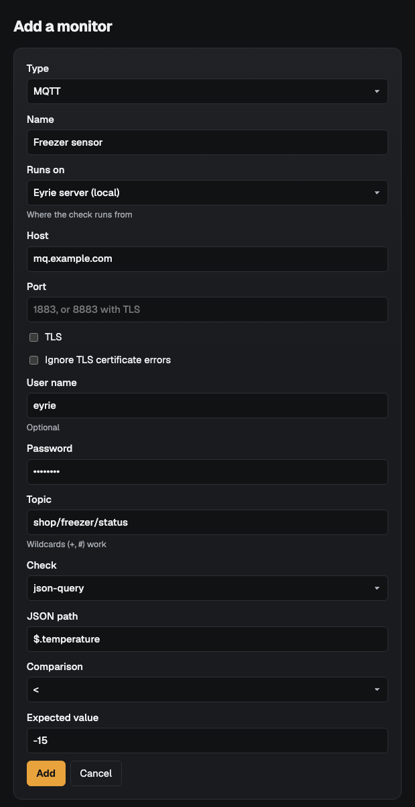

# MQTT

Subscribes to a topic on an MQTT broker and waits for a message, and is
up when one arrives in time and is what you expect. Use it for a broker
(Mosquitto, EMQX, HiveMQ), and for devices that publish their state, such
as sensors or Home Assistant.



## Before you start

- **Choose a topic that has a message whenever Eyrie looks.** Eyrie waits
  for a retained message, or the next one published:
  - a topic with a **retained** message, such as a device's
    `…/status` or `…/availability` (`online`); or
  - a topic published to more often than the monitor's timeout.

  A topic published once an hour, without retain, is down at every check.
- **Make a user** on the broker that may read that topic. In Mosquitto:

  ```sh
  mosquitto_passwd /etc/mosquitto/passwd eyrie
  ```

  and in its ACL file, `user eyrie` then `topic read shop/#`.
- **Try it**: `mosquitto_sub -h mq.example.com -u eyrie -P '…' -t
  shop/status -C 1 -v`.

## Add the monitor

1. On **Monitors**, click **Add a monitor**.
2. **Type**: **MQTT**. **Name**: such as `Freezer sensor`.
3. **Host** and **Port** (1883, or 8883 with **TLS**).
4. **User name** and **Password**, if the broker needs them.
5. **Topic**: such as `shop/freezer/status`. Wildcards (`+`, `#`) work.
6. **Check**:
   - `keyword`: up when the message contains the **keyword** (empty: any
     message), such as `online`;
   - `json-query`: the message is JSON, with a value at a **JSON path**
     compared with an **expected value**, as for [HTTP(S) JSON
     query](json-query.md#writing-the-path), such as `$.temperature`,
     `<`, `-15`.
7. Set the [settings every type has](../monitors.md#settings-every-type-has),
   then click **Add**.

## Settings

| Setting | Default | Meaning |
| --- | --- | --- |
| Host | | The broker |
| Port | 1883, or 8883 with TLS | |
| TLS | off | |
| Ignore TLS certificate errors | off | |
| User name, Password | | Optional; the password is a [secret setting](../monitors.md#secret-settings) |
| Topic | | Wildcards work |
| Check | `keyword` | `keyword` or `json-query` |
| Keyword | | Empty: any message |
| JSON path, Comparison, Expected value | | For `json-query` |

Eyrie speaks MQTT 3.1.1 over TCP; MQTT over WebSockets is not supported.

## Check that it works

The message is `Message: online`, or with a JSON query,
`$.temperature is -18.5`.

## Its page

- **At the top**: the value and the topic, the uptime and the last check.
- **Message**: everything the last check found: the topic, the message, how long Eyrie waited for it, and with a JSON query the value and what it must be.
- **Chart**: the value, when it is a number, instead of a response time: the wait for a message says nothing about the broker.

With every page's outages of the last 30 days, its uptime by day and its status changes ([A monitor's page](../monitors.md#a-monitors-page)).

## When it is down

| Message | What to do |
| --- | --- |
| `No message on shop/freezer/status in time` | Nothing was published, and nothing is retained: the device is offline, the topic is wrong, or it is published less often than the timeout. Have the device retain its state, or raise **Timeout**. |
| `"online" not found in offline` | The message is not what you expected. |
| `$.temperature is -9, not < -15` | The value is not what you expected. |
| `The broker refused: wrong user name or password` (or `not authorized`) | Check the user and password, and that the user may connect. |
| A message with `refused the subscription` | The user may not read that topic: check the broker's ACL. |
| `Timed out`, `connection refused` | The broker does not listen on that port, or TLS does not match it. |
