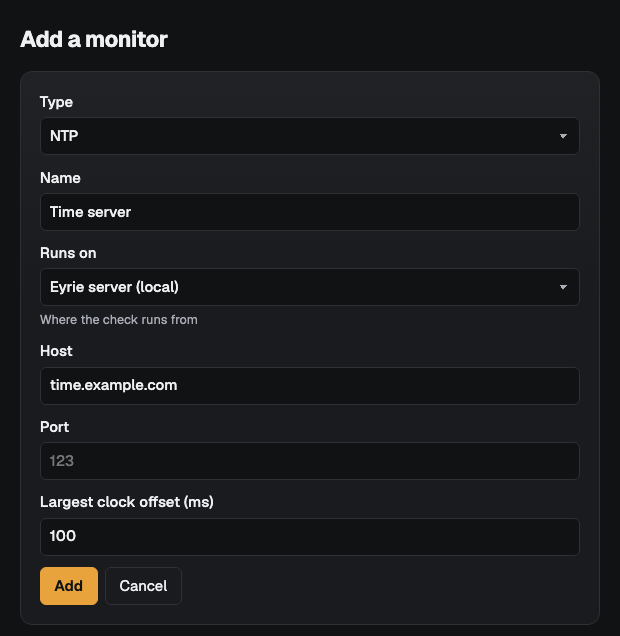
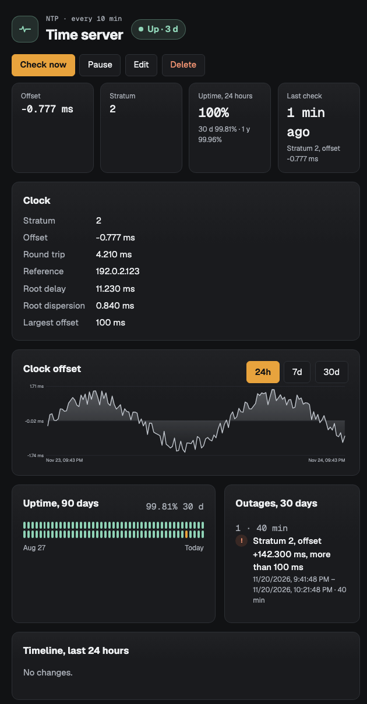

# NTP

Asks a time server for the time, and is up when it answers with a
synchronized clock, optionally close to Eyrie's own. Use it for your own
NTP servers, or a router that serves time to your network.

## Before you start

- Check that the server answers from where the check runs, for example
  `ntpdate -q time.example.com` or `chronyc -h time.example.com
  tracking`. It needs UDP port 123 open between them.
- To use **Largest clock offset**, Eyrie's own host must keep good time
  (run an NTP client on it): the offset is measured against Eyrie's clock.

## Add the monitor

1. On **Monitors**, click **Add a monitor**.
2. **Type**: **NTP**. **Name**: such as `Time server`.
3. **Host**: such as `time.example.com`.
4. **Largest clock offset (ms)** (optional): such as `100`, to be down
   when the server's clock is more than 100 ms from Eyrie's.
5. Set the [settings every type has](../monitors.md#settings-every-type-has),
   then click **Add**.

Public pools such as `pool.ntp.org` limit how often a client may ask; a
check every minute is fine, every 20 seconds may get a `RATE` refusal.

## Settings

| Setting | Default | Meaning |
| --- | --- | --- |
| Host | | The time server |
| Port | 123 | |
| Largest clock offset (ms) | any | 0 (any) to 3600000 |

Eyrie asks with NTP version 4 over UDP. The response time is the round trip.

## Check that it works

The message gives the stratum and the offset: `Stratum 2, offset +1.250 ms`.

## Its page

- **At the top**: the offset and the stratum, the uptime and the last check.
- **Clock**: everything the last check found: the stratum, the offset, the round trip, what the server's clock follows (a source such as GPS at stratum 1, the upstream server's address below), its root delay and dispersion, and the largest offset allowed.
- **Chart**: the clock's offset, in milliseconds, instead of a response time.

With every page's outages of the last 30 days, its uptime by day and its status changes ([A monitor's page](../monitors.md#a-monitors-page)).

## When it is down

| Message | What to do |
| --- | --- |
| `The server's clock is not synchronized` | The server answers but has no good time source itself (stratum 16 or an alarm). Check its upstream servers. |
| `The server refused: "RATE"` (or another code) | A "kiss-o'-death": the server asks Eyrie to back off (`RATE`) or denies it (`DENY`, `RSTR`). Check less often, or use a server that allows Eyrie. |
| `Stratum 2, offset +250.000 ms, more than 100 ms` | The server's clock and Eyrie's differ by more than **Largest clock offset**. Check which of the two is wrong. |
| `Timed out` | No answer: UDP port 123 is blocked, or the server is down. |
