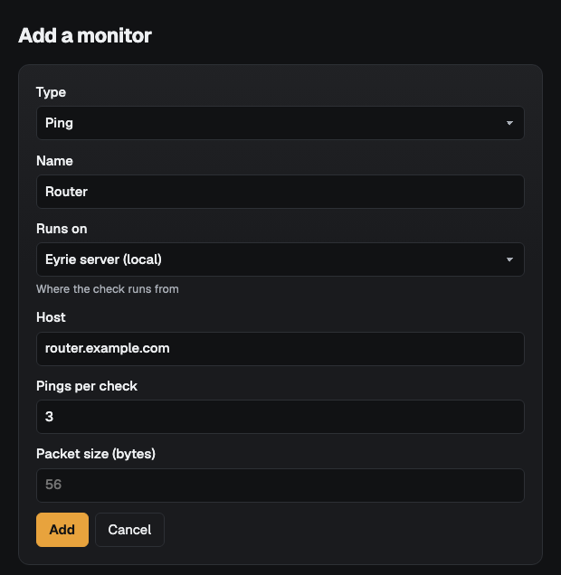
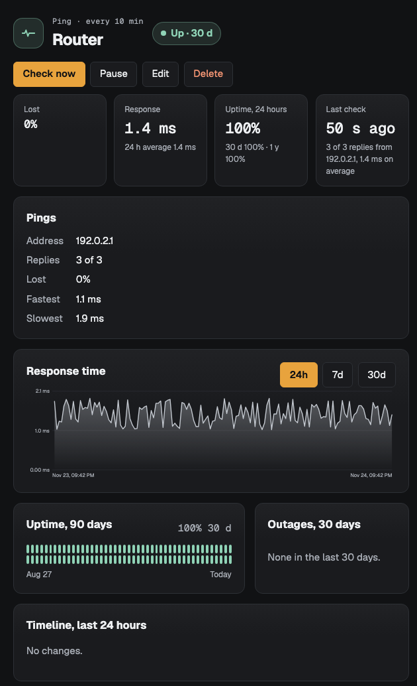

# Ping

Sends ICMP echo requests (pings) to a host, and is up when it answers. Use
it for routers, switches, servers and anything else that answers pings.



## Before you start

- Check that the host answers pings from where the check runs: `ping -c 1
  router.example.com`. Many hosts, and Windows by default, block them;
  allow ICMP echo requests in their firewall, or use a [TCP port](port.md)
  monitor instead.
- Eyrie pings without root, through the system's unprivileged ICMP
  sockets:
  - **In Docker** (Eyrie's image, or an agent's), they work for every
    container: nothing to do.
  - **On a Linux host without Docker**, the group Eyrie runs as must be in
    `net.ipv4.ping_group_range`. To allow every group:

    ```sh
    echo 'net.ipv4.ping_group_range = 0 2147483647' | sudo tee /etc/sysctl.d/90-ping.conf
    sudo sysctl --system
    ```

  - **On macOS** it works as is. On other systems (Windows, BSD) ping
    monitors cannot run.

## Add the monitor

1. On **Monitors**, click **Add a monitor**.
2. **Type**: **Ping**. **Name**: such as `Router`.
3. **Host**: a host name or IP address.
4. **Pings per check**: 1 is enough for most hosts. On a lossy link, send
   3, so that one lost ping does not count as down.
5. Set the [settings every type has](../monitors.md#settings-every-type-has),
   then click **Add**.

## Settings

| Setting | Default | Meaning |
| --- | --- | --- |
| Host | | A host name or IP address |
| Pings per check | 1 | 1 to 10, sent one after another, each with an equal share of the timeout |
| Packet size (bytes) | 56 | 8 to 1400 |

Up when at least one ping is answered; the response time is the average of
the answers. A host name is resolved first, and its IPv4 address is
preferred.

## Check that it works

The message is `3 of 3 replies from 192.0.2.1, 1.2 ms on average`.

## Its page



- **At the top**: the share of pings lost, the response time, the uptime and the last check.
- **Pings**: everything the last check found: the address pinged, the replies, the share lost and, with more than one ping, the fastest and slowest.
- **Chart**: the average response time.

With every page's outages of the last 30 days, its uptime by day and its status changes ([A monitor's page](../monitors.md#a-monitors-page)).

## When it is down

| Message | What to do |
| --- | --- |
| `No reply from 192.0.2.1` | The host did not answer in time: it is down, unreachable, or blocks pings. Try `ping` from Eyrie's host or agent. |
| A message with `cannot open an ICMP socket` | Eyrie may not send pings on this host: set `net.ipv4.ping_group_range` as above. |
| `ping works on Linux and macOS only` | Eyrie or the agent runs on another system. Run the check from a Linux agent. |
| A message with `cannot resolve` or `has no address` | The host name does not resolve where the check runs. |
