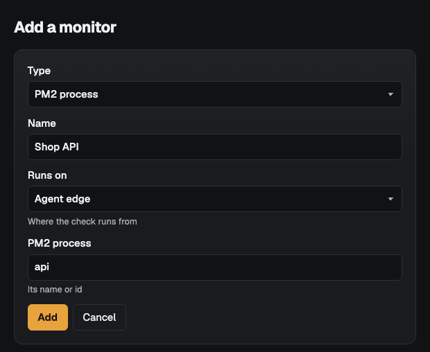
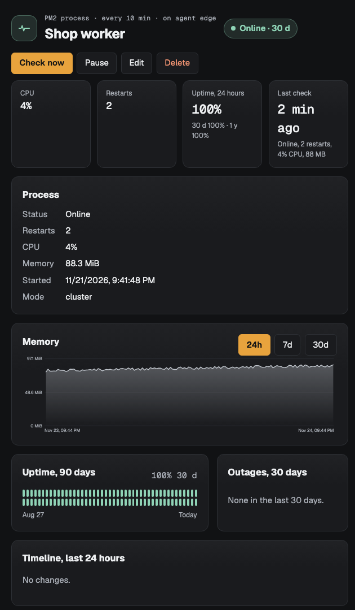

# PM2 process

Asks PM2 about one of its processes, and is up while it is `online`. Use
it for Node.js (or other) apps run by PM2.

## Before you start

The check runs `pm2 jlist` where it runs, so it needs PM2 there, and it
sees the processes of the user it runs as:

- Run an [agent directly on the host](../agents.md#on-a-host-without-docker)
  where PM2 runs, **as the same user that runs PM2** (`User=` in its
  systemd unit): each user has its own PM2. A container cannot see PM2.
- Or set `PM2_HOME` for the agent (`Environment=PM2_HOME=…`) to that
  user's PM2 folder, such as `/home/alice/.pm2`, and let it read it.
- Find the process's name or id with `pm2 list`.

## Add the monitor

1. On **Monitors**, click **Add a monitor**.
2. **Type**: **PM2 process**. **Name**: such as `Shop API`.
3. **Runs on**: the agent on PM2's host.
4. **PM2 process**: its name or id, such as `api`.
5. Set the [settings every type has](../monitors.md#settings-every-type-has),
   then click **Add**.

## Settings

| Setting | Meaning |
| --- | --- |
| PM2 process | Its name or id |

## Check that it works

The message gives its status, restarts, CPU and memory: `Online, 2
restarts, 12% CPU, 80 MB`.

## Its page

- **At the top**: its CPU use and restarts, the uptime and the last check.
- **Process**: everything the last check found: its status, restarts, CPU, memory, when it started and its mode.
- **Chart**: its memory, in MiB.

With every page's outages of the last 30 days, its uptime by day and its status changes ([A monitor's page](../monitors.md#a-monitors-page)).

## When it is down

| Message | What to do |
| --- | --- |
| `Errored, 15 restarts` (or `Stopped`) | PM2 has the process but it is not running: `pm2 logs <name>` says why. |
| `PM2 has no process api` | PM2 runs no such process for this user: check `pm2 list` as the user Eyrie runs as, or `PM2_HOME`. |
| `pm2 is not installed where Eyrie runs` | PM2 is not on the agent's `PATH` (systemd's is short: install PM2 globally, or link it into `/usr/local/bin`), or the check runs in a container. |
| `pm2 jlist did not answer JSON` | PM2 printed something else, such as a first-run message: run `pm2 jlist` once as that user. |
