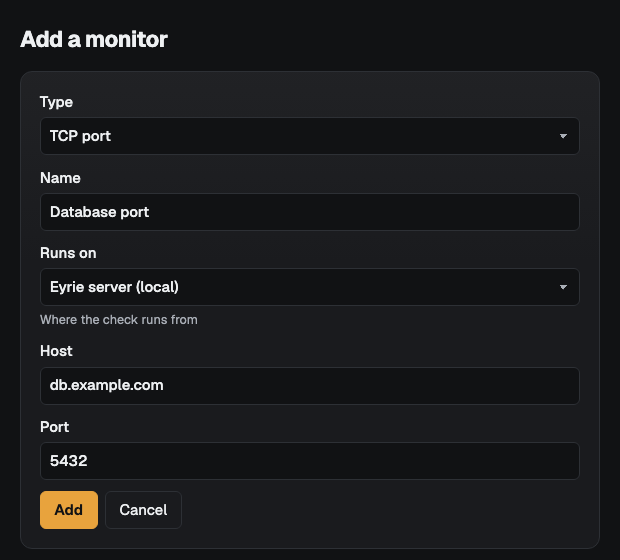

# TCP port

Up when a TCP connection to a host and port opens. Use it for anything
that listens on TCP and has no type of its own: SSH, a game's TCP port, a
database you do not want to sign in to, a printer.

## Before you start

- Know the host (a name or an IP address) and the port, such as
  `db.example.com` and `5432`.
- Check that the port is open from where the check runs (Eyrie's host, or
  the agent under **Runs on**), for example with `nc -vz db.example.com
  5432`. A firewall between them makes the check time out.

## Add the monitor

1. On **Monitors**, click **Add a monitor**.
2. **Type**: **TCP port**. **Name**: such as `Database port`.
3. **Host** and **Port**.
4. Set the [settings every type has](../monitors.md#settings-every-type-has),
   then click **Add**.

## Settings

| Setting | Default | Meaning |
| --- | --- | --- |
| Host | | A host name or IP address |
| Port | | 1 to 65535 |

Eyrie only opens the connection and closes it again: it sends nothing. The
response time is the time to connect.

## Check that it works

The message is `Connected`.

## Its page

- **At the top**: the address it connected to, the response time, the uptime and the last check.
- **Connection**: everything the last check found: the address it connected to.
- **Chart**: the time to connect.

With every page's outages of the last 30 days, its uptime by day and its status changes ([A monitor's page](../monitors.md#a-monitors-page)).

## When it is down

| Message | What to do |
| --- | --- |
| A message with `connection refused` | The host answered, but nothing listens on that port. Check the port and that the service runs. |
| `Timed out` | No answer at all: a firewall drops the connection, or the host is down or unreachable from where the check runs. |
| A message with `no such host` | The name does not resolve where the check runs. |
| A message with `no route to host` or `network is unreachable` | The host's network cannot be reached from Eyrie's host or agent. |
