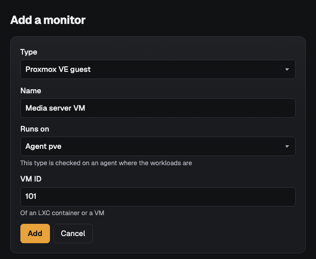

# Proxmox VE guest

Follows an LXC container or a VM in a Proxmox VE cluster, and is up while
it runs. Checked on an [agent](../agents.md) that reads the Proxmox API.



## Before you start

Run an agent with `EYRIE_AGENT_PLATFORM: proxmox`, as
[Agents → Proxmox VE](../agents.md#proxmox-ve) shows. It can run on any
host that reaches the Proxmox API:

1. On a Proxmox node, make a read-only API token:

   ```sh
   pveum user add eyrie@pve
   pveum acl modify / --users eyrie@pve --roles PVEAuditor
   pveum user token add eyrie@pve agent --privsep 0
   ```

2. Copy the certificate's SHA-256 fingerprint: node → **System →
   Certificates** in the Proxmox web UI.
3. In Eyrie, open **Settings → Agents**, type a name under **Add an agent**, click **Add**, and copy the token it shows.
4. Start the agent with `PROXMOX_URL`, `PROXMOX_TOKEN_ID`,
   `PROXMOX_TOKEN_SECRET` and `PROXMOX_FINGERPRINT`, and wait until it is
   **online**.

## Add the monitor

1. On **Monitors**, click **Add a monitor**.
2. **Type**: **Proxmox VE guest**. **Name**: such as `Media server VM`.
3. **Runs on**: the Proxmox agent.
4. **VM ID**: the guest's ID, such as `101`. The field suggests the
   guests the agent reports.
5. Set the [settings every type has](../monitors.md#settings-every-type-has),
   then click **Add**.

[Discovery](../discovery.md) adds monitors for many guests at once.

## Settings

| Setting | Meaning |
| --- | --- |
| VM ID | Of an LXC container or a VM, 100 and up |

Up while the guest runs. It has no response time, and a report that
changes the guest checks it at once, so a guest that stops is down within
seconds. The guest is followed by its ID wherever it moves in the cluster.

This says whether the guest runs, not whether what runs in it works: add
an [HTTP(S)](http.md), [Ping](ping.md) or other monitor for that too.

## Check that it works

The message is `Running`.

## Its page

- **At the top**: its CPU and memory use, the uptime and the last check.
- **Guest**: everything the last check found: its state, name, node, whether it is an LXC container or a VM, how long it has been up, its CPU use of its cores, and its memory and disk used of their size.
- **Chart**: none.

With every page's outages of the last 30 days, its uptime by day and its status changes ([A monitor's page](../monitors.md#a-monitors-page)).

## When it is down

| Message | What to do |
| --- | --- |
| `Stopped` | The guest is stopped (or paused): start it in Proxmox, or pause the monitor while it is meant to be off. |
| `No LXC container or VM 101` | The cluster has no guest with that ID. Templates are not reported. |
| `A Proxmox VE guest monitor is checked on an agent` | **Runs on** is Eyrie: choose the Proxmox agent. |
| The agent's status shows it cannot list its workloads, with a fingerprint | `PROXMOX_FINGERPRINT` is missing or wrong: check the fingerprint shown against the node's certificate, and set it. |
| The agent is offline, or its status shows another error | See [Agents → When something is wrong](../agents.md#when-something-is-wrong). |
