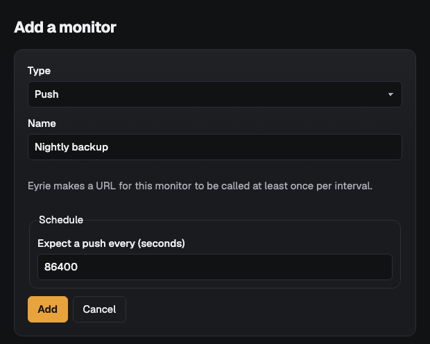
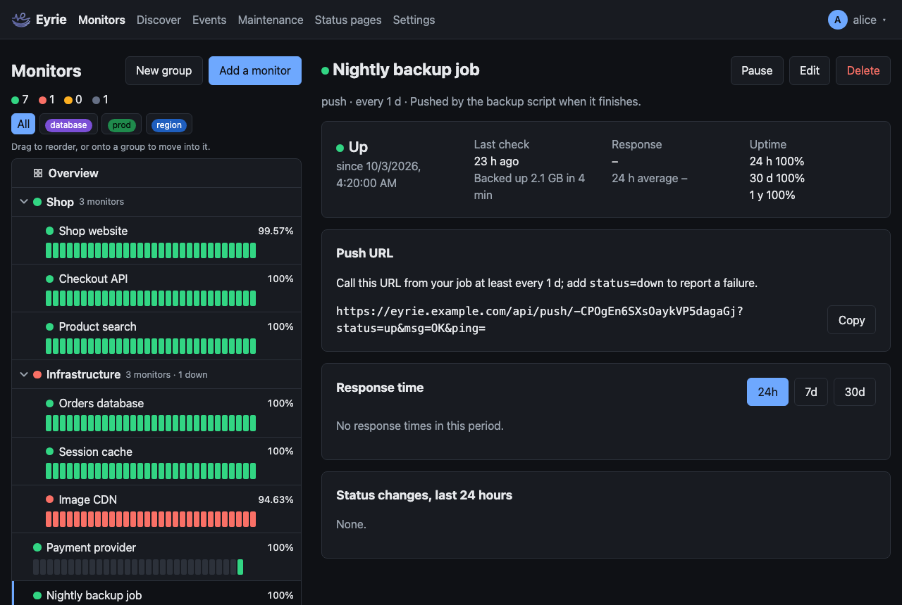

# Push

Eyrie does not check anything: something else calls the monitor's **push
URL** at least once per interval, and the monitor is down when no push
arrives in time. Use it for backups, cron jobs and scripts, and for
anything Eyrie cannot reach (behind a firewall, on a laptop).



## Before you start

- The job must reach Eyrie's address, as a browser would.
- Decide how often the job runs: the monitor's **Check every** is how
  often a push is expected. For a nightly backup, set 1 day, and a few
  **retries before down** (each retry waits **Retry every**), so that a
  backup that runs late is not down at once.

## Add the monitor

1. On **Monitors**, click **Add a monitor**.
2. **Type**: **Push**. **Name**: such as `Nightly backup`.
3. **Check every**: how often the job runs.
4. Set the other [settings every type has](../monitors.md#settings-every-type-has),
   then click **Add**.
5. The monitor's page shows its **push URL**: click **Copy**.
6. Call it at the end of the job, only when it worked:

   ```sh
   #!/bin/sh
   set -e
   /usr/local/bin/backup.sh
   curl -fsS -m 10 --retry 3 "https://eyrie.example.com/api/push/<token>?status=up&msg=OK"
   ```

   Or report a failure as such, with its message:

   ```sh
   if /usr/local/bin/backup.sh; then
     curl -fsS -m 10 "https://eyrie.example.com/api/push/<token>?status=up&msg=OK"
   else
     curl -fsS -m 10 "https://eyrie.example.com/api/push/<token>?status=down&msg=Backup+failed"
   fi
   ```

   In cron: `0 3 * * * /usr/local/bin/backup-and-push.sh`.



## The push URL

```sh
curl -fsS "https://eyrie.example.com/api/push/<token>?status=up&msg=OK&ping="
```

- `status`: `up` (the default) or `down`, to report a failure.
- `msg`: a message, up to 500 characters.
- `ping`: a response time in milliseconds, optional.
- `GET` and `POST` both work. The answer is `{"ok":true}`, or `404`
  `{"ok":false,"msg":"Monitor not found or not active."}` for an unknown
  token or a paused monitor. This is the same URL format as Uptime Kuma's,
  so scripts written for it work.

The token in the URL is the only credential: keep it secret. **Make a new
URL** in the monitor's settings replaces it.

## Check that it works

Run the job (or the `curl` line) once by hand: the monitor goes up, with
your message.

## When it is down

| What you see | What to do |
| --- | --- |
| Down, with no new push | The job did not run, failed before the push, or could not reach Eyrie. Run it by hand and read its output; `curl -fsS` prints the error. |
| Down, with your `msg` | The job reported `status=down`. |
| `curl` answers `404` | The token is wrong (the URL was replaced with **Make a new URL**), or the monitor is paused. |
