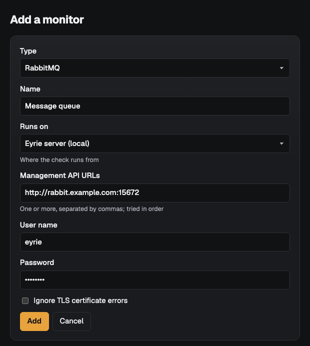
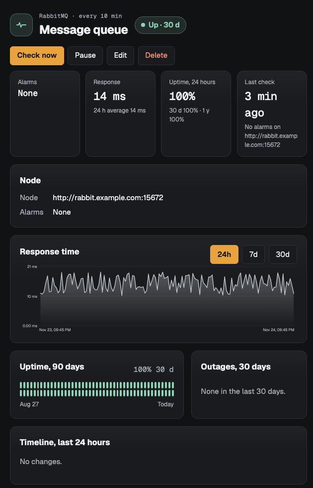

# RabbitMQ

Asks RabbitMQ's management API whether a node has alarms (memory or disk
space running out), and is up when it has none.



## Before you start

1. **Turn on the management plugin**, if it is not:
   `rabbitmq-plugins enable rabbitmq_management`. Its API listens on port
   15672 (15671 with TLS).
2. **Make a user for the check** with the `monitoring` tag, which may read
   but not change anything:

   ```sh
   rabbitmqctl add_user eyrie 'a-long-random-password'
   rabbitmqctl set_user_tags eyrie monitoring
   ```

3. **Try it**: `curl -u eyrie:… http://rabbit.example.com:15672/api/health/checks/alarms`.

## Add the monitor

1. On **Monitors**, click **Add a monitor**.
2. **Type**: **RabbitMQ**. **Name**: such as `Message queue`.
3. **Management API URLs**: such as `http://rabbit.example.com:15672`. For
   a cluster, list several nodes, separated by commas: they are tried in
   order until one answers.
4. **User name** and **Password**.
5. Set the [settings every type has](../monitors.md#settings-every-type-has),
   then click **Add**.

## Settings

| Setting | Default | Meaning |
| --- | --- | --- |
| Management API URLs | | One or more `http://` or `https://` URLs, separated by commas |
| User name | | Required |
| Password | | A [secret setting](../monitors.md#secret-settings) |
| Ignore TLS certificate errors | off | |

Eyrie asks `GET /api/health/checks/alarms`.

## Check that it works

The message is `No alarms on http://rabbit.example.com:15672`.

## Its page



- **At the top**: the node's alarms, the response time, the uptime and the last check.
- **Node**: everything the last check found: the node that answered and its alarms.
- **Chart**: response time.

With every page's outages of the last 30 days, its uptime by day and its status changes ([A monitor's page](../monitors.md#a-monitors-page)).

## When it is down

| Message | What to do |
| --- | --- |
| The alarm RabbitMQ reports, such as a memory or disk alarm | The node is out of memory or disk space and blocks publishers: free some, or raise its limits. |
| `Wrong user name or password` | Check them; the user needs a tag that may use the management API (`monitoring` is the least). |
| A message starting `No node answered:` | No URL answered: the plugin is off, the port is another, or a firewall blocks it. The message lists each URL's error. |
