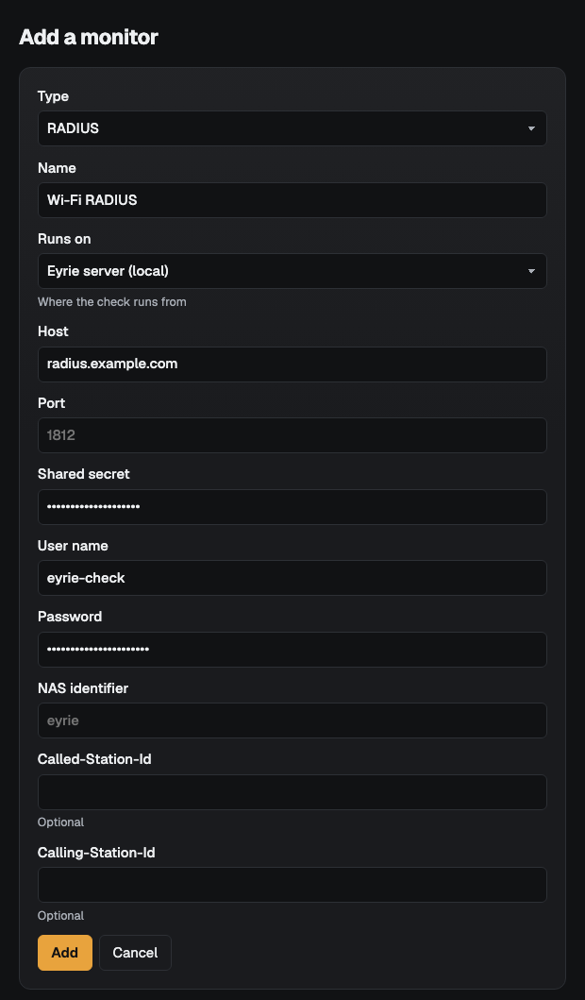
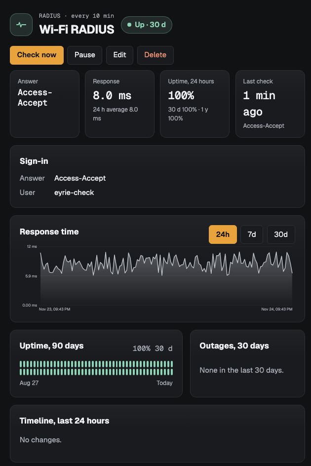

# RADIUS

Signs in to a RADIUS server with a user name and password, and is up when
the server accepts them. Use it for the RADIUS server behind your Wi-Fi
(WPA Enterprise), VPN or network devices.



## Before you start

1. **Add Eyrie as a client** of the RADIUS server, with a shared secret.
   In FreeRADIUS, in `clients.conf`, with the address Eyrie (or the agent
   that runs the check) connects from:

   ```text
   client eyrie {
       ipaddr = 192.0.2.20
       secret = a-long-random-secret
   }
   ```

   Other servers (Windows NPS, a NAC appliance) call this a RADIUS client
   or NAS.
2. **Make a user for the check**, with a password and no rights anywhere
   else, such as `eyrie-check`. Eyrie signs in with PAP, so the server
   must allow PAP for it.
3. If the server's policies match on the NAS identifier or station IDs,
   note the values they expect.

## Add the monitor

1. On **Monitors**, click **Add a monitor**.
2. **Type**: **RADIUS**. **Name**: such as `Wi-Fi RADIUS`.
3. **Host** and **Port** (1812 by default).
4. **Shared secret**: the client's secret from step 1.
5. **User name** and **Password**: the user from step 2.
6. **NAS identifier**, **Called-Station-Id** and **Calling-Station-Id**,
   only if the server's policies need them.
7. Set the [settings every type has](../monitors.md#settings-every-type-has),
   then click **Add**.

## Settings

| Setting | Default | Meaning |
| --- | --- | --- |
| Host | | The RADIUS server |
| Port | 1812 | |
| Shared secret | | Required; a [secret setting](../monitors.md#secret-settings) |
| User name | | Required |
| Password | | A secret setting; at most 128 bytes |
| NAS identifier | `eyrie` | Sent as is |
| Called-Station-Id, Calling-Station-Id | | Optional, sent as given |

Eyrie sends an Access-Request with PAP. The request carries a
Message-Authenticator, as servers protected against BlastRADIUS require,
and the answer's authenticators are checked.

## Check that it works

The message is `Access-Accept`, with the server's Reply-Message if it
sends one.

## Its page



- **At the top**: the server's answer, the response time, the uptime and the last check.
- **Sign-in**: everything the last check found: the server's answer, the user, and its Reply-Message.
- **Chart**: response time.

With every page's outages of the last 30 days, its uptime by day and its status changes ([A monitor's page](../monitors.md#a-monitors-page)).

## When it is down

| Message | What to do |
| --- | --- |
| `Access-Reject` | The server refused the user: a wrong password, a disabled user, a policy that does not match, or PAP not allowed. The server's log says which. |
| `Timed out` | No answer. Most RADIUS servers do not answer clients they do not know: check that Eyrie's address is a client, and that UDP port 1812 is open. |
| `The answer's authenticator is wrong: is the shared secret right?` | The shared secret in Eyrie and on the server differ. |
| `Access-Challenge: the server asks for more than a password` | The user needs a second factor or EAP. Use a user that signs in with a password alone. |
