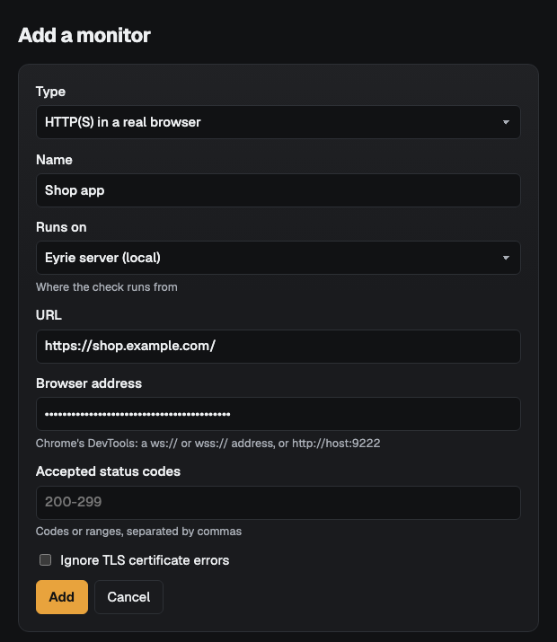
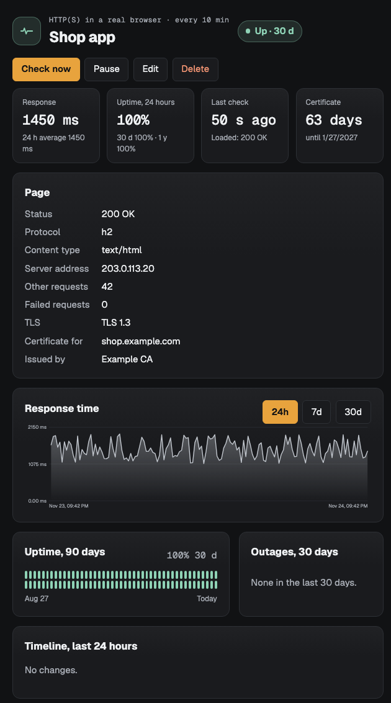

# HTTP(S) in a real browser

Loads a page in a real Chrome, running its JavaScript and loading its
images, styles and scripts, and checks the page's status. Use it for
single-page apps and pages that a plain [HTTP(S)](http.md) request does
not show working.



## Before you start

Eyrie's image has no browser. Run Chrome (or Chromium) where Eyrie can
reach it, and note its DevTools address:

- **A headless browser container** next to Eyrie, such as browserless.
  In Eyrie's Compose file:

  ```yaml
    chrome:
      image: ghcr.io/browserless/chromium:latest
      restart: unless-stopped
      environment:
        TOKEN: a-long-random-token
  ```

  Its DevTools address is `ws://chrome:3000?token=a-long-random-token`.
- **Chrome started by hand** with `--remote-debugging-port=9222` (and
  `--remote-debugging-address=0.0.0.0` to listen beyond the host itself):
  `http://192.0.2.40:9222`. Chrome accepts only an IP address or
  `localhost` as the host of an `http://` address, not a name.

Anyone who can reach the DevTools port controls that browser: keep it on
a private network, reachable only by Eyrie.

## Add the monitor

1. On **Monitors**, click **Add a monitor**.
2. **Type**: **HTTP(S) in a real browser**. **Name**: such as `Shop app`.
3. **URL**: the page to load.
4. **Browser address**: the DevTools address from above. It is a
   [secret setting](../monitors.md#secret-settings), since it can hold a
   token.
5. Give it a longer **Timeout** than an HTTP(S) monitor, such as 30
   seconds: the browser loads everything on the page.
6. Set the [settings every type has](../monitors.md#settings-every-type-has),
   then click **Add**.

## Settings

| Setting | Default | Meaning |
| --- | --- | --- |
| URL | | `http://` or `https://` |
| Browser address | | `ws://` or `wss://` (a DevTools WebSocket), or `http://host:9222` |
| Accepted status codes | `200-299` | |
| Ignore TLS certificate errors | off | The browser accepts any certificate |

Up when the page loads (the browser's load event) with a status in
**accepted status codes**; the response time is until the load event.
Each check opens the page in a new, separate browser context and closes it
afterwards. The expiry of the page's certificate is recorded.

## Check that it works

The message is `Loaded: 200 OK`.

## Its page



- **At the top**: the time until the page loaded, the uptime, the last check and the certificate's days left.
- **Page**: everything the last check found: the document's status, where it ended, its protocol, content type and server address, how many other requests the page made and how many failed, and the TLS version and certificate.
- **Chart**: the time until the load event; the certificate's days left.

With every page's outages of the last 30 days, its uptime by day and its status changes ([A monitor's page](../monitors.md#a-monitors-page)).

## When it is down

| Message | What to do |
| --- | --- |
| `Status 500 Internal Server Error` (or another code) | The page loaded with a status you did not accept. |
| A message starting `Cannot reach the browser:` | Eyrie cannot open the DevTools address: check that the browser runs, the address, and that its port is open to Eyrie. For an `http://` address, the host must be an IP address. |
| A message with `browser refused` | The browser rejected the request, such as a missing or wrong token in a `ws://` address. |
| `Timed out` | The page did not finish loading within the timeout: something on it loads slowly or never. Raise **Timeout**, or see in a browser's developer tools what is slow. |
