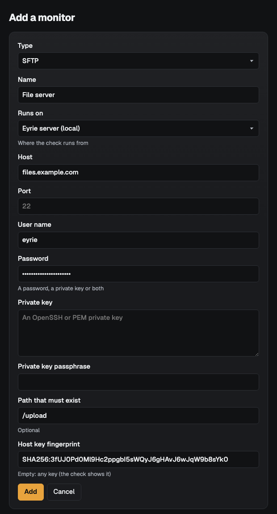

# SFTP

Signs in to an SFTP server, starts SFTP and, if you want, checks that a
path exists. Use it for file servers your partners or devices upload to.



## Before you start

1. **Make a user for the check** on the server, such as `eyrie`, that can
   sign in to SFTP only. With OpenSSH, in `/etc/ssh/sshd_config`:

   ```text
   Match User eyrie
       ForceCommand internal-sftp
       ChrootDirectory /srv/sftp
   ```

2. **Choose how it signs in**: a password, a private key, or both.
   For a key, make one for Eyrie alone and put its public half in the
   user's `~/.ssh/authorized_keys`:

   ```sh
   ssh-keygen -t ed25519 -f eyrie-sftp -C eyrie
   ```

3. **Note the server's host key fingerprint**, so Eyrie can tell it is
   talking to the right server: `ssh-keygen -lf
   /etc/ssh/ssh_host_ed25519_key.pub` on the server. Or leave the setting
   empty at first: the message then shows the fingerprint to copy.

## Add the monitor

1. On **Monitors**, click **Add a monitor**.
2. **Type**: **SFTP**. **Name**: such as `File server`.
3. **Host** and **Port** (22 by default).
4. **User name**, and a **Password** or a **Private key** (paste the whole
   private key file) with its **Private key passphrase** if it has one.
5. **Path that must exist** (optional): such as `/upload`.
6. **Host key fingerprint**: `SHA256:…`, or empty for now.
7. Set the [settings every type has](../monitors.md#settings-every-type-has),
   then click **Add**.
8. If you left the fingerprint empty, copy it from the message (`host key
   SHA256:…`), check it against the server's, and set it in the monitor.

## Settings

| Setting | Default | Meaning |
| --- | --- | --- |
| Host | | The SFTP server |
| Port | 22 | |
| User name | | Required |
| Password | | A [secret setting](../monitors.md#secret-settings) |
| Private key | | OpenSSH or PEM; a secret setting |
| Private key passphrase | | A secret setting |
| Path that must exist | | Optional |
| Host key fingerprint | | `SHA256:…`, as `ssh-keygen -lf` shows it; empty: any key, and the message shows it |

A password, a private key or both are required.

## Check that it works

The message is `Signed in, SFTP version 3; /upload exists`, with `; host
key SHA256:…` while no fingerprint is set.

## When it is down

| Message | What to do |
| --- | --- |
| A message with `unable to authenticate` | The server refused the user name, password or key. Check them, that the key is in `authorized_keys`, and the server's log (`journalctl -u ssh`). |
| A message with `host key is SHA256:…, not SHA256:…` | The server's key is not the one you set. If the server was reinstalled or its keys changed on purpose, set the new fingerprint; otherwise find out why before trusting it. |
| A message with `the server has no SFTP` | The user can sign in, but the server does not start SFTP for it: check its `Subsystem sftp` or `ForceCommand internal-sftp`. |
| A message naming the path | The path does not exist, or the user cannot see it (a chroot changes where paths start). |
| A message with `the private key cannot be read` | The key is not OpenSSH or PEM, is cut short, or its passphrase is wrong. |
| `Timed out`, `connection refused` | As for [TCP port](port.md#when-it-is-down). |
