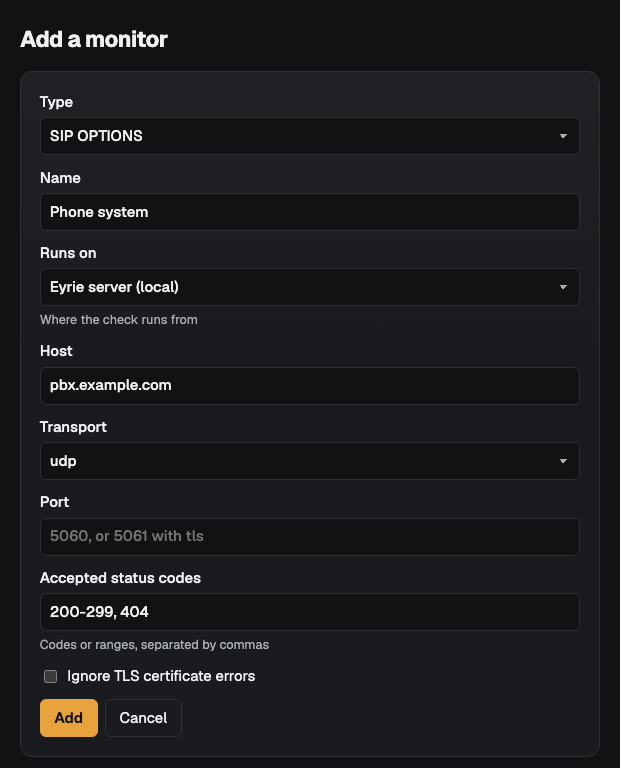

# SIP OPTIONS

Sends a SIP `OPTIONS` request to a SIP server, and is up when it answers
with an accepted status. Use it for a PBX (Asterisk, FreeSWITCH, a hosted
phone system), a SIP trunk or a session border controller.

## Before you start

- Know the server's host, the transport it listens on (UDP, TCP or TLS)
  and the port: 5060, or 5061 for TLS.
- Many SIP servers answer `OPTIONS` only from addresses they know, and
  `fail2ban` or a firewall may block unknown ones. Allow Eyrie's address
  (or the agent's).
- Find out what the server answers: some answer `200 OK`, others `404 Not
  Found` or `405 Method Not Allowed` while working. Try it with `sipsak
  -s sip:pbx.example.com` if you have it.

## Add the monitor

1. On **Monitors**, click **Add a monitor**.
2. **Type**: **SIP OPTIONS**. **Name**: such as `Phone system`.
3. **Host**, **Transport** and **Port**.
4. **Accepted status codes**: `200-299` by default; add what your server
   answers, such as `200-299, 404`.
5. Set the [settings every type has](../monitors.md#settings-every-type-has),
   then click **Add**.

## Settings

| Setting | Default | Meaning |
| --- | --- | --- |
| Host | | The SIP server |
| Transport | `udp` | `udp`, `tcp` or `tls` |
| Port | 5060, or 5061 with `tls` | |
| Accepted status codes | `200-299` | Codes or ranges, separated by commas |
| Ignore TLS certificate errors | off | For `tls` |

Eyrie waits for the final answer: provisional `1xx` answers are skipped.

## Check that it works

The message is the status, such as `200 OK`.

## When it is down

| Message | What to do |
| --- | --- |
| `Status 404 Not Found` (or another code) | The server answered, with a code you did not accept. If it means the server works, add it to **accepted status codes**. |
| `Timed out` | No answer: the server ignores Eyrie's address, a firewall or `fail2ban` blocks it, or the transport or port is wrong. |
| A message with `connection refused` | TCP or TLS: nothing listens on that port. |
| `The answer is not SIP` | Something else answers on that port. |
