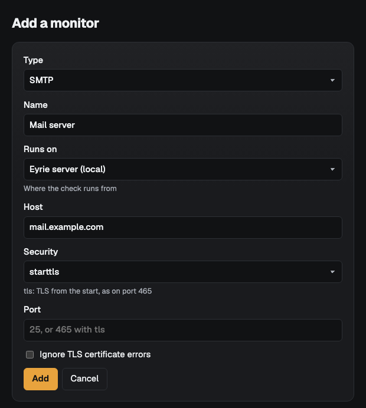
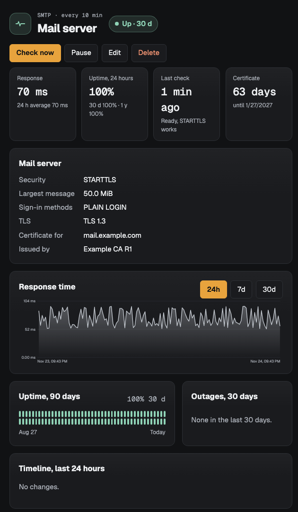

# SMTP

Connects to a mail server, and is up when it greets Eyrie and answers
`EHLO`, with TLS working if you ask for it. Use it for your own mail
server or relay. Eyrie does not sign in or send mail.

## Before you start

- Know the server's host name and which port it uses:
  - **25** for mail between servers, usually with STARTTLS;
  - **587** for submission, with STARTTLS;
  - **465** for submission with TLS from the start.
- Many networks and cloud hosts block outgoing connections to port 25.
  Check from where the check runs: `nc -vz mail.example.com 25`.

## Add the monitor

1. On **Monitors**, click **Add a monitor**.
2. **Type**: **SMTP**. **Name**: such as `Mail server`.
3. **Host**: such as `mail.example.com`. Use the name on the server's
   certificate, so that TLS can be verified.
4. **Security** and **Port**:
   - `starttls` with port 25 (the default) or 587;
   - `tls` with port 465;
   - `none` for a server without TLS: STARTTLS is not tried.
5. Set the [settings every type has](../monitors.md#settings-every-type-has),
   then click **Add**.

## Settings

| Setting | Default | Meaning |
| --- | --- | --- |
| Host | | The mail server |
| Security | `starttls` | `starttls`: the server must offer STARTTLS and the handshake must work. `tls`: TLS from the start. `none`: plain |
| Port | 25, or 465 with `tls` | |
| Ignore TLS certificate errors | off | As for HTTP(S) |

With TLS, the certificate is verified unless **Ignore TLS certificate
errors** is ticked, and its expiry is recorded.

## Check that it works

The message is `Ready, STARTTLS works`, `Ready over TLS` or `Ready`.

## Its page

- **At the top**: the response time, the uptime and the last check, and with TLS the certificate's days left.
- **Mail server**: everything the last check found: the security, the largest message the server takes, the sign-in methods it offers, and the TLS version and certificate.
- **Chart**: response time; the certificate's days left, with TLS.

With every page's outages of the last 30 days, its uptime by day and its status changes ([A monitor's page](../monitors.md#a-monitors-page)).

## When it is down

| Message | What to do |
| --- | --- |
| `The server does not offer STARTTLS` | The server answered but has no STARTTLS on this port. Use `tls` on 465, or `none` if the server has no TLS. |
| A message starting `STARTTLS:` with `certificate` | TLS was offered, but the certificate does not verify: expired, self-signed, or not for the host you typed. Fix it, use the certificate's name as **Host**, or tick **Ignore TLS certificate errors**. |
| A message starting `No greeting:` | Something answered, but not as a mail server: a wrong port, or TLS expected (try `tls`) or not (try `starttls`). |
| `Timed out` | No answer: port 25 may be blocked between Eyrie and the server. |
| A message with `connection refused` | Nothing listens on that port. |
