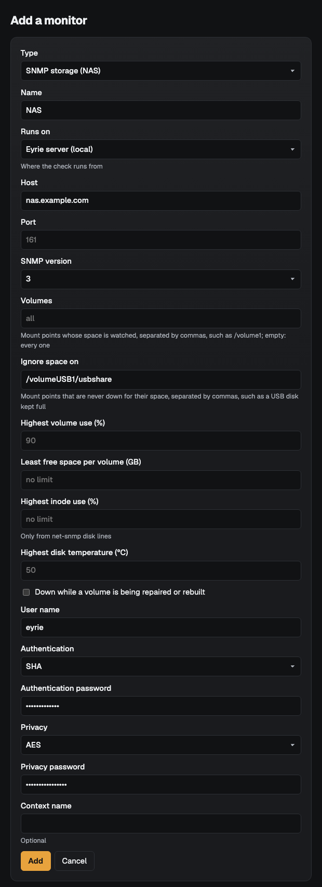
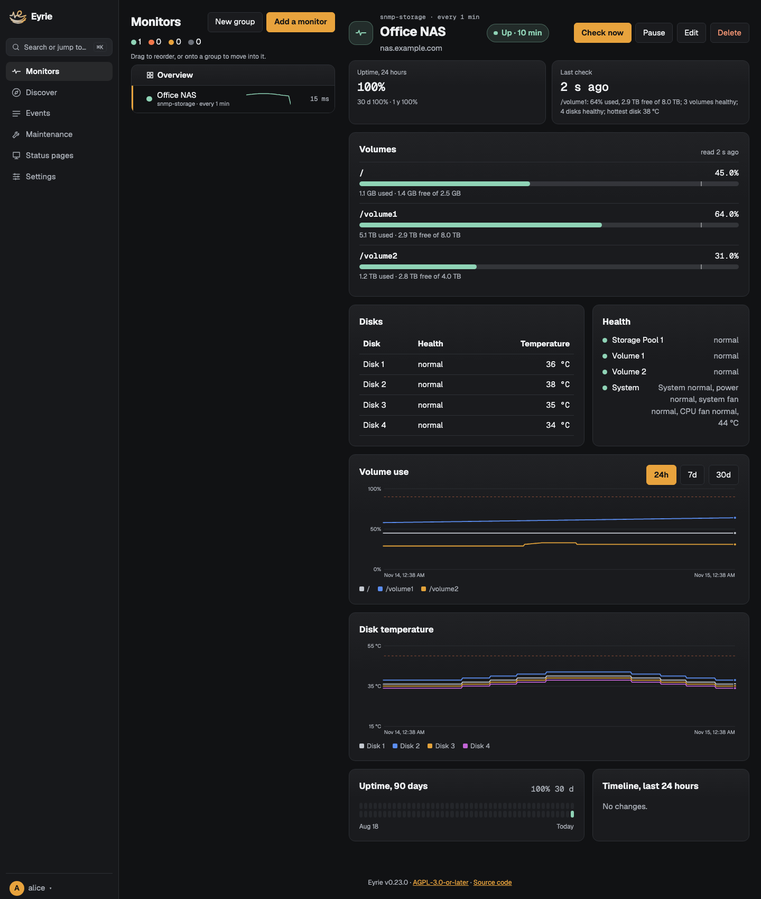

# SNMP storage (NAS)

One monitor for a whole NAS, read over SNMP: how full each volume is, the
health of its volumes or pools, its disks' health and temperature, and the
system's own health. Its page shows the volumes, the disks and their
history.

[NAS monitoring](../nas.md) says what each system (Synology, QNAP,
Asustor, TrueNAS, OpenMediaVault and other net-snmp hosts) reports and how
to turn its SNMP on. This page is the monitor itself.

## Before you start

1. **Turn on SNMP on the NAS**, as [NAS monitoring](../nas.md) shows for
   your system. Use version 3 with SHA and AES where the NAS offers it.
2. Allow Eyrie's address (or the agent's) to ask, and UDP port 161 between
   them.
3. On OpenMediaVault, Debian and other net-snmp hosts, add a `disk` line
   for each volume to watch, and the [SnapRAID and SMART
   script](../nas.md#snapraid-and-smart) if you want disk health there.

The easiest way to add it is [Discovery](../discovery.md#nas-storage-snmp):
it asks the NAS what it reports and fills in the form.

## Add the monitor

1. On **Monitors**, click **Add a monitor**.
2. **Type**: **SNMP storage (NAS)**. **Name**: such as `NAS`.
3. **Host**, **Port**, **SNMP version** and the credentials, as for an
   [SNMP](snmp.md#add-the-monitor) monitor.
4. **Volumes**: leave it empty to watch every volume, or list the mount
   points, such as `/volume1, /volume2`.
5. **Ignore space on**: mount points that may be full, such as a USB disk
   for backups.
6. Change the limits if the defaults do not suit you: 90% volume use,
   50 °C per disk.
7. Set the [settings every type has](../monitors.md#settings-every-type-has),
   then click **Add**.

## Settings

The **host**, port, version and credentials are as for [SNMP](snmp.md#settings).
It is down when any of these is true:

| What | Down when | Settings |
| --- | --- | --- |
| A volume's space | More than **highest volume use** is used (90%), less than **least free space per volume** is free, or more than **highest inode use** of its inodes are used (both off by default) | **Volumes**: the mount points to watch, separated by commas, such as `/volume1`; empty: every volume but the system's memory and devices (`/dev`, `/run`, `/sys`, `/proc`, `/tmp`). A volume named but missing is down. **Ignore space on**: mount points that are never down for their space (a USB disk kept full, say); they still show on the page. |
| A volume or pool | It is degraded, crashed, failed, faulted or in a state Eyrie does not know | **Down while a volume is being repaired or rebuilt** (off): repairs, rebuilds, scrubs, expansions and parity checks are up otherwise, as the failure that started a repair was down already. |
| A disk | It has failed, or its SMART status is not good; on Synology DSM 7.1 and later, also when its health is a warning or worse | |
| A disk's temperature | Above **highest disk temperature** (50 °C) | |
| The system | Synology: the system, power or a fan has failed; QNAP: a fan or a power supply has | |
| A command snmpd runs | It did not exit with 0 | Every `extend` line in the NAS's `snmpd.conf` is checked. |

Space is read from net-snmp's `dskTable` (64-bit sizes and inodes) where
the NAS has the volume there, otherwise from `hrStorageTable`; used space
is counted as `df` counts it, and sizes are in decimal units (1 TB = 10¹²
bytes). Eyrie keeps what each check read, one sample in each five minutes,
for 35 days.

## Check that it works

A healthy NAS is summed up: `/volume1: 72% used, 2.1 TB free of 7.6 TB;
2 volumes healthy; 4 disks healthy; hottest disk 41 °C`.

The monitor's page shows the NAS instead of response times:

- **Volumes**: each one's use as a bar, by path, with the highest use
  marked, and what is used, free and the total, and inode use where
  known. An admin can ignore a volume's space from here (**Ignore its
  space**, which adds it to **Ignore space on** and checks again) and
  alert on it again. Mount points with the same size and free space are
  one filesystem mounted again (a NAS's shares for its containers), shown
  once by the shortest path.
- **Disks**: each disk's health and temperature, by name (Disk 2 before
  Disk 10).
- **Health**: each volume or pool by name, the system and each command.
- **Volume use** and **Disk temperature**: a line per volume and per disk
  over 24 hours, 7 or 30 days, with the limit marked and a dot at each
  line's latest value.

## When it is down

The message lists what is wrong, such as `Disk 2 normal, health warning,
Disk 2 at 52 °C`.

| Problem | What to do |
| --- | --- |
| A volume is over its limit | Free space on it, raise **Highest volume use**, or add it to **Ignore space on** (also from the monitor's page, **Ignore its space**). |
| A volume named in **Volumes** is missing | The mount point is not in what the NAS reports: check its spelling against the page, or the NAS's `disk` lines on net-snmp. |
| A disk's health or temperature | Check the disk in the NAS's own interface; replace it, or improve its cooling. |
| `snmpd has no extend line named …: add one to snmpd.conf` | The NAS's `snmpd.conf` lacks a command Eyrie was told to read. See [SnapRAID and SMART](../nas.md#snapraid-and-smart). |
| `No answer: is the community right?`, version 3 errors | As for [SNMP](snmp.md#when-it-is-down). |
