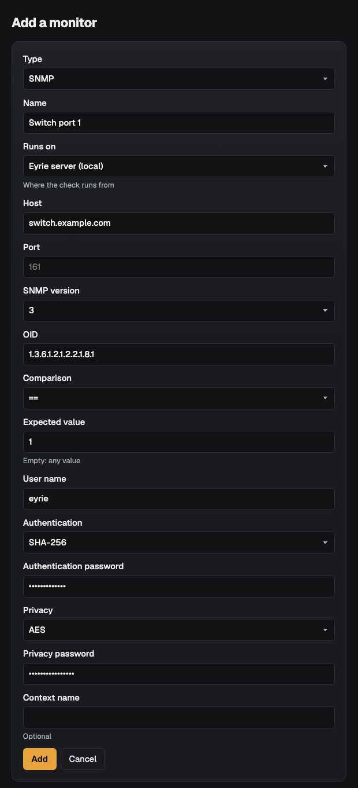
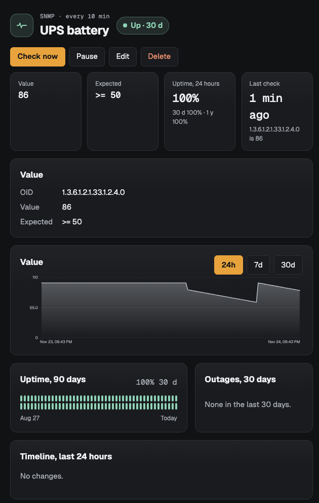

# SNMP

Asks a device's SNMP agent for one value (an OID), and compares it with
what you expect. Use it for switches, routers, printers, UPSes and
anything else that speaks SNMP: whether a port is up, a UPS's battery
charge, a device's uptime.



To watch a whole NAS (volumes, disks, temperatures) with one monitor, use
[SNMP storage (NAS)](snmp-storage.md) instead. To add a device and each of
its interfaces in one go, use [Discovery](../discovery.md#network-devices-snmp).

## Before you start

1. **Turn on SNMP on the device**, read-only, in its web interface or
   configuration. Prefer version 3 with SHA and AES where the device has
   it: versions 1 and 2c send the community in the clear.
   - For versions 1 and 2c, set a **community** other than `public`.
   - For version 3, make a read-only **user** with an authentication
     password and a privacy password (8 characters or more each).
   - Allow Eyrie's address (or the agent's) if the device limits who may
     ask.
   - On a Linux host with net-snmp, a minimal `/etc/snmp/snmpd.conf`:

     ```text
     agentaddress udp:161
     rouser eyrie authpriv
     ```

     with the user made by `net-snmp-create-v3-user -ro -a SHA -A
     <auth password> -x AES -X <privacy password> eyrie` while snmpd is
     stopped.
2. **Find the OID** of the value you want, in the device's MIB or its
   documentation, and try it from where the check runs:

   ```sh
   snmpget -v3 -l authPriv -u eyrie -a SHA -A '<auth>' -x AES -X '<priv>' switch.example.com 1.3.6.1.2.1.1.3.0
   ```

   Common OIDs:

   | OID | Value |
   | --- | --- |
   | `1.3.6.1.2.1.1.3.0` | `sysUpTime`: answers while the device is up |
   | `1.3.6.1.2.1.1.5.0` | `sysName`: the device's name |
   | `1.3.6.1.2.1.2.2.1.8.<index>` | `ifOperStatus` of interface `<index>`: `1` is up, `2` down |
   | `1.3.6.1.2.1.33.1.2.4.0` | UPS-MIB `upsEstimatedChargeRemaining`: the battery charge in % |

## Add the monitor

1. On **Monitors**, click **Add a monitor**.
2. **Type**: **SNMP**. **Name**: such as `Switch port 1`.
3. **Host** and **Port** (161 by default).
4. **SNMP version**, then the **community** (1 and 2c), or the version 3
   **user name**, **authentication** and its password, **privacy** and
   its password, and the **context name** if the device needs one.
5. **OID**: such as `1.3.6.1.2.1.2.2.1.8.1`.
6. **Comparison** and **Expected value**: such as `==` and `1`. Leave the
   expected value empty to be up whenever the device answers.
7. Set the [settings every type has](../monitors.md#settings-every-type-has),
   then click **Add**.

## Settings

| Setting | Default | Meaning |
| --- | --- | --- |
| Host | | The device |
| Port | 161 | UDP |
| SNMP version | 2c | 1, 2c or 3 |
| Community | `public` | Versions 1 and 2c; a [secret setting](../monitors.md#secret-settings) |
| OID | | Such as `1.3.6.1.2.1.1.3.0` |
| Comparison | `==` | `==`, `!=`, `<`, `<=`, `>`, `>=` (as numbers when both are), `contains` |
| Expected value | | Empty: any value is up |
| User name | | Version 3 |
| Authentication | none | none, MD5, SHA, SHA-224, SHA-256, SHA-384 or SHA-512, with its password |
| Privacy | none | none, DES or AES (AES-128), with its password; needs authentication |
| Context name | | Version 3, optional |

Values: integers, counters, gauges and time ticks as numbers; text as is,
other bytes as hex (`02:00:00:00:00:01`); OIDs and IP addresses dotted.
For version 3, Eyrie learns the agent's engine ID first, and retries once
with the agent's time if its clock is outside the time window.

## Check that it works

The message is the OID and its value: `1.3.6.1.2.1.1.5.0 is switch-1`.

## Its page



- **At the top**: the value and what it must be, the uptime and the last check.
- **Value**: everything the last check found: the OID, its value and what it must be.
- **Chart**: the value, when it is a number (a UPS's charge, a port's status), instead of a response time.

With every page's outages of the last 30 days, its uptime by day and its status changes ([A monitor's page](../monitors.md#a-monitors-page)).

## When it is down

| Message | What to do |
| --- | --- |
| `No answer: is the community right?` | A device ignores a wrong community, so this looks like no answer at all. Check the community, that SNMP is on, that the device allows Eyrie's address, and that UDP port 161 is open. |
| `1.3.6.1.2.1.2.2.1.8.1 is 2, not == 1` | The value is not what you expected: here, the interface is down. |
| `1.3.6.1.2.1.2.2.1.8.9: no such instance` (or `no such object`; version 1: `The agent answered noSuchName`) | The device does not have that OID. Check it with `snmpwalk`; an interface's index can differ from its number on the front panel. |
| `Wrong authentication password or protocol`, or `The answer's authentication is wrong: are the passwords right?` | Version 3: the authentication protocol or password differs from the device's. |
| `Wrong privacy password or protocol`, or `The answer cannot be read: are the privacy settings right?` | Version 3: the privacy protocol or password differs. |
| `The agent does not know this user` | Version 3: the user does not exist on the device, or has another name. |
| `The agent does not support this security level` | Version 3: the user is set up for another level, such as authentication without privacy. Match **Authentication** and **Privacy** to it. |
| `No answer to SNMPv3 discovery` | The device does not answer version 3: it may have only 1 and 2c on, or ignore Eyrie's address. |
