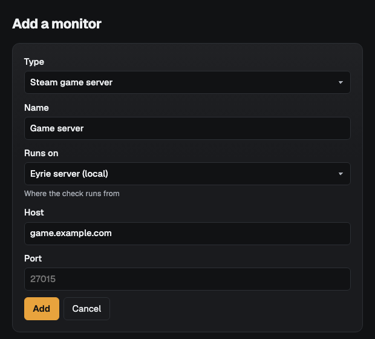
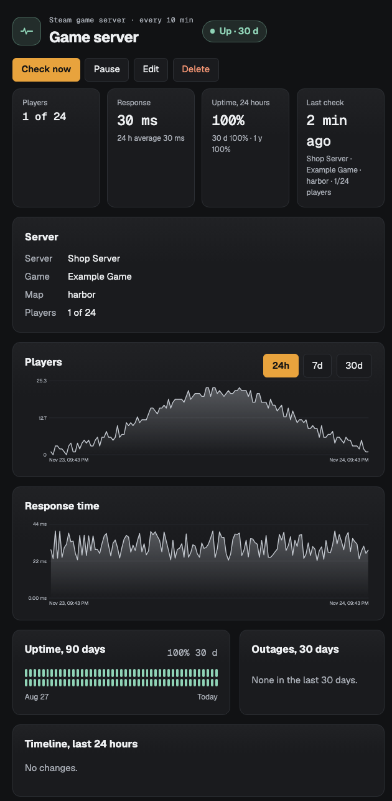

# Steam game server

Asks a game server for its information the way Steam's server browser
does (Valve's `A2S_INFO` query), and is up when it answers. Use it for
Source and GoldSrc games, and other games listed in Steam's server
browser.

For Minecraft, Quake and other protocols, use [Game server](gamedig.md).

## Before you start

- Find the server's **query port**: 27015 for most Source games. Some
  games answer queries on a port other than the one players join on (the
  game port plus one, or a `QueryPort` setting): use the query port.
- The query goes over UDP: open that port to Eyrie (or the agent) in the
  server's firewall.

## Add the monitor

1. On **Monitors**, click **Add a monitor**.
2. **Type**: **Steam game server**. **Name**: such as `Game server`.
3. **Host** and **Port** (27015 by default).
4. Set the [settings every type has](../monitors.md#settings-every-type-has),
   then click **Add**.

## Settings

| Setting | Default | Meaning |
| --- | --- | --- |
| Host | | The game server |
| Port | 27015 | The query port, UDP |

Eyrie answers the server's challenge if it sends one, as Steam does.

## Check that it works

The message gives the server's name, game, map and players: `Shop Server ·
Example Game · harbor · 5/24 players`.

## Its page

- **At the top**: the players, the response time, the uptime and the last check.
- **Server**: everything the last check found: the server's name, game, map and players.
- **Chart**: players, and the response time.

With every page's outages of the last 30 days, its uptime by day and its status changes ([A monitor's page](../monitors.md#a-monitors-page)).

## When it is down

| Message | What to do |
| --- | --- |
| `Timed out` | No answer: the port is the game port and not the query port, UDP is blocked, or the server is down. |
| `The server did not answer A2S_INFO` or another message about its answer | Something answers on that port, but not as a Valve server: check the port, or try [Game server](gamedig.md) with another protocol. |
