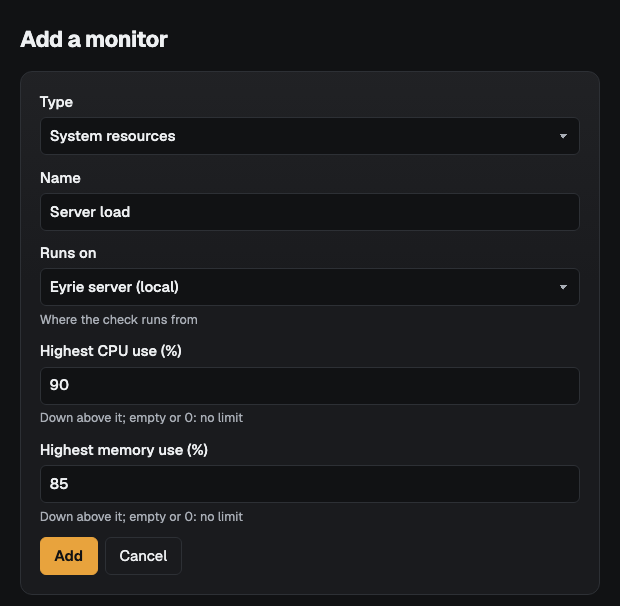

# System resources

How busy a Linux host is: its CPU and memory use, with charts, and down
when either goes over a limit you set. Use it for Eyrie's own host, and
for any host an agent runs on.

## Before you start

The figures come from Linux's `/proc` where the check runs. Choose the
host with **Runs on**:

- **Eyrie server (local)**: the host Eyrie runs on. In Docker, these
  `/proc` files show the whole host, not the container, so it needs no
  volume, privilege or Docker socket.
- **An [agent](../agents.md)**: the host the agent runs on, in the same
  way. Run one on each host you want to follow.

It works only on Linux:

- With Docker Desktop on macOS or Windows, the figures are those of
  Docker's Linux virtual machine, not the computer's.
- In a VM, they are the VM's own.
- **In an LXC container, the figures are the container's, not the
  host's.** Proxmox VE's LXC containers (and others that use LXCFS) put
  their own `/proc/stat`, `/proc/meminfo` and `/proc/loadavg` over the
  host's, so that programs inside see the container's limits. Eyrie, or
  an agent, in an LXC container, with or without Docker inside it,
  reports that container's use, against its own memory size and cores.
  To follow a Proxmox VE node itself, run an agent on the node; to follow
  its guests, use [Proxmox VE guest](proxmox.md) monitors.

## Add the monitor

1. On **Monitors**, click **Add a monitor**.
2. **Type**: **System resources**. **Name**: such as `Server load`.
3. **Runs on**: the host to follow.
4. **Highest CPU use (%)** and **Highest memory use (%)**: such as `90`
   and `85`, to be down above them. Leave them empty to only record the
   figures.
5. Set the [settings every type has](../monitors.md#settings-every-type-has),
   then click **Add**. A short spike over a limit is normal: give it a
   few **retries before down**, so it alerts only when the use stays
   high.

## Settings

| Setting | Default | Meaning |
| --- | --- | --- |
| Highest CPU use (%) | no limit | Down while the CPU use is above it |
| Highest memory use (%) | no limit | Down while the memory use is above it |

- **CPU use**: the share of one second the processors were busy, from two
  readings of `/proc/stat`; waiting for disks counts as idle.
- **Memory use**: what is not available to start programs without
  swapping (`MemTotal` less `MemAvailable` in `/proc/meminfo`).
- The load average over the last minute (`/proc/loadavg`), in the message
  only.

A check takes about a second. It has no response time: its page shows the
CPU and memory use, with a chart of each for 24 hours, 7 or 30 days, and
[`/metrics`](../../technical/http-interface.md#metrics) has
`eyrie_monitor_cpu_ratio` and `eyrie_monitor_memory_ratio`.

## Check that it works

The message is `CPU 12.3%, memory 43.1% of 15.6 GiB, load 0.52`.

## When it is down

| Message | What to do |
| --- | --- |
| `CPU is above 90%: CPU 95.2%, memory …` | The host is busy. `top` on it shows what uses the CPU (or memory). |
| `System resources can be read only on Linux, not darwin` | The check runs on another system: choose a Linux agent. |
| A message with `cannot read the CPU times` or `cannot read the memory figures` | `/proc` cannot be read where the check runs. |
