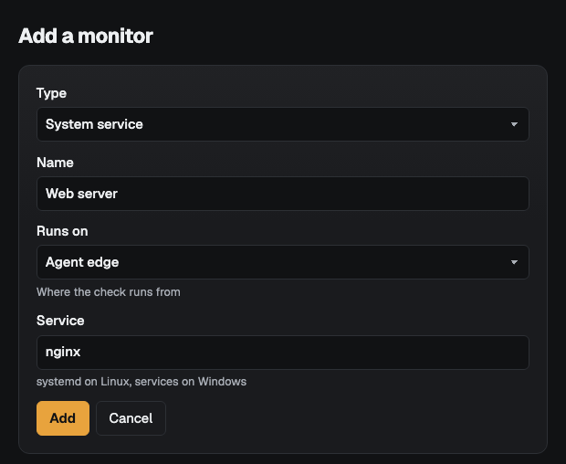

# System service

Checks a service on the host where the check runs: on Linux, a systemd
unit must be `active`; on Windows, a service must be `RUNNING`. Use it for
the services of the host itself: `nginx`, `sshd`, a database.

## Before you start

The check runs `systemctl` (Linux) or `sc.exe` (Windows) where it runs,
and sees that system's services:

- **Inside a container**, it sees the container, not the host. So with
  Eyrie in Docker, run an [agent directly on the
  host](../agents.md#on-a-host-without-docker) and check the service
  there.
- Find the service's name: `systemctl list-units --type=service` on
  Linux, or `sc.exe query` on Windows (the `SERVICE_NAME`, not the display
  name).

## Add the monitor

1. On **Monitors**, click **Add a monitor**.
2. **Type**: **System service**. **Name**: such as `Web server`.
3. **Runs on**: the agent on that host.
4. **Service**: such as `nginx` or `sshd.service`.
5. Set the [settings every type has](../monitors.md#settings-every-type-has),
   then click **Add**.

## Settings

| Setting | Meaning |
| --- | --- |
| Service | systemd on Linux, a service's name on Windows |

On Linux, Eyrie runs `systemctl is-active <service>`, which needs no
privileges. Other systems than Linux and Windows are not supported.

## Check that it works

The message is the state: `Active` on Linux, `Running` on Windows.

## Its page

- **At the top**: since when it runs and its memory, the uptime and the last check.
- **Service**: everything the last check found: its state and sub-state, its description, since when it runs, its main process, its restarts and its memory (from `systemctl show`; on Windows, its state).
- **Chart**: none.

With every page's outages of the last 30 days, its uptime by day and its status changes ([A monitor's page](../monitors.md#a-monitors-page)).

## When it is down

| Message | What to do |
| --- | --- |
| `Inactive`, `Failed`, `Activating` | As systemd says. `systemctl status <service>` and `journalctl -u <service>` say why. |
| `Stopped`, `Start_pending` | Windows: the service is not running. |
| `systemctl is not installed where Eyrie runs` | The check runs in a container, or on a Linux without systemd. Choose an [agent on the host](../agents.md#on-a-host-without-docker) under **Runs on**. |
| `System services can be checked only on Linux and Windows, not darwin` | macOS and others are not supported. |
| `sc.exe did not say the service's state` | No service of that name on Windows: use its `SERVICE_NAME`. |
