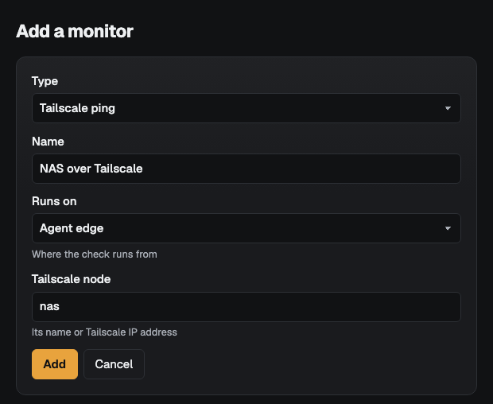
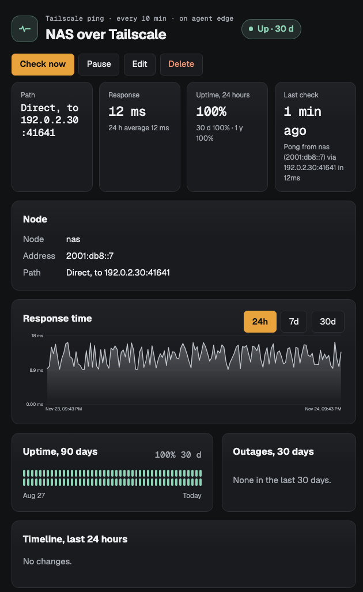

# Tailscale ping

Runs `tailscale ping` for a node of your tailnet, and is up when it
answers. Use it to know a device is reachable over Tailscale, whatever
network it is on.

## Before you start

The check runs the `tailscale` program where it runs, which needs a
running `tailscaled` signed in to your tailnet. Eyrie's image has
neither, so choose one:

- **An agent directly on a host in your tailnet**: install Tailscale on
  the host and sign in, then run an [agent on the
  host](../agents.md#on-a-host-without-docker). It runs as root, which
  may use `tailscale`.
- **An image you extend**: add Tailscale to Eyrie's (or an agent's) image
  and run `tailscaled` in it, signed in with an auth key.

Then check from that host: `tailscale ping --c 1 nas`.

The node must allow pings from Eyrie's node in your tailnet's access
controls.

## Add the monitor

1. On **Monitors**, click **Add a monitor**.
2. **Type**: **Tailscale ping**. **Name**: such as `NAS over Tailscale`.
3. **Runs on**: the agent (or Eyrie) where Tailscale is.
4. **Tailscale node**: its name (as `tailscale status` shows it) or its
   Tailscale IP address.
5. Set the [settings every type has](../monitors.md#settings-every-type-has),
   then click **Add**.

## Settings

| Setting | Meaning |
| --- | --- |
| Tailscale node | Its name or Tailscale IP address |

Eyrie runs `tailscale ping --c 1 <node>`; the response time is the one
`tailscale` reports.

## Check that it works

The message is what `tailscale` says: `Pong from nas (<its Tailscale IP>) via
192.0.2.30:41641 in 12ms`.

## Its page

- **At the top**: the path (direct or through DERP), the response time, the uptime and the last check.
- **Node**: everything the last check found: the node, its Tailscale address, and whether the path is direct (with the address it reached) or relayed through a DERP region.
- **Chart**: the response time `tailscale` reports.

With every page's outages of the last 30 days, its uptime by day and its status changes ([A monitor's page](../monitors.md#a-monitors-page)).

## When it is down

| Message | What to do |
| --- | --- |
| `tailscale is not installed where Eyrie runs` | The program is missing where the check runs: see above. |
| A message with `failed to connect to local tailscaled` | `tailscaled` does not run there, or Eyrie may not use it. |
| A message with `no matching peer` | Your tailnet has no node by that name: check `tailscale status`. |
| A message with `timeout` or `Timed out` | The node did not answer: it is offline, or access controls block the ping. |
