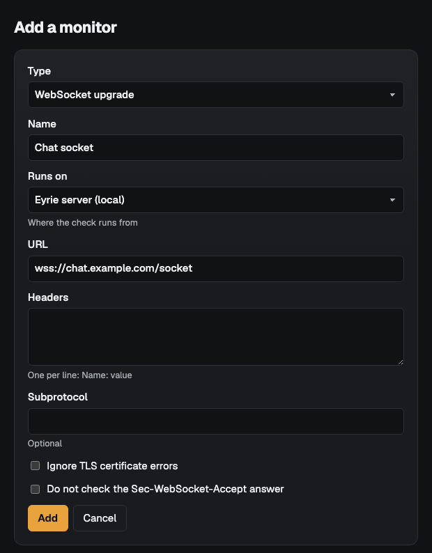

# WebSocket upgrade

Opens a WebSocket connection to a URL, and is up when the server accepts
it. Use it for chat servers, live dashboards and other services that talk
over WebSockets.

## Before you start

- Find the WebSocket's URL: it starts with `ws://` or `wss://`, such as
  `wss://chat.example.com/socket`. The browser's developer tools show it
  under **Network**, filtered to WS.
- If the server needs a header to accept the connection (a token, an
  `Origin`), have it ready.

## Add the monitor

1. On **Monitors**, click **Add a monitor**.
2. **Type**: **WebSocket upgrade**. **Name**: such as `Chat socket`.
3. **URL**: the `ws://` or `wss://` address.
4. **Headers** and **Subprotocol**, if the server needs them.
5. Set the [settings every type has](../monitors.md#settings-every-type-has),
   then click **Add**.

## Settings

| Setting | Default | Meaning |
| --- | --- | --- |
| URL | | `ws://` or `wss://` |
| Headers | | One per line, `Name: value` |
| Subprotocol | | Sent as `Sec-WebSocket-Protocol` |
| Ignore TLS certificate errors | off | As for HTTP(S) |
| Do not check the Sec-WebSocket-Accept answer | off | For proxies that get it wrong |

Up when the server answers `101 Switching Protocols` with the right
`Sec-WebSocket-Accept`; Eyrie then closes the connection. For `wss://`,
the certificate's expiry is recorded.

## Check that it works

The message is `101 Switching Protocols`.

## Its page

- **At the top**: Status and TLS, with the uptime and the last check.
- **Connection**: everything the last check found: the server's answer, and for `wss://` the TLS version and certificate.
- **Chart**: response time; the certificate's days left, for `wss://`.

With every page's outages of the last 30 days, its uptime by day and its status changes ([A monitor's page](../monitors.md#a-monitors-page)).

## When it is down

| Message | What to do |
| --- | --- |
| `Status 403 Forbidden, not 101 Switching Protocols` | The server refused the upgrade: it may need a header (a token, an `Origin` it accepts) or a subprotocol. |
| `Status 200 OK, not 101 Switching Protocols` (or a 404) | That URL is a page, not the WebSocket. Check the path. A reverse proxy in front of the server may also not pass WebSockets on. |
| `The server's Sec-WebSocket-Accept is wrong` | Something in between answers for the server. Fix the proxy, or tick **Do not check the Sec-WebSocket-Accept answer**. |
| `Timed out`, connection or certificate errors | As for [HTTP(S)](http.md#when-it-is-down). |
