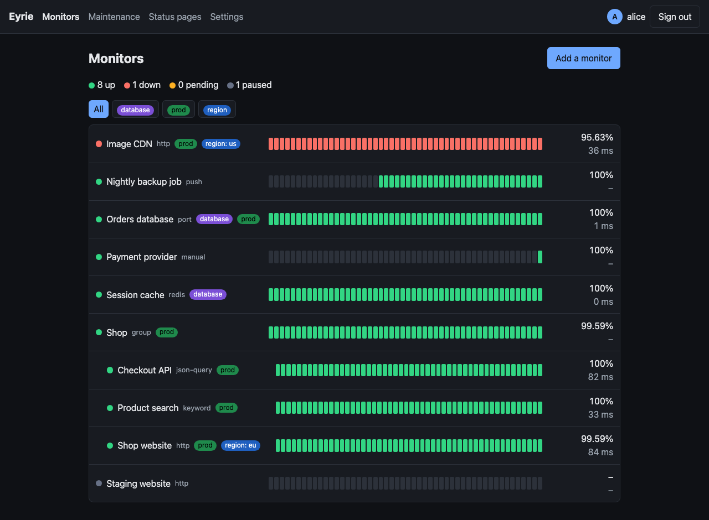
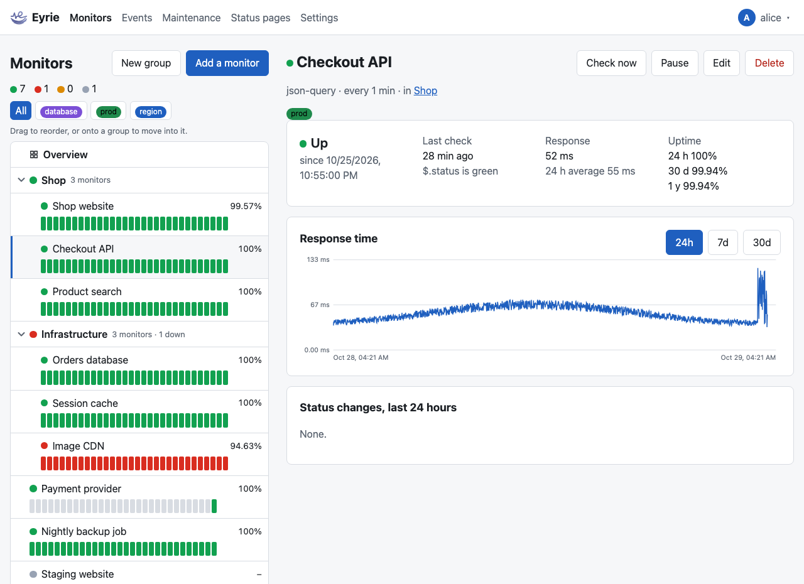
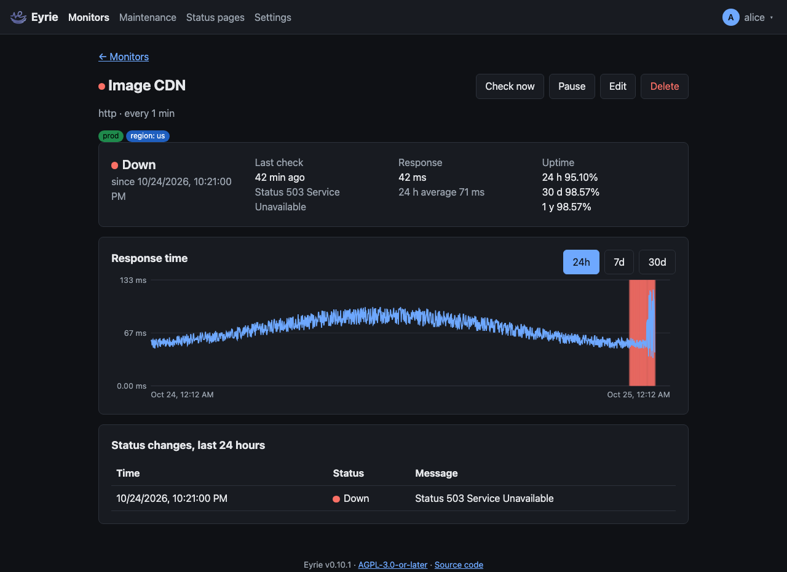
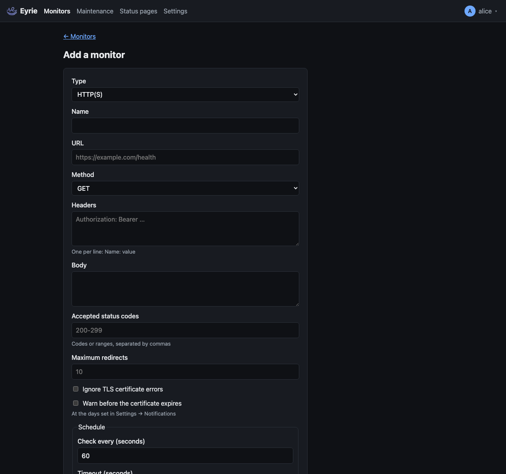
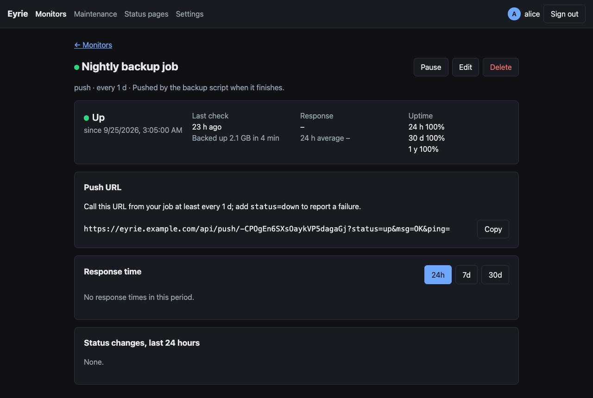

# Monitors

A monitor checks one thing, such as a web page, a TCP port or a host
answering pings, at a fixed interval, and records every check as a
**heartbeat**. Admins add, change, pause and delete monitors; everyone signed
in sees them.

## The dashboard



The **Monitors** page has the list of every [group](#groups) and monitor on
the left, and what you click in it on the right: a monitor's page, a
group's page, or the form to add or change a monitor. With nothing chosen,
the right shows what is down, pending or in maintenance. The list stays in
place while the right side scrolls. On a narrow screen they take turns: the
list, then what you chose, with **← Monitors** to go back.

The list is in the order admins give it (see [Arranging the
list](#arranging-the-list)). What is in a group is indented under it; the
arrow left of a group hides or shows it, and this browser remembers which
groups you hid. A monitor's row shows:

- the status: green **up**, red **down**, amber **pending**, violet
  **maintenance** (in a [maintenance window](maintenance.md)), grey
  **unknown** (not checked yet) or **paused**;
- its [tags](#tags) and its uptime over the last 24 hours;
- the last 30 checks as a bar, oldest on the left (hover a check for its
  time, response time and message).

A group's row shows the status of the monitors in it (and in the groups
inside it): **down** when one is down, else **pending** when one is, else
**up**; paused monitors do not count. It also says how many monitors it has
and how many are down.

The counts above the list add up the statuses. When monitors have tags, a
row of them above the list filters it: click a tag to see only the monitors
with it (without groups), **All** or the tag again for everything.
Everything updates live: the page listens to Eyrie's event stream and needs
no reload.

## Groups

A group keeps monitors together in the list, and can be in another group.
It is not a monitor: nothing is checked, and it has no history of its own.

- **New group**, above the list (admins), asks only for a name and makes
  the group at the end of the list; its page opens.
- **Add group** under a monitor's **Group** setting makes one on the spot
  and puts the monitor in it.
- A group's page lists the monitors in it with their status. Admins change
  its name, the group it is in, and its alerts there, and **Delete group**
  deletes it: what was in it moves to the group's own parent (or the top
  level), and no monitor is deleted.

### A group's alerts

A group can send alerts of its own, to the
[channels](notifications.md) chosen on its page, on top of what its
monitors send to theirs:

| Alerts | When |
| --- | --- |
| No alerts (the default) | Never: only its monitors alert. |
| When its first monitor goes down | One `group_down` message when a monitor in it goes down while none was, and one `group_up` when none is down any more. |
| When one of the chosen monitors goes down | The same, counting only the monitors ticked. |

Monitors in groups inside the group count too; paused ones do not. A group
alerts with its monitors' own alerts, so it waits for their retries and is
not alerted by a maintenance window starting or ending. Changing a group
alerts nobody. See [what is sent](notifications.md#what-is-sent).

### Arranging the list

Admins drag a monitor or a group in the list: onto the top or bottom of a
row to put it before or after that row, onto the middle of a group's row to
move it into that group (at the end), or onto **Drop here for the top
level** below the list. A group cannot go into itself or a group inside it.
Dragging is off while the list is filtered by a tag. A new monitor or
group, or one moved to another group in its settings, goes at the end of
its group.

Earlier versions made groups as monitors of the type **Group**. Eyrie turns
those into groups when it starts, and when it restores a backup made by one
of those versions. They keep their IDs, names and what was in them; a group
monitor's notification channels become the group's, with alerts **when its
first monitor goes down**, as it alerted before; maintenance windows that
covered it cover the group; on a status page, the monitors in it take its
place. Its own history, tags and badges go.

## A monitor's page

Click a monitor for its page:

- its tags, and the group it is in;
- its status and since when (in maintenance, the window's title), the last
  check and its message;
- the last and the 24-hour average response time;
- uptime over 24 hours, 30 days and 1 year;
- for HTTPS monitors, how many days the server's certificate has left;
- a response time chart for 24 hours (every check), 7 or 30 days (hourly
  averages), with down periods marked in red;
- the status changes of the last 24 hours.

Response times are kept to the microsecond and shown with decimals under
10 ms (`0.51 ms`, `3.2 ms`), so a fast check on the local network does
not read as 0 ms.

Admins also get **Check now**, **Pause** or **Resume**, **Edit** and
**Delete** (which also deletes the monitor's history).





## Adding a monitor

**Add a monitor** on the dashboard (admins). Choose the type first; it
cannot change later.



### Settings every type has

| Setting | Default | Meaning |
| --- | --- | --- |
| Name | | 1 to 100 characters |
| Check every | 60 s | 20 seconds to 1 day, whole seconds. For push monitors: how often a push is expected. |
| Timeout | 80% of the interval, at most 48 s | How long a check may take, from 0.1 seconds to the interval. Not used by push and manual monitors. |
| Retries before down | 0 | Failed checks in a row that leave the monitor **pending** before it goes **down**. 0: down at the first failure. |
| Retry every | the interval | How soon a pending monitor is checked again. |
| Notify again every | 0 (never) | While down, notify again every this many checks. |
| Notify | the default channels | The [notification channels](notifications.md) it sends to. |
| Tags | none | Its [tags](#tags), each with an optional value. **Add tag** under them makes a new tag (a name and a colour) and gives it to the monitor. |
| Group | none | The [group](#groups) the monitor is in. **Add group** under it makes a new group (with no alerts) and puts the monitor in it. |
| Description | | Shown on the monitor's page. |
| Upside down | off | A failed check counts as up and a successful one as down: for things that must *not* answer. |
| Active | on | Unticked, the monitor is paused: not checked, its status kept. |

### Secret settings

Passwords, keys, tokens, SNMP communities and a real browser's address are
**secret settings**: Eyrie stores them encrypted, never shows them again
(not even to admins) and never gives them to alert analysis. When you
change a monitor, leave a secret empty to keep the saved one, or tick
**Remove the saved …** to delete it.

### How the status is decided

- A successful check makes the monitor **up**.
- A failed check while up makes it **pending** and it is checked again after
  the retry interval, until the retries run out; then it is **down**.
- A check that succeeds while pending makes it up again, with no
  notification.
- Only changes between up and down are [notified](notifications.md), and
  while down again every "Notify again every" checks.
- In a [maintenance window](maintenance.md), checks go on but are recorded
  as **maintenance**: they change nothing and notify nobody. Afterwards the
  monitor takes back its status and is checked at once.
- The next check starts one interval after the last one started, so checks
  do not drift. After a restart, first checks are spread over each
  monitor's interval, and every monitor keeps the status it had.

## Tags

Tags label monitors, such as `prod` or `database`, each with a colour.
Admins make them in **Settings → Tags**, or with **Add tag** in a
monitor's form (a name of 1 to 50 characters, unique whatever the case,
and a colour), and give them to monitors in the
monitor's settings, each with an optional value of up to 100 characters
(`env: prod`, `region: eu`). Renaming or recolouring a tag changes it on
every monitor; deleting it takes it off every monitor and maintenance
window.

Tags show on the dashboard and a monitor's page, filter the dashboard, and
choose the monitors a [maintenance window](maintenance.md) covers.

## Types

### HTTP(S)

Requests a URL; up when the answer's status code is accepted.

| Setting | Default | Meaning |
| --- | --- | --- |
| URL | | `http://` or `https://` |
| Method | GET | GET, HEAD, POST, PUT, PATCH, DELETE or OPTIONS |
| Headers | | One per line, `Name: value` |
| Body | | Sent as is |
| Accepted status codes | `200-299` | Codes or ranges, separated by commas, such as `200-299, 301` |
| Maximum redirects | 10 | From 0 to 20. Redirects beyond it fail the check ("more than N redirects"). |
| Ignore TLS certificate errors | off | Accept expired, self-signed or wrongly named certificates |
| Warn before the certificate expires | off | Notify at the days set in Settings → Notifications; see [Certificate warnings](notifications.md#certificate-warnings) |

The request has `User-Agent: Eyrie/<version>`. Every check opens a new
connection. The response time is from sending the request to the end of
the body (at most 1 MiB of it is read). For HTTPS, the expiry of the
server's certificate is recorded and shown.

Messages: the status, such as `200 OK`, or `Status 503 Service
Unavailable`, `Timed out`, or the connection error.

### HTTP(S) keyword

An HTTP(S) check whose response body must contain a **keyword**
(case-sensitive), in the first 1 MiB. With **Up when the keyword is
missing**, it must not contain it. The message says whether the keyword was
found and, when it was missing, quotes the start of the body.

### HTTP(S) JSON query

An HTTP(S) check whose response must be JSON with a value at a **JSON path**
that compares as wanted with the **expected value**.

- The path names one value: object keys separated by dots, array indexes in
  brackets, keys with other characters in brackets and quotes, with an
  optional `$` or `$.` in front: `status`, `$.data.items[0].state`,
  `checks["db.primary"].ok`.
- Strings are compared as they are; other values as JSON (`true`, `null`,
  `3`, `{"a":1}`).
- **Comparison**: `==` (default), `!=`, `<`, `<=`, `>`, `>=` compare as
  numbers when both sides are numbers, otherwise as text; `contains` looks
  for the expected text in the value.
- The message shows the value found: `$.status is green`, or
  `$.status is red, not == green`.

Uptime Kuma uses JSONata here; Eyrie's paths are the common subset, without
JSONata's functions and filters.

### TCP port

Up when a TCP connection to **host** and **port** opens within the timeout.
The response time is the time to connect.

### Ping

Sends **pings per check** (1 to 10, default 1) ICMP echo requests of
**packet size** bytes (8 to 1400, default 56) to **host**, one after
another, each with an equal share of the timeout. Up when at least one is
answered; the response time is the average of the answers. A host name is
resolved first, and its IPv4 address is preferred.

Eyrie pings without root, through the system's unprivileged ICMP sockets.
Docker allows them for every container. On a Linux host without Docker, the
group Eyrie runs as must be in `net.ipv4.ping_group_range`; otherwise the
check fails with "cannot open an ICMP socket".

### DNS

Asks a **DNS server** (default `1.1.1.1`, port 53) for the **record type**
of a **name**. Up when it answers with at least one record of that type and,
if **A record must contain** is set, one of them contains that text.

- Record types: A, AAAA, CAA, CNAME, MX, NS, PTR, SOA, SRV and TXT. For PTR,
  the name may be an IP address; Eyrie asks for its reverse name.
- The query goes over UDP, and again over TCP when the answer is truncated.
- The message lists the records: `A 192.0.2.10, 192.0.2.11`,
  `MX 10 mail.example.com`, or the server's error, such as `NXDOMAIN`.

### WebSocket upgrade

Opens a WebSocket connection to a `ws://` or `wss://` **URL**. Up when the
server answers `101 Switching Protocols` with the right
`Sec-WebSocket-Accept`; Eyrie then closes the connection.

| Setting | Default | Meaning |
| --- | --- | --- |
| URL | | `ws://` or `wss://` |
| Headers | | One per line, `Name: value` |
| Subprotocol | | Sent as `Sec-WebSocket-Protocol` |
| Ignore TLS certificate errors | off | As for HTTP(S) |
| Do not check the Sec-WebSocket-Accept answer | off | For proxies that get it wrong |

For `wss://`, the certificate's expiry is recorded. Messages: `101 Switching
Protocols`, or `Status 403 Forbidden, not 101 Switching Protocols`.

### SMTP

Connects to a mail server's **host** and **port**: up when it greets Eyrie
(`220`) and answers `EHLO`.

- **Security** `starttls` (the default, port 25): the server must offer
  STARTTLS and the TLS handshake must work. `tls` (port 465): TLS from the
  start. `none`: plain, STARTTLS is not tried.
- With TLS, the certificate is verified unless **Ignore TLS certificate
  errors** is ticked, and its expiry is recorded.
- Eyrie does not sign in or send mail. Messages: `Ready, STARTTLS works`,
  `Ready over TLS`, `Ready`, or what failed.

### NTP

Asks a time server (**host**, port 123) for the time, with NTP version 4
over UDP. Up when it answers with a synchronized clock: not stratum 0 (a
"kiss-o'-death" refusal, such as `RATE`, which the message quotes), not
stratum 16 or an alarm. With **Largest clock offset** (milliseconds), the
server's clock must also be within that much of Eyrie's. The response time
is the round trip; the message gives the stratum and the offset: `Stratum
2, offset +1.250 ms`.

### RADIUS

Sends an Access-Request to a RADIUS server (**host**, port 1812) for a
**user name** and **password** (PAP), with the **shared secret**. Up on
Access-Accept; Access-Reject (with the server's Reply-Message, if any) and
Access-Challenge are down.

- The request carries a Message-Authenticator, as servers protected
  against BlastRADIUS require, and the answer's authenticators are checked:
  a wrong shared secret shows as "The answer's authenticator is wrong".
- **NAS identifier** (default `eyrie`), **Called-Station-Id** and
  **Calling-Station-Id** are sent as given, for servers whose policies need
  them.
- The shared secret and the password are secret settings. Passwords are at
  most 128 bytes.

### SNMP

Asks an SNMP agent (**host**, port 161, UDP) for one **OID** and compares
the value with an **expected value**, with the same comparisons as JSON
queries (`==`, `!=`, `<`, `<=`, `>`, `>=` as numbers when both are, and
`contains`). Without an expected value, any value is up.

- **Versions** 1 and 2c (the default) use a **community** (default
  `public`, a secret setting). A wrong community gets no answer: the check
  times out with "No answer: is the community right?".
- **Version 3** uses a **user name**, an **authentication** protocol
  (none, MD5, SHA, SHA-224, SHA-256, SHA-384 or SHA-512) with its password,
  and **privacy** (none, DES or AES-128) with its password; privacy needs
  authentication, and passwords have at least 8 characters. An optional
  **context name** is sent. Eyrie learns the agent's engine ID first, and
  says what the agent reports: an unknown user, a wrong password, a clock
  outside the time window (Eyrie retries once with the agent's time).
- Values: integers, counters, gauges and time ticks as numbers; text as is,
  other bytes as hex (`02:00:00:00:00:01`); OIDs and IP addresses dotted.
  The message is `1.3.6.1.2.1.1.5.0 is switch-1`, or `…, not == switch-2`.

### Docker container

Asks the Docker daemon about a **container** (its name or ID): up while it
runs and, if it has a health check, is healthy or still starting. Exited,
dead, paused, restarting and unhealthy containers are down; an exited one's
message gives its exit code.

- **Docker host**: `unix:///var/run/docker.sock` (the default), or the
  daemon's API at `tcp://host:2375` or `https://host:2376` (client
  certificates are not supported; **Ignore TLS certificate errors** as for
  HTTP(S)).
- In Docker, mount the socket into Eyrie's container
  (`/var/run/docker.sock:/var/run/docker.sock`, as in the
  [installation](installation.md#with-sqlite-the-default) examples).
  Whoever can use the socket controls the host: see
  [Security](../technical/security.md#monitor-checks).

### Agent workload

Follows a workload one of Eyrie's [agents](agents.md) reports: a Docker
container, a Docker Swarm service, a Kubernetes Deployment, StatefulSet or
DaemonSet, or a Proxmox VE LXC container or VM. Choose the **agent**, then
the **workload** from what the agent last reported, grouped by Compose
project, stack, namespace or Proxmox node.

The check reads the agent's last report; it reaches no host itself, and
has no response time. Its message is the workload's status:

| Workload | Up while | Messages |
| --- | --- | --- |
| Container | It runs and, with a health check, is healthy or starting | `Running`, `Running, healthy`, `Running, health check starting`, `Running, unhealthy`, `Exited (exit code 137)`, `Paused`, `Restarting`, `Created`, `Dead` |
| Swarm service | Every task it wants runs | `3 of 3 tasks running`, `Scaled to 0` |
| Deployment, StatefulSet | Every replica it wants is ready | `3 of 3 ready`, `Scaled to 0` |
| DaemonSet | Every scheduled pod is ready | `4 of 4 ready`, `Scheduled on no nodes` |
| LXC container, VM | Its status is running | `Running`, `Stopped` |

The monitor is also down, with the reason, when the agent was removed
from Eyrie, is not enrolled, has not reported for 90 seconds (`The agent
edge has not reported for 2m5s`), cannot list its workloads (`The agent
edge cannot list its workloads: cannot reach Docker: …`), or no longer
reports the workload (`The agent edge reports no web`).

A report that changes a workload's status checks its monitors at once,
so a container that stops is down within seconds, not at the next
interval. The interval still applies, and an agent that stops reporting
takes the monitors down within 15 seconds of the 90.

Workloads are named so a monitor survives their being re-created: a
container by its name, a Swarm service by `service/<name>`, a Kubernetes
workload by `<namespace>/<kind>/<name>` and a Proxmox guest by `lxc/<vmid>`
or `qemu/<vmid>`.

### SIP OPTIONS

Sends a SIP `OPTIONS` request to a SIP server (**host**, port 5060, or 5061
over TLS) over **UDP** (the default), **TCP** or **TLS**, and waits for its
final answer (provisional `1xx` answers are skipped). Up when the status is
in **accepted status codes** (default `200-299`; some servers answer
`404` or `405` while working). Messages: `200 OK` or `Status 404 Not Found`.

### Tailscale ping

Runs `tailscale ping --c 1` for a **Tailscale node** (its name or Tailscale
IP address) on Eyrie's host: up when it answers (`pong from … in 12ms`, the
response time). It needs the `tailscale` program and a running `tailscaled`
where Eyrie runs; Eyrie's image has neither, so use it with Eyrie running
directly on a host in your tailnet, or with an image you extend.

### System service

Checks a **service** on Eyrie's host: on Linux, `systemctl is-active`
must say `active`; on Windows, `sc.exe query` must say `RUNNING`. Other
systems are not supported. Inside a container this sees the container, not
the host: it is for Eyrie running directly on a host.

### PM2 process

Runs `pm2 jlist` on Eyrie's host and finds a **process** by name or id: up
while it is `online`. The message gives its status, restarts, CPU and
memory: `Online, 2 restarts, 12% CPU, 80 MB`. Needs PM2 where Eyrie runs.

### Globalping

Measures from one of [Globalping](https://globalping.io)'s probes around
the world, through its API (Eyrie needs to reach `api.globalping.io`).

- **Measurement** `ping` (the default): pings the **target** host with
  **packets** (1 to 16, default 3); up when at least one is answered, with
  the average as the response time.
- `http`: requests the **target** URL with **method** HEAD (the default),
  GET or OPTIONS; up when the status is in **accepted status codes**
  (default `200-299`). The response time is Globalping's total time, and
  the certificate's expiry is recorded for HTTPS.
- **Probe location**: where the probe is, in Globalping's own words (a
  continent, country, city, cloud region, network or ASN, such as `Europe`
  or `AS64496`); empty, any probe.
- **Globalping API token** (optional, a secret setting) allows more
  measurements an hour than anonymous use; each check is one measurement.
- The message names the probe: `3 of 3 replies from example.com, pinging
  from <city>, <country> (AS<number> <network>)`.

### SFTP

Signs in to an SFTP server (**host**, port 22) as **user name** with a
**password** and/or a **private key** (OpenSSH or PEM, with its
**passphrase** if it has one), starts SFTP and, if a **path** is set,
checks that it exists. Up when all of that works: `Signed in, SFTP version
3; /upload exists`.

**Host key fingerprint** (`SHA256:…`, as `ssh-keygen -lf` shows it): the
server's key must match it. Left empty, any key is accepted and the message
shows the key's fingerprint, so you can copy it into the setting. The
password, the key and its passphrase are secret settings.

### Steam game server

Asks a game server (**host**, port 27015) with Valve's `A2S_INFO` query
over UDP, as Steam does (answering the server's challenge if it sends
one). Up when it answers; the message gives the server's name, game, map
and players: `Shop Server · Example Game · harbor · 5/24 players`.

### Game server

Asks a game server (**host**, **port**: the protocol's usual one by
default) for its status with a **query protocol**:

| Protocol | Usual port | For |
| --- | --- | --- |
| `valve` | 27015 | Source and GoldSrc games and others that answer Steam's `A2S_INFO` |
| `minecraft` | 25565 | Minecraft Java Edition (the server list ping, over TCP) |
| `minecraft-bedrock` | 19132 | Minecraft Bedrock Edition (RakNet's unconnected ping) |
| `quake2` | 27910 | Quake II and games on its engine |
| `quake3` | 27960 | Quake III Arena and games on id Tech 3 |

Up when it answers; the message is as for Steam game servers. Uptime Kuma
uses the GameDig library, which knows hundreds of games by name; Eyrie
speaks these protocols itself.

### gRPC keyword

Calls one gRPC method and looks for a **keyword** in the answer.

| Setting | Default | Meaning |
| --- | --- | --- |
| Address | | `host:port` |
| TLS | off | HTTP/2 over TLS; off, cleartext HTTP/2 (h2c) |
| Ignore TLS certificate errors | off | As for HTTP(S) |
| Protobuf definition | | The `.proto` text of the service and its messages, at most 256 KiB |
| Service | | Its full name, with the package: `shop.v1.Health` |
| Method | | Such as `Check`; a unary method (streaming ones are refused) |
| Request (JSON) | `{}` | The request message as JSON, by field name or JSON name |
| Metadata | | One per line, `name: value`, sent as headers |
| Keyword | | Must be in the answer as JSON; empty, any answer is up |
| Up when the keyword is missing | off | As for HTTP(S) keyword |

- Eyrie reads the definition itself: messages (nested too), enums,
  `oneof`, `map` and `repeated` fields, services. Imports are not read, so
  every type the method uses must be in the text; `google.protobuf.Empty`
  is known.
- The answer is turned into JSON with field names in lowerCamelCase (as
  protobuf's JSON mapping writes them), enums by name, 64-bit integers as
  strings, bytes in base64. The keyword is searched in that text.
- Down on a gRPC status other than OK, shown by name with its message
  (`UNAVAILABLE: …`), on an HTTP error, or on a compressed answer.

### HTTP(S) in a real browser

Loads a **URL** in a real Chrome and checks the page's own status: up when
it loads (the browser's load event) with a status in **accepted status
codes** (default `200-299`). Unlike HTTP(S), this runs the page's
JavaScript and loads its images, styles and scripts; the response time is
until the load event.

Eyrie's image has no browser. Run Chrome (or Chromium) where Eyrie can
reach it, and give its DevTools address as **Browser address** (a secret
setting, since it can hold a token):

- `ws://` or `wss://` and the browser's DevTools WebSocket, as headless
  browser containers give it (`ws://chrome.example.com:3000`);
- `http://host:9222`, Chrome started with `--remote-debugging-port=9222`:
  Eyrie asks it where its WebSocket is. Chrome accepts only an IP address
  or `localhost` as the host here.

Each check opens the page in a new, separate browser context and closes it
afterwards. **Ignore TLS certificate errors** makes the browser accept any
certificate; the expiry of the page's certificate is recorded.

### PostgreSQL, MySQL / MariaDB, SQL Server, Oracle Database

Connects with a **connection string** (a secret setting) and runs a
**query** (default `SELECT 1`, on Oracle `SELECT 1 FROM DUAL`): up when it
runs without an error. The message gives the first column of the first row,
and how many rows came back (counted up to 1000): `Query OK: 1`, `Query
OK: a (3 rows)`, `Query OK, no rows`. The query runs as written, so give
the monitor's database user only the rights it needs.

| Type | Connection string |
| --- | --- |
| PostgreSQL | `postgres://db.example.com:5432/shop?sslmode=require`, or `host=… user=… password=… dbname=…` |
| MySQL / MariaDB | `mysql://db.example.com:3306/shop` (port 3306 by default), or the Go driver's DSN, `tcp(db.example.com:3306)/shop?tls=true` after `user:password@` |
| SQL Server | `sqlserver://db.example.com:1433?database=shop`, or `server=…;user id=…;password=…` |
| Oracle Database | `oracle://db.example.com:1521/service` |

In the URLs, the user and password go before the host, as `user:password@`.

- Characters such as `@`, `/` or `:` in a URL's password are written
  percent-encoded (`%40`, `%2F`, `%3A`).
- A connection string is checked when you save it; a saved one is kept
  until you type a new one.
- PostgreSQL queries use the simple protocol, which works through
  connection poolers such as PgBouncer.

### MongoDB

Connects with a **connection string** (`mongodb://` or `mongodb+srv://`, a
secret setting) and runs a database **command** given as JSON (MongoDB's
extended JSON), `{"ping": 1}` by default, on the URI's database or `admin`.
Up when the command succeeds. With a **JSON path**, a value in the answer
must also compare as wanted with the **expected value**, as for JSON
queries: for example `{"replSetGetStatus": 1}` with `members[0].health ==
1`. The message shows the start of the answer or the value found.

### Redis

Connects with a **connection string**, `redis://host[:port][/db]` (port
6379 by default), or `rediss://` for TLS, a secret setting, with
`user:password@` or `:password@` before the host to sign in; signs in if
the URL has a password, selects the database, and sends `PING`. Up when
the answer is `PONG`. Works with anything that speaks Redis's protocol,
such as Valkey.

### MQTT

Subscribes to a **topic** on an MQTT broker (**host**, port 1883, or 8883
with **TLS**), with an optional **user name** and **password**, and waits
for a message: a retained one, or the next one published.

- **Check** `keyword` (the default): up when the message contains the
  **keyword**, or with any message when the keyword is empty.
- `json-query`: the message must be JSON with a value at the **JSON path**
  that compares as wanted with the **expected value**, as for JSON queries.
- No message within the timeout is down: "No message on <topic> in time".
  Wildcards (`+`, `#`) work in the topic.
- Eyrie speaks MQTT 3.1.1 over TCP; MQTT over WebSockets is not supported.

### RabbitMQ

Asks RabbitMQ's management API (the `rabbitmq_management` plugin) whether
a node has alarms (`GET /api/health/checks/alarms`), signed in with a **user
name** and **password** (a user with the `monitoring` tag is enough). Give
one or more **management API URLs**, such as
`http://rabbit.example.com:15672`: they are tried in order until one
answers. Up when it reports no alarms; down with the alarm it reports, or
when no node answers.

### Kafka producer

Sends a **message** (default `Eyrie check`) to a **topic** on a Kafka
cluster (**brokers**, `host:port`, separated by commas): up when the
cluster acknowledges it, with the partition and offset in the message.

- **TLS** (with **Ignore TLS certificate errors**), and **SASL** `plain`,
  `scram-sha-256` or `scram-sha-512` with a **user name** and **password**.
  AWS IAM and Kerberos are not supported.
- **Create the topic if it does not exist**: lets the cluster create it
  automatically (if it allows that).
- Every check adds a message to the topic: use one meant for it.

### Push

Eyrie does not check anything: something else calls the monitor's **push
URL**, shown to admins on its page, at least once per interval. It is down (after its
retries) when no push arrives in time.

```sh
curl -fsS "https://eyrie.example.com/api/push/<token>?status=up&msg=OK&ping="
```

- `status`: `up` (the default) or `down`, to report a failure.
- `msg`: a message, up to 500 characters.
- `ping`: a response time in milliseconds, optional.
- `GET` and `POST` both work. The answer is `{"ok":true}`, or `404`
  `{"ok":false,"msg":"Monitor not found or not active."}` for an unknown
  token or a paused monitor. This is the same URL format as Uptime Kuma's,
  so scripts written for it work.

The token in the URL is the only credential: keep it secret. **Make a new
URL** in the monitor's settings replaces it.



### Manual

Eyrie does not check anything: an admin sets it **up** or **down**, with an
optional message, on the monitor's page. Use it for things nothing can
check, such as a supplier's outage.

## Uptime and history

- Every check is a heartbeat: time, status, response time, message.
- Uptime is the share of checks that were up. **Pending checks count as up**:
  a monitor is not down until its retries run out. Paused periods have no
  checks and do not count, and checks in maintenance count neither way (nor
  towards the average response time).
- The 24-hour and 30-day figures come from hourly totals, the 1-year figure
  from daily totals (days in UTC), so they never read every heartbeat.
- Heartbeats are kept for 90 days by default: **Settings → History**
  (admins), from 1 to 3650 days. Hourly totals are kept 35 days and daily
  totals 400 days. Old data is deleted at start and then once a day.

## Who can do what

| | Viewer | Admin | API token |
| --- | --- | --- | --- |
| See monitors, their pages and history | yes | yes | yes, through the API |
| Add, change, pause, check, delete | | yes | |
| Set a manual monitor | | yes | |
| See tags and maintenance windows | yes | yes | yes, through the API |
| Add, change and delete tags and maintenance windows | | yes | |
| See groups | yes | yes | yes, through the API |
| Add, change, arrange and delete groups | | yes | |
