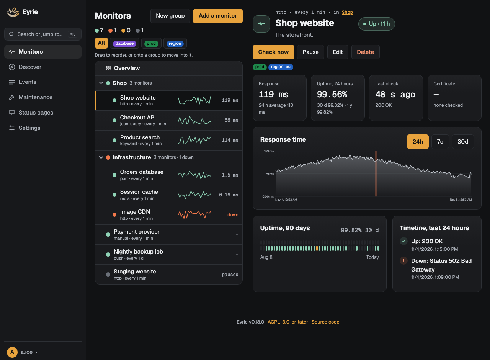
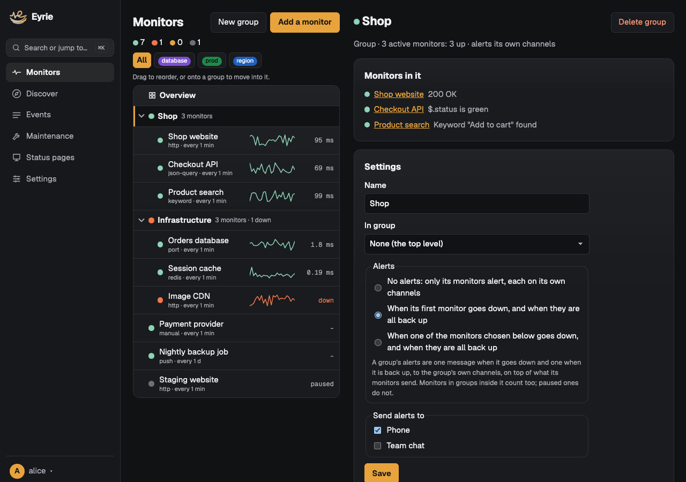
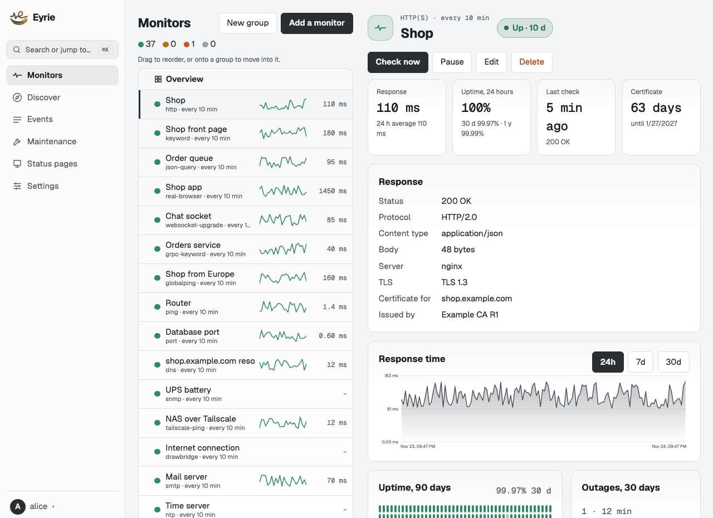
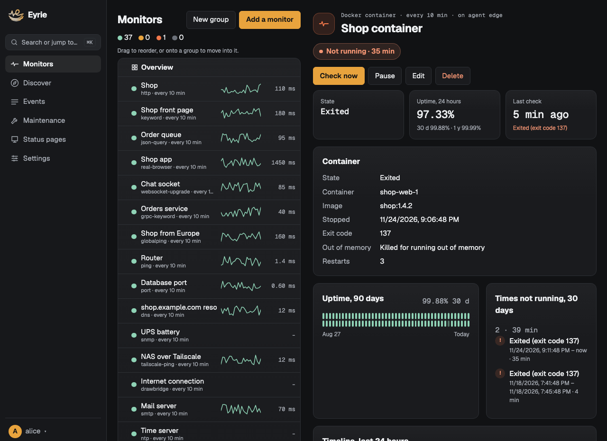
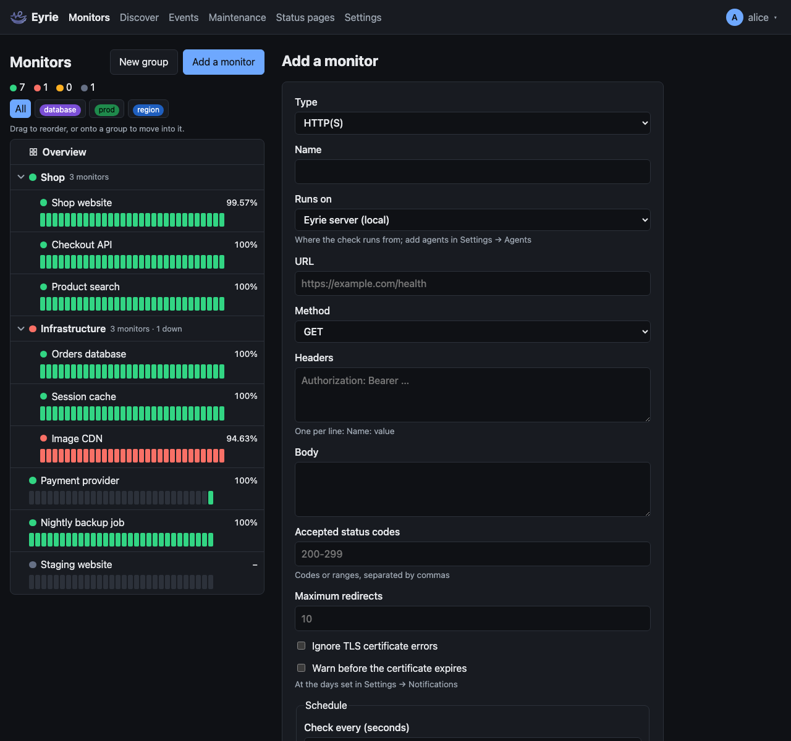

# Monitors

A monitor checks one thing, such as a web page, a TCP port or a host
answering pings, at a fixed interval, and records every check as a
**heartbeat**. Admins add, change, pause and delete monitors; everyone signed
in sees them.

## The dashboard

The **Monitors** page has the list of every [group](#groups) and monitor on
the left, and what you click in it on the right: a monitor's page, a
group's page, or the form to add or change a monitor. With nothing chosen,
the right shows the overview; **Overview**, at the top of the list, goes
back to it:

- the number of active monitors (and paused ones), the average uptime
  of the active monitors over 24 hours and 30 days, their average
  response time over 24 hours, and how many certificates expire within
  30 days;
- a bar of the active monitors by status;
- what is down, pending or in maintenance;
- the six latest [events](web-ui.md#events), the five monitors with the
  lowest uptime over 30 days (below 100%), the five slowest over 24
  hours, and the five certificates that expire next.

The list stays in place while the right side scrolls. On a narrow screen they take turns: the
list, then what you chose, with **← Monitors** to go back.

The list is in the order admins give it (see [Arranging the
list](#arranging-the-list)). What is in a group is indented under it; the
arrow left of a group hides or shows it, and this browser remembers which
groups you hid. A monitor's row shows:

- the status: green **up**, red **down**, amber **pending**, violet
  **maintenance** (in a [maintenance window](maintenance.md)), grey
  **unknown** (not checked yet) or **paused**;
- its uptime over the last 24 hours;
- the last 30 checks as a bar, oldest on the left (hover a check for its
  time, response time and message).

A group's row shows the status of the monitors in it (and in the groups
inside it): **down** when one is down, else **pending** when one is, else
**up**; paused monitors do not count. It also says how many monitors it has
and how many are down.

The counts above the list add up the statuses. When monitors have tags, a
row of them above the list filters it: click a tag to see only the monitors
with it (without groups), **All** or the tag again for everything.
Everything updates live: the page listens to Eyrie's event stream and needs
no reload.

## Groups

A group keeps monitors together in the list, and can be in another group.
It is not a monitor: nothing is checked, and it has no history of its own.

- **New group**, above the list (admins), asks only for a name and makes
  the group at the end of the group chosen in the list (shown open), or at
  the end of the list when no group is chosen; its page opens.
- **Add group** under a monitor's **Group** setting makes one on the spot
  and puts the monitor in it.
- A group's page lists the monitors in it with their status. Admins change
  its name, the group it is in, and its alerts there, and **Delete group**
  deletes it: what was in it moves to the group's own parent (or the top
  level), and no monitor is deleted.

### A group's alerts

A group can send alerts of its own, to the
[channels](notifications.md) chosen on its page, on top of what its
monitors send to theirs:

| Alerts | When |
| --- | --- |
| No alerts (the default) | Never: only its monitors alert. |
| When its first monitor goes down | One `group_down` message when a monitor in it goes down while none was, and one `group_up` when none is down any more. |
| When one of the chosen monitors goes down | The same, counting only the monitors ticked. |

Monitors in groups inside the group count too; paused ones do not. A group
alerts with its monitors' own alerts, so it waits for their retries and is
not alerted by a maintenance window starting or ending. Changing a group
alerts nobody. See [what is sent](notifications.md#what-is-sent).

### Arranging the list

Admins drag a monitor or a group in the list: onto the top or bottom of a
row to put it before or after that row, onto the middle of a group's row to
move it into that group (at the end), or onto **Drop here for the top
level** below the list. A group cannot go into itself or a group inside it.
Dragging is off while the list is filtered by a tag. A new monitor or
group, or one moved to another group in its settings, goes at the end of
its group.

Earlier versions made groups as monitors of the type **Group**. Eyrie turns
those into groups when it starts, and when it restores a backup made by one
of those versions. They keep their IDs, names and what was in them; a group
monitor's notification channels become the group's, with alerts **when its
first monitor goes down**, as it alerted before; maintenance windows that
covered it cover the group; on a status page, the monitors in it take its
place. Its own history, tags and badges go.

## A monitor's page

Click a monitor for its page. Each type's page is made for what it
watches: a container's page shows the container, a game server's its
players, a WAN Drawbridge monitor the internet connection and its
failovers. Every page has:

- its type, interval, agent, tags and group, and its status and since
  when, in the type's words (WAN Drawbridge: **On primary** and **Failed
  over**; Docker container, Proxmox VE guest and System service:
  **Running** and **Not running**; PM2 process: **Online** and **Not
  online**; in maintenance, the window's title);
- at most four figures at the top: the most telling things the last check
  found (a container's state and health; an NTP server's offset and
  stratum; the ISP Drawbridge is on and its public IP), the response time
  where it means something, the uptime over 24 hours, 30 days and 1 year,
  the last check with its message, and the certificate's days left;
- **what the last check found**, in a card named for it (Container,
  Internet connection, Clock, Response…): everything the check read, such
  as an HTTP response's status, protocol, redirect, server and
  certificate, or a DNS server's records. Each type's guide under [Monitor
  types](monitor-types/README.md) says what its check finds;
- the **outages of the last 30 days** (for WAN Drawbridge, its failovers),
  each with when it began and ended and how long it lasted, and their
  number and total time;
- uptime for each of the last 90 days, and the status changes of the last
  24 hours.

What else a page shows depends on its type:

| Shown | Types |
| --- | --- |
| The last and 24-hour average response time, and a response time chart | Types whose response time says how the thing answers: the HTTP(S) types, ping, TCP port, DNS, WebSocket, SMTP, RADIUS, SIP, Tailscale, Globalping, SFTP, game servers, gRPC, the databases, Redis, RabbitMQ, Kafka, and push monitors whose jobs send `ping` |
| A chart of the value it measures, first, above any response time chart | NTP (the clock's offset, in ms), Steam and game servers (players), SNMP, HTTP(S) JSON query, MongoDB and MQTT (the value, when it is a number), the SQL databases (the first value, when it is a number), Docker Swarm services (tasks running), Kubernetes workloads (ready replicas), PM2 processes (memory, in MiB) |
| How many days the certificate has left | The HTTP(S) types always; others once a check has seen a certificate (`wss://`, SMTP with TLS, gRPC with TLS, `rediss://`…) |
| CPU and memory charts | System resources |
| The NAS's volumes, disks and health | [SNMP storage](monitor-types/snmp-storage.md) |
| The push URL and when the next push is due, or the buttons to set the status | Push, Manual |

The other types (a Docker container, a Swarm service or Kubernetes
workload without a value yet, a Proxmox VE guest, a system service, WAN
Drawbridge) have no response time chart: how long Eyrie took to ask says
nothing about them.

Charts cover 24 hours (every check), 7 or 30 days (hourly averages), with
down periods marked in red.

Response times are kept to the microsecond and shown with decimals under
10 ms (`0.51 ms`, `3.2 ms`), so a fast check on the local network does
not read as 0 ms.

Admins also get **Check now**, **Pause** or **Resume**, **Edit** and
**Delete** (which also deletes the monitor's history).

## Adding a monitor

**Add a monitor** on the dashboard (admins). With a group chosen in the
list, the new monitor's **Group** is that group. Choose the type first; it
cannot change later. [Discovery](discovery.md) opens this form filled in,
for a container, service, workload, guest or network interface it found.

### Settings every type has

| Setting | Default | Meaning |
| --- | --- | --- |
| Name | | 1 to 100 characters |
| Runs on | Eyrie server (local) | Where it is checked from: **Eyrie server (local)**, the host Eyrie runs on, or one of its [agents](agents.md#monitors-on-an-agent). Not for push and manual monitors; the platform types (Swarm services, Kubernetes workloads, Proxmox VE guests) run only on an agent. |
| Check every | 60 s | 20 seconds to 1 day, whole seconds. For push monitors: how often a push is expected. |
| Timeout | 80% of the interval, at most 48 s | How long a check may take, from 0.1 seconds to the interval. When adding a monitor, it follows the interval until you change it; lowering the interval below the timeout brings the timeout down to 80% of it. Not used by push and manual monitors. |
| Retries before down | 0 | Failed checks in a row that leave the monitor **pending** before it goes **down**. 0: down at the first failure. |
| Retry every | the interval | How soon a pending monitor is checked again. |
| Notify again every | 0 (never) | While down, notify again every this many checks. |
| Notify | the default channels | The [notification channels](notifications.md) it sends to. |
| Tags | none | Its [tags](#tags), each with an optional value. **Add tag** under them makes a new tag (a name and a colour) and gives it to the monitor. |
| Group | none | The [group](#groups) the monitor is in. **Add group** under it makes a new group (with no alerts) and puts the monitor in it. |
| Description | | Shown on the monitor's page. |
| Upside down | off | A failed check counts as up and a successful one as down: for things that must *not* answer. |
| Active | on | Unticked, the monitor is paused: not checked, its status kept. |

### Secret settings

Passwords, keys, tokens, SNMP communities and a real browser's address are
**secret settings**: Eyrie stores them encrypted, never shows them again
(not even to admins) and never gives them to alert analysis. A monitor on
an agent sends them to its agent with each check. When you
change a monitor, leave a secret empty to keep the saved one, or tick
**Remove the saved …** to delete it.

### How the status is decided

- A successful check makes the monitor **up**.
- A failed check while up makes it **pending** and it is checked again after
  the retry interval, until the retries run out; then it is **down**.
- A check that succeeds while pending makes it up again, with no
  notification.
- Only changes between up and down are [notified](notifications.md), and
  while down again every "Notify again every" checks.
- In a [maintenance window](maintenance.md), checks go on but are recorded
  as **maintenance**: they change nothing and notify nobody. Afterwards the
  monitor takes back its status and is checked at once.
- The next check starts one interval after the last one started, so checks
  do not drift. After a restart, first checks are spread over each
  monitor's interval, and every monitor keeps the status it had.

## Tags

Tags label monitors, such as `prod` or `database`, each with a colour.
Admins make them in **Settings → Tags**, or with **Add tag** in a
monitor's form (a name of 1 to 50 characters, unique whatever the case,
and a colour), and give them to monitors in the
monitor's settings, each with an optional value of up to 100 characters
(`env: prod`, `region: eu`). Renaming or recolouring a tag changes it on
every monitor; deleting it takes it off every monitor and maintenance
window.

Tags show on the dashboard and a monitor's page, filter the dashboard, and
choose the monitors a [maintenance window](maintenance.md) covers.

## Types

Each type has a setup guide: what to prepare on the thing it checks, the
form's settings, what a working check says, and what to do when it is
down. Every type that is checked can run on an [agent](agents.md).

### Websites and APIs

| Type | Up when |
| --- | --- |
| [HTTP(S)](monitor-types/http.md) | A URL answers with an accepted status code |
| [HTTP(S) keyword](monitor-types/keyword.md) | A page contains a word, or does not |
| [HTTP(S) JSON query](monitor-types/json-query.md) | A JSON answer has the right value |
| [HTTP(S) in a real browser](monitor-types/real-browser.md) | A page loads in a real Chrome, with its scripts |
| [WebSocket upgrade](monitor-types/websocket-upgrade.md) | A WebSocket accepts a connection |
| [gRPC keyword](monitor-types/grpc-keyword.md) | A gRPC method answers, with a keyword |
| [Globalping](monitor-types/globalping.md) | A probe elsewhere in the world reaches the target |

### Network

| Type | Up when |
| --- | --- |
| [Ping](monitor-types/ping.md) | A host answers pings |
| [TCP port](monitor-types/port.md) | A TCP port accepts connections |
| [DNS](monitor-types/dns.md) | A DNS server answers with the right records |
| [SNMP](monitor-types/snmp.md) | A device's SNMP value is right |
| [SNMP storage (NAS)](monitor-types/snmp-storage.md) | A NAS's volumes, disks and system are healthy |
| [Tailscale ping](monitor-types/tailscale-ping.md) | A node of your tailnet answers |
| [WAN Drawbridge](monitor-types/drawbridge.md) | The internet connection has not failed over to a backup ISP |

### Servers and services

| Type | Up when |
| --- | --- |
| [SMTP](monitor-types/smtp.md) | A mail server answers, with TLS |
| [NTP](monitor-types/ntp.md) | A time server answers with good time |
| [RADIUS](monitor-types/radius.md) | A RADIUS server accepts a sign-in |
| [SIP OPTIONS](monitor-types/sip-options.md) | A SIP server answers |
| [SFTP](monitor-types/sftp.md) | An SFTP server accepts a sign-in |
| [Steam game server](monitor-types/steam.md) | A Valve game server answers |
| [Game server](monitor-types/gamedig.md) | A Minecraft, Valve or Quake server answers |

### Containers and hosts

| Type | Up when |
| --- | --- |
| [Docker container](monitor-types/docker.md) | A container runs and is healthy |
| [Docker Swarm service](monitor-types/docker-swarm.md) | Every task of a service runs (on an agent) |
| [Kubernetes workload](monitor-types/kubernetes.md) | Every replica is ready (on an agent) |
| [Proxmox VE guest](monitor-types/proxmox.md) | An LXC container or VM runs (on an agent) |
| [System resources](monitor-types/system-resources.md) | A Linux host's CPU and memory use are under their limits |
| [System service](monitor-types/system-service.md) | A systemd or Windows service runs |
| [PM2 process](monitor-types/pm2.md) | A PM2 process is online |

### Databases and message brokers

| Type | Up when |
| --- | --- |
| [PostgreSQL](monitor-types/postgres.md) | A query runs |
| [MySQL / MariaDB](monitor-types/mysql.md) | A query runs |
| [Microsoft SQL Server](monitor-types/sqlserver.md) | A query runs |
| [Oracle Database](monitor-types/oracledb.md) | A query runs |
| [MongoDB](monitor-types/mongodb.md) | A command runs, with the right value |
| [Redis](monitor-types/redis.md) | Redis answers PING |
| [MQTT](monitor-types/mqtt.md) | A topic has the right message |
| [RabbitMQ](monitor-types/rabbitmq.md) | A node has no alarms |
| [Kafka producer](monitor-types/kafka-producer.md) | A topic takes a message |

### Not checked by Eyrie

| Type | Up when |
| --- | --- |
| [Push](monitor-types/push.md) | A job calls the monitor's URL in time |
| [Manual](monitor-types/manual.md) | An admin sets it up or down |

## Uptime and history

- Every check is a heartbeat: time, status, response time, message, and
  for system resources the CPU and memory use.
- Uptime is the share of checks that were up. **Pending checks count as up**:
  a monitor is not down until its retries run out. Paused periods have no
  checks and do not count, and checks in maintenance count neither way (nor
  towards the average response time).
- The 24-hour and 30-day figures come from hourly totals, the 1-year figure
  from daily totals (days in UTC), so they never read every heartbeat.
- Every figure added up from those totals is worked out in the background,
  at once when Eyrie starts and then every 30 minutes by default
  (**Settings → History → Uptime figures**, admins, from 1 to 1440
  minutes), so that no page waits for it: uptime, average response times,
  daily and hourly counts. The list of monitors, a monitor's page and its
  charts, the dashboards, status pages and badges show them as of the last
  time; just after Eyrie starts, before the first
  are worked out, they show no data. Saving the setting, and restoring a
  backup, work them out again at once.
- Heartbeats are kept for 90 days by default: **Settings → History**
  (admins), from 1 to 3650 days. Hourly totals are kept 35 days and daily
  totals 400 days. Old data is deleted at start and then once a day.

## Who can do what

| | Viewer | Admin | API token |
| --- | --- | --- | --- |
| See monitors, their pages and history | yes | yes | yes, through the API |
| Add, change, pause, check, delete | | yes | |
| Set a manual monitor | | yes | |
| See tags and maintenance windows | yes | yes | yes, through the API |
| Add, change and delete tags and maintenance windows | | yes | |
| See groups | yes | yes | yes, through the API |
| Add, change, arrange and delete groups | | yes | |
