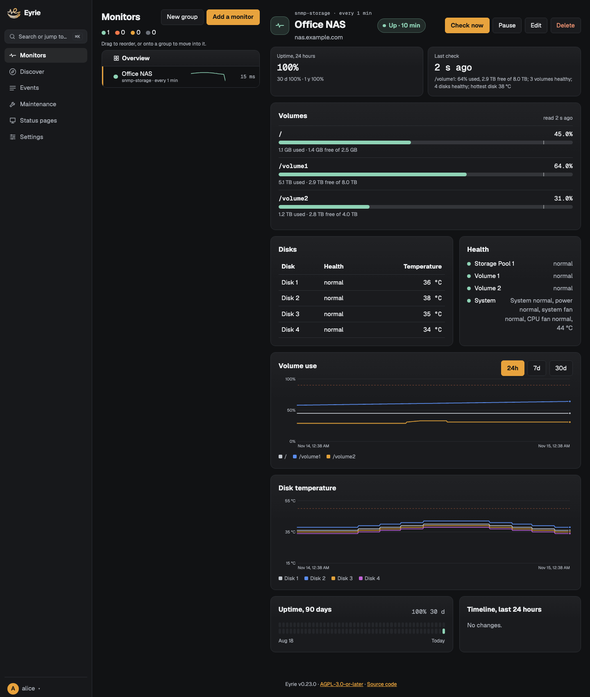

# NAS monitoring

Eyrie watches a whole NAS over SNMP with one [SNMP
storage](monitor-types/snmp-storage.md) monitor: how full each volume is,
the health of its volumes or pools, its disks' health and temperature,
the system's own health, and anything else a command on the NAS can tell
(SnapRAID, SMART). Its page shows the volumes, the disks and their
history. Nothing is installed on a NAS that has SNMP built in.
[Discovery](discovery.md#nas-storage-snmp) finds a NAS, ready to add.



## What each system reports

| System | Space | Volume or pool health | Disk health | Disk temperature | System health |
| --- | --- | --- | --- | --- | --- |
| Synology DSM | Yes | Yes | Yes | Yes | Yes |
| QNAP QTS, QuTS hero | Yes | Yes | Yes | Yes | Fans and power supplies |
| Asustor ADM 4 and later | Yes | Yes | Yes | Yes | No |
| TrueNAS SCALE and CORE | Yes | ZFS pools | No: ZFS marks the pool degraded instead | Yes | No |
| OpenMediaVault, Debian, Ubuntu, Unraid, others with net-snmp | Yes | With a command | With a command | With a command | No |

Space comes from the standard tables every SNMP agent on a NAS has
(HOST-RESOURCES-MIB's `hrStorageTable`, and net-snmp's `dskTable` where
it has `disk` lines). Health comes from the vendor's own MIB, which Eyrie
finds by asking for each in turn. A NAS without one, such as UGREEN's
UGOS Pro or TerraMaster's TOS, which document no MIB, still reports space
if its SNMP service answers, and anything else through a command (below)
where you can edit its `snmpd.conf`.

Versions 1, 2c and 3 all work. Use version 3 with SHA and AES where the
NAS offers it: version 1 and 2c send the community in the clear.

## Synology DSM

**Control Panel → Terminal & SNMP → SNMP**: tick **Enable SNMP service**,
then either **SNMPv1, SNMPv2c service** with a community, or **SNMPv3
service** with a user name, SHA and a password, and AES with a password.
Volumes are named as in the space table, `/volume1`; the health tables
name them `Volume 1` and `Storage Pool 1`, and disks `Disk 1`.

## QNAP QTS and QuTS hero

**Control Panel → Network & File Services → SNMP**: enable it, choose the
version and set the community or the version 3 user. Eyrie reads the
tables of QTS 4 and later (`systemInfoEx`), and the older ones where
those are missing.

## Asustor ADM

**Services → SNMP**: enable it and set the community or the version 3
user. Disks are named as ADM names their bays.

## TrueNAS

**System → Services → SNMP** (SCALE) or **Services → SNMP** (CORE): set a
community, or a version 3 user, then start the service and tick **Start
Automatically**. Pools are named as in TrueNAS; datasets show up in the
space table by mount point, such as `/mnt/tank`.

## OpenMediaVault and Debian

Install net-snmp's agent (`apt install snmpd`; on OpenMediaVault 7,
install the **openmediavault-snmp** plugin and use its extra options for
the lines below). Then, in `/etc/snmp/snmpd.conf`:

```
# Answer on the network, not only on the loopback.
agentaddress udp:161
# Version 3 (the user is below), or "rocommunity <community>" for 2c.
rouser eyrie priv

# Each volume to watch, by mount point: they show in dskTable, with inodes.
# A pooled filesystem (such as a FUSE pool) needs its own line, as do the
# disks under it that you want to watch.
disk /srv/pool
disk /srv/data1
disk /srv/data2

# SnapRAID and SMART (below).
extend snapraid /usr/local/bin/eyrie-nas-health report snapraid
extend smart /usr/local/bin/eyrie-nas-health report smart
```

For version 3, stop snmpd and add the user to
`/var/lib/snmp/snmpd.conf`, where snmpd turns the passwords into keys
when it starts (SHA-256 needs net-snmp 5.8, in Debian 11 and later):

```
createUser eyrie SHA-256 "a long passphrase" AES "another long passphrase"
```

Then start it again (`systemctl restart snmpd`). The `disk` lines' mount
points are the volumes the monitor shows.

### SnapRAID and SMART

SnapRAID and SMART have no MIB, so snmpd runs a command and Eyrie reads
what it said (NET-SNMP-EXTEND-MIB): the monitor is down when one does not
exit with 0, with its first line in the message, and its page lists each
one.

Both checks need root and take a while, longer than an SNMP request can
wait, so `eyrie-nas-health` (in Eyrie's source, `deploy/snmpd/`) runs
them as root from a systemd timer every 15 minutes and keeps the results;
snmpd, which runs as its own user, only reads them:

```sh
install -m 755 eyrie-nas-health.sh /usr/local/bin/eyrie-nas-health
install -m 644 eyrie-nas-health.service eyrie-nas-health.timer /etc/systemd/system/
systemctl daemon-reload
systemctl enable --now eyrie-nas-health.timer
```

| Check | Down when |
| --- | --- |
| `snapraid` | `snapraid status` finds errors, or the array is not fully synced; the last sync or scrub (SnapRAID's content file) is more than `SYNC_MAX_HOURS` old (48); with `SCRUB_MAX_DAYS` set, the oldest block was scrubbed longer ago; SnapRAID is not installed. Up while a sync or scrub holds SnapRAID's lock. |
| `smart` | A disk `smartctl --scan` finds says it is failing, has a pre-failure attribute at its threshold, or cannot be read; smartctl finds no disks or is not installed. Disks that are asleep are not woken (`-n standby`) and are counted as asleep. |
| Both | The timer has not run for `STALE_MINUTES` (120), or has not run yet. |

Settings go in `/etc/default/eyrie-nas-health`, such as
`SYNC_MAX_HOURS=26` for a nightly sync, `SCRUB_MAX_DAYS=60`, or
`SNAPRAID_CONF=/etc/snapraid/snapraid.conf`. Any other command of your
own works the same way: give it an `extend` line, exit with 0 when all is
well, and print why when it is not.
