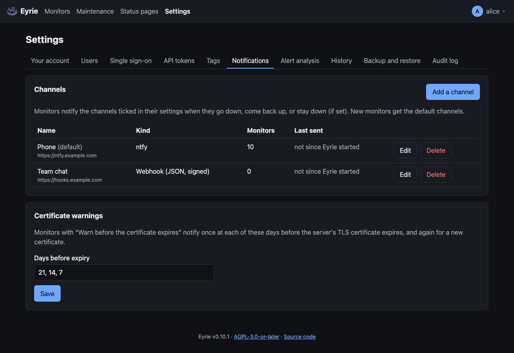

# Notifications

Eyrie tells you when a monitor goes down, comes back up or stays down, and
before a website's certificate expires. It sends to
[ntfy](https://ntfy.sh), [Gotify](https://gotify.net),
[Pushover](https://pushover.net), Telegram, Discord, email, or any URL that
accepts a JSON POST, signed so the receiver can check it came from Eyrie.

Admins set up **channels** in **Settings → Notifications**, then choose in
each monitor's settings which channels it notifies.



## Adding a channel

**Add a channel**, and fill in:

| Field | Meaning |
| --- | --- |
| Name | Your label, for example `Phone`. |
| Kind | ntfy, Gotify, Pushover, Telegram, Discord, Email (SMTP) or Webhook (JSON, signed). The form shows the fields the kind uses; the kind cannot change once saved. |
| URL, token, user | See the table below. Stored encrypted; afterwards only the URL's scheme and host are shown. |
| Send to this channel | Untick to pause the channel without deleting it. |
| Give it to new monitors | Ticked for new monitors' channels (the **default** channels). |
| Add it to every existing monitor | Adds the channel to every monitor when you save. |

**Send test** sends a test message with the form as it is, saved or not,
and shows "✓ Sent." or the error. On a saved channel, leave the URL, token
and user blank to keep the stored ones; tick **Remove the saved value** to
delete an optional one.

| Kind | URL | Token | Other fields |
| --- | --- | --- | --- |
| ntfy | The topic URL: `https://ntfy.sh/your-topic`, or your own server's | An access token, for a protected topic (sent as `Authorization: Bearer`) | |
| Gotify | The server address: `https://gotify.example.com` (Eyrie posts to `/message`) | An **application** token (sent as `X-Gotify-Key`); required | |
| Pushover | Not used: messages go to `https://api.pushover.net/1/messages.json` | The application's API token; required | **User key**; required |
| Telegram | Optional: only for your own [Bot API server](https://core.telegram.org/bots/api#using-a-local-bot-api-server); blank uses `https://api.telegram.org` | The bot token from @BotFather; required | **Chat ID** (a group's starts with `-`); required. Add the bot to the group, or send it a message first, so it may write to you. |
| Discord | The channel's webhook URL: **Edit Channel → Integrations → Webhooks → Copy Webhook URL** | Not used: the URL is the secret | |
| Email | `smtp://host:port` (port 587 if left out) to upgrade with STARTTLS, or `smtps://host:port` (port 465 if left out) for TLS from the start | The SMTP password | **Username** (optional: without one Eyrie does not sign in), **From** and **To** (recipients separated by commas); From and To required |
| Webhook | Any `http://` or `https://` URL | Optional **signing secret**: see [Webhooks](#webhooks) | |

Email is always encrypted: a server reached with `smtp://` that does not
offer STARTTLS is refused ("the server does not offer STARTTLS"), and so is
a certificate the system does not trust or that does not match the host
(TLS 1.2 or newer). Eyrie signs in (AUTH PLAIN) only over TLS.

Each channel shows when it last sent: **3 min ago**, or **failed** with the
error on hover. This is kept in memory, so it is empty after a restart until
the next message.

## Which monitors notify which channels

In a monitor's settings, **Notify** lists every channel; tick the ones it
uses. A new monitor starts with the default channels ticked. Deleting a
channel removes it from every monitor.

## What is sent

| Event | When | Title | Message | Priority |
| --- | --- | --- | --- | --- |
| `monitor_down` | The monitor goes down (after its retries) | `Shop website is down` | The check's message: `Status 503 Service Unavailable` | 4 |
| `monitor_analysis` | The model answers about a down alert ([alert analysis](alert-analysis.md) on) | `Shop website is down: analysis` | `Likely cause: … Check first: …` | 3 |
| `monitor_still_down` | Still down, every "Notify again every" checks (if set) | `Shop website is still down` | `Down for 3 h 5 min. Status 503 Service Unavailable` | 4 |
| `monitor_up` | Back up after being down | `Shop website is up` | `Up again after 12 min down. 200 OK` | 3 |
| `certificate_expiring` | The HTTPS certificate is within one of the warning days | `Shop website: the certificate expires in 14 days` | `The TLS certificate expires on 1 February 2027 at 12:00 UTC. Renew it before then.` | 4 within 7 days, else 3 |
| `test` | **Send test** | `Test notification` | `Notifications from Eyrie reach this channel.` | 3 |

With [alert analysis](alert-analysis.md) on, a `monitor_down` message is
followed by a `monitor_analysis` message, `Shop website is down: analysis`,
whose text is the model's explanation (priority 3). The down alert never
waits for it, and none is sent when the model does not answer.

A monitor that goes pending and recovers before its retries run out sends
nothing. Paused monitors send nothing, nor do monitors in a
[maintenance window](maintenance.md), whose status changes neither start
nor end: when the window ends, they take back the status they had, without
a message. Certificate warnings are still sent during maintenance. When
`EYRIE_BASE_URL` is set, every message links to the monitor's page.

Priorities are on ntfy's 1 to 5 scale. Gotify gets them as 8 and 5;
Pushover as 1 and 0 (Pushover's emergency priority, which repeats until
acknowledged, is not used); email marks priority 4 with `X-Priority: 2`.

### Certificate warnings

HTTP(S), keyword and JSON query monitors have **Warn before the certificate
expires**. **Settings → Notifications → Certificate warnings** sets the days
before expiry (default `21, 14, 7`; up to 10 values from 1 to 365). At each
check, Eyrie looks at how many whole days the server's certificate has left
and sends one warning when it reaches a day in the list, so with the default
a certificate is warned about three times. A renewed certificate (another
expiry date) starts again. The warnings sent are remembered across
restarts.

## Message formats

Messages are cut to fit Pushover (1024 characters), Discord (2000)
and Telegram (4096), ending in `…`.

- **ntfy**: the message (and the link) as the body, with the `Title`,
  `Priority`, `Tags` (`warning` for down and priority 4, `white_check_mark`
  for up and tests) and `Click` (the link) headers.
- **Gotify**: `{"title", "message", "priority"}`.
- **Pushover**: a form with `token`, `user`, `title`, `message`, `priority`,
  `timestamp` and `url` (the link).
- **Telegram**: `sendMessage` with `chat_id` and `text` (title, a blank line,
  the message), link previews off.
- **Discord**: `{"username": "Eyrie", "content": "**Title**\nMessage"}`.
- **Email**: subject `Eyrie: <title>`, a plain-text body (UTF-8,
  quoted-printable) with the message, the link, the event and its time in
  UTC.
- **Webhook**: the whole message as JSON, below.

Every HTTP request has the `User-Agent` `Eyrie/<version>`.

### Webhooks

```json
{
  "event": "monitor_down",
  "title": "Shop website is down",
  "message": "Status 503 Service Unavailable",
  "priority": 4,
  "time": "2027-01-15T08:30:00Z",
  "url": "https://eyrie.example.com/monitors/3",
  "monitor": { "id": 3, "name": "Shop website", "type": "http", "description": "the shop" },
  "heartbeat": { "status": "down", "at": "2027-01-15T08:30:00Z", "latency_ms": null, "message": "Status 503 Service Unavailable" }
}
```

Certificate warnings have `cert_expires` instead of `heartbeat`. `url` is
left out without `EYRIE_BASE_URL`. A `monitor_analysis` message has the
model's explanation as `message`, and the `monitor` and `heartbeat` of
the down alert it follows.

With a **signing secret**, each request has the header
`X-Hub-Signature-256: sha256=<hex>`: the HMAC-SHA256 of the request body
with the secret as key, as GitHub signs its webhooks. To check it, compute
the same over the raw body and compare in constant time, for example in
Python:

```python
expected = "sha256=" + hmac.new(secret.encode(), body, hashlib.sha256).hexdigest()
ok = hmac.compare_digest(expected, request.headers["X-Hub-Signature-256"])
```

## Delivery

- Messages go out in the background, in order; a slow channel never holds
  up the monitors. A message goes to all of a monitor's channels at once.
- Each request has a 10 second timeout (email: 10 seconds to connect, 30 for
  the whole exchange). A failure is retried after 5 seconds and again after
  30 seconds. A `4xx` answer other than `429 Too Many Requests`, an SMTP
  `5xx` reply and a server without STARTTLS are not retried: they would fail
  again (a wrong token, URL or address).
- Errors never show a URL's path, which can hold a secret (a Discord
  webhook's, a Telegram bot token): only its scheme and host.
- Up to 256 messages wait in the queue; when it is full, further messages
  are dropped and logged (`notification queue full`). Messages still queued
  when Eyrie stops are lost.
- Failures are logged (`notification failed`) and counted in the metric
  `eyrie_notifications_total{result="failed"}`.

## Secrets

Channel URLs, tokens and users are encrypted in the database with the
instance key (`secret.key` or `EYRIE_SECRET_KEY`), like the single sign-on
client secret. They are never sent back to the browser.
