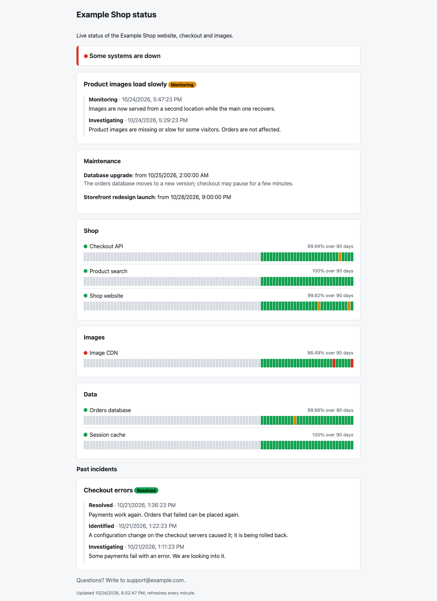
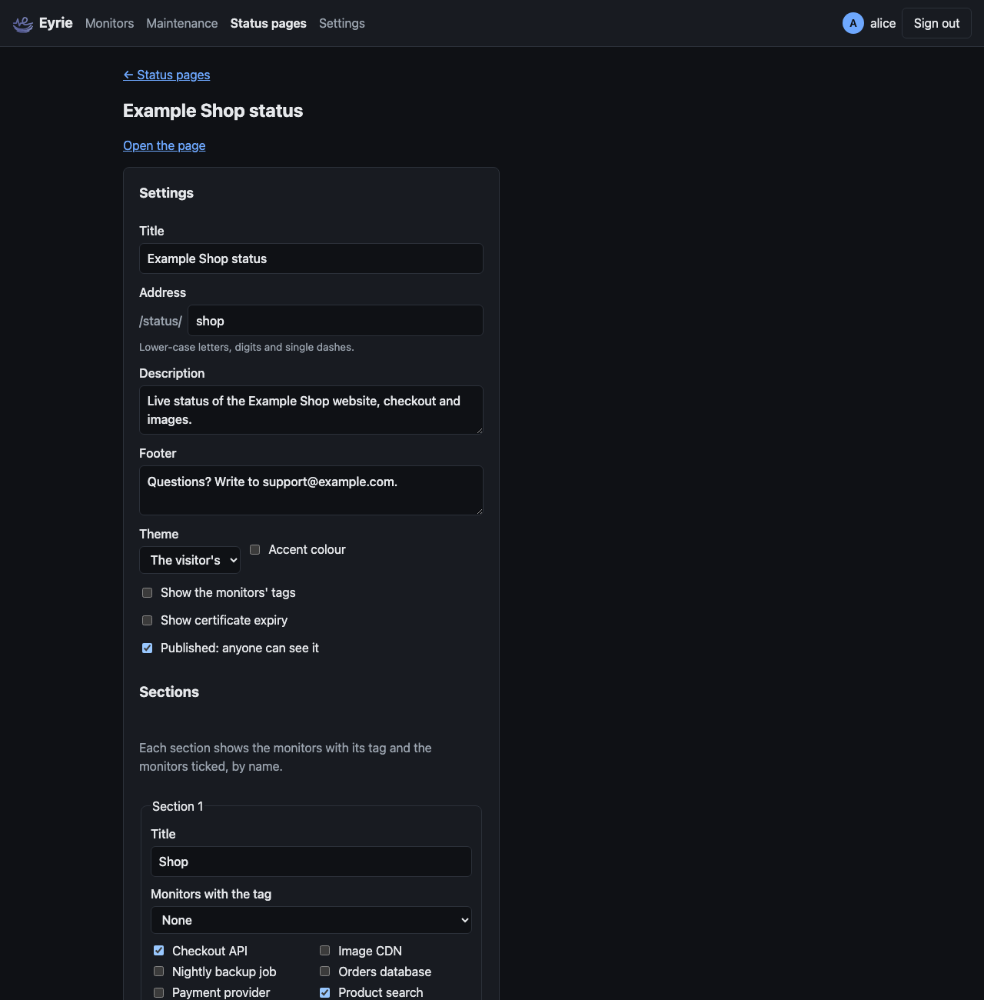

# Status pages, incidents and badges

A status page shows the people who use your services whether they work: the
status and uptime of chosen monitors, grouped in sections, with incidents
and maintenance. Once published, anyone can open it at
`https://<your Eyrie>/status/<address>`, without signing in.

A status page shows only monitors' **names**, statuses, uptime and,
optionally, tags and certificate expiry. It never shows check messages,
URLs, hosts or any other setting, nor who wrote an incident update.

**Status pages**, at the top, lists them. Admins add, change and delete
pages and incidents; viewers see the list, the pages (also unpublished, as
a preview) and their incidents.

## A page's settings

| Setting | Meaning |
| --- | --- |
| Title | 1 to 100 characters, at the top of the page and in the browser's tab |
| Address | Its URL, `/status/<address>`: 1 to 64 lower-case letters, digits and single dashes (`shop`, `shop-status`); unique |
| Description | Up to 2000 characters, under the title |
| Footer | Up to 2000 characters, at the bottom |
| Theme | The visitor's (light or dark as their system is), light or dark |
| Accent colour | The colour of links and buttons; Eyrie's blue by default |
| Show the monitors' tags | Their tags, with values, next to their names |
| Show certificate expiry | For HTTPS monitors, the days left on the server's certificate |
| Published | Anyone can see it. Unpublished, only signed-in users can (a preview), and its monitors have no badges. |
| Logo | A PNG, JPEG, GIF or WebP image, at most 1 MB, next to the title |

### Sections

A page has up to 50 sections, in order, each with an optional title. A
section shows, by name:

- the monitors with its **tag**, if it has one: tagging a monitor puts it on
  the page, and taking the tag off takes it off;
- the monitors ticked.

Sections list monitors, not [groups](monitors.md#groups); a group a page
showed in an earlier version was replaced by the monitors in it.

## What the page shows

- At the top, the overall status: **All systems operational**, **Some
  systems are down**, **All systems are down** (every monitor that runs is
  down), **Under maintenance** (none down, some in maintenance) or **No data
  yet**. Paused monitors do not count.
- Incidents that are open, newest first, each with its timeline.
- Maintenance windows covering a monitor on the page that are on, or start
  within 7 days (see [Maintenance windows](maintenance.md)).
- Each section's monitors: status (**up**, **down**, **maintenance**,
  **paused** or **unknown**; a pending monitor shows up until its retries
  run out), uptime over 90 days, and a bar for each of the last 90 days
  (days in UTC): green at 99.9% and over, amber from 95%, red below, grey
  without checks.
- Incidents resolved in the last 14 days.

The page reloads its data every minute.

## Incidents

An incident is something you tell visitors about, such as "Checkout errors".
Open one on the status page's page in Eyrie (**Status pages → Edit**) with
a title, a status and a message; post updates as things change. Each update
has a status:

| Status | Meaning |
| --- | --- |
| Investigating | Something is wrong, you are looking into it |
| Identified | The cause is known |
| Monitoring | A fix is in place; you are watching it |
| Resolved | It is over |

The incident's status is its latest update's. An update other than
**Resolved** reopens a resolved incident. Titles are 1 to 200 characters,
messages 1 to 5000, shown as written (plain text, line breaks kept).
Incidents can be renamed and deleted (with their timeline). Each update
records who posted it; only signed-in users see that.

## Badges

Every monitor on a published status page has SVG badges, for README files,
wikis and dashboards:

| URL | Shows |
| --- | --- |
| `/api/badge/<id>/status` | The monitor's name and status, as on the status page |
| `/api/badge/<id>/uptime` | Uptime over 24 hours; `?period=30d` or `?period=1y` for 30 days or a year |
| `/api/badge/<id>/response` | The last check's response time, with decimals under 10 ms (`0.51 ms`, `3.2 ms`): green under 300 ms, amber under 1 s, orange above |
| `/api/badge/<id>/cert` | Days until the HTTPS certificate expires: green over 21, amber over 7, red after |

`?label=` replaces the text on the left (up to 50 characters), such as
`/api/badge/3/status?label=Shop`. Uptime is green from 99.9%, light green
from 99%, amber from 95%, orange from 90%, red below. The badges of a page's
monitors are listed, with their URLs, on its page in Eyrie.

A monitor that is on no published page has no badges: its URLs answer
**404**. Badges may be cached for a minute.
