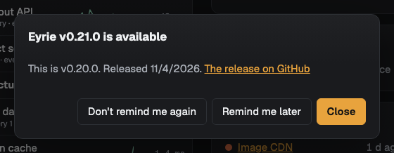
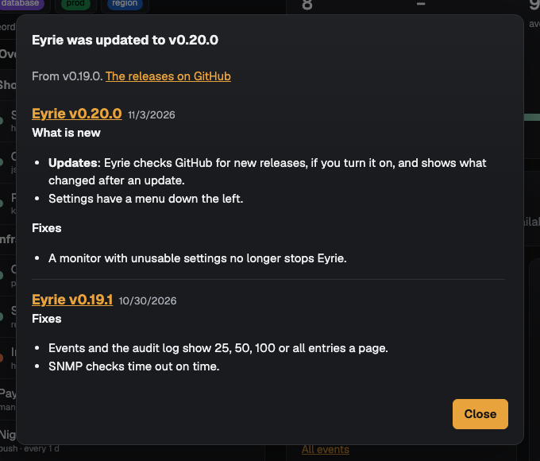

# Checking for updates

Eyrie can check GitHub for a newer release of itself. It is off until an
admin turns it on, at [setup](web-ui.md#first-start-setup) or in
**Settings → Updates**.

## What it does

When it is on, Eyrie asks the GitHub API for the latest release of the
repository it was built from (`GET /repos/<owner>/<name>/releases/latest`)
at the interval chosen: every 6 or 12 hours, every day (the default), every
3 days or every week. The first check happens within a minute of turning
it on. Nothing is sent but that request (and, [after an update](#after-an-update),
one for the list of releases), with `User-Agent: Eyrie/<version>`.

The repository is taken from the build's source address
(`EYRIE_SOURCE_URL`, or the one built into the image,
`https://github.com/<owner>/<name>`). A build whose source is not on
GitHub has no releases to check, and **Settings → Updates** says so.

A release is newer when its version (`vX.Y.Z`) is above the running one. A
development build (`dev`) is never out of date.

**Check now** checks at once, whether checks are on or off. The page
shows when Eyrie last checked, why the last check failed (if it did), and
the newer release with its notes.

## The reminder

When a newer release is out and checks are on, admins see a window with
its version, release date and a link to its notes on GitHub when they
open Eyrie. Viewers never see it. Each admin chooses:

- **Close** hides it until they open Eyrie in a new tab.
- **Remind me later** hides it for a day, on every device.
- **Don't remind me again** hides it for good for this release. A later
  release shows a new reminder.

## After an update

When Eyrie starts on a newer version than the one that ran before, every
user sees the notes of the releases since then (newest first, up to 20)
the next time they open Eyrie, once: **Close** (or Escape) hides it for
good. Accounts made after the update don't see it, nor does a first start,
a downgrade or a development build. When there is also a newer release
than this one, admins see its reminder after closing this window.

The notes come from GitHub, so Eyrie fetches them only while checks are
on, within a minute of starting or of turning checks on (through the same
proxy), and again an hour later if that fails. With checks off the window
still says Eyrie was updated, with a link to the releases on GitHub.

## Notifications

With **Tell these channels about a newer release** ticked, the chosen
[notification channels](notifications.md) get an `update_available`
message once per release: `Eyrie v1.3.0 is available`, with the first
1500 characters of its notes and the release's address as the link.
Channels that are off are skipped.

## Through a proxy

Leave **Proxy → URL** empty to use the `HTTPS_PROXY` (or `HTTP_PROXY`) and
`NO_PROXY` environment variables, if Eyrie has them, or to reach GitHub
directly. Otherwise give the proxy's URL (`http://`, `https://` or
`socks5://`, such as `http://proxy.example.com:3128`), and its username
and password if it needs them. The password is sealed like other
[stored secrets](../technical/security.md#stored-secrets) and never shown
again; leave it blank to keep the saved one. The proxy is used only for the
update check.
