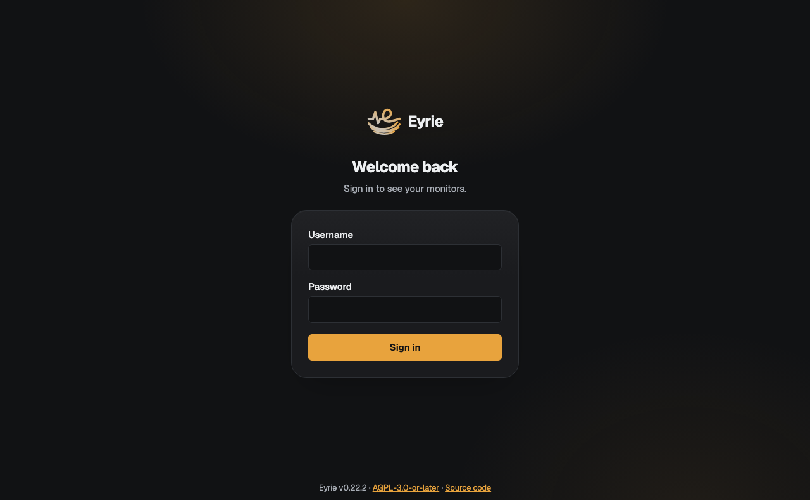
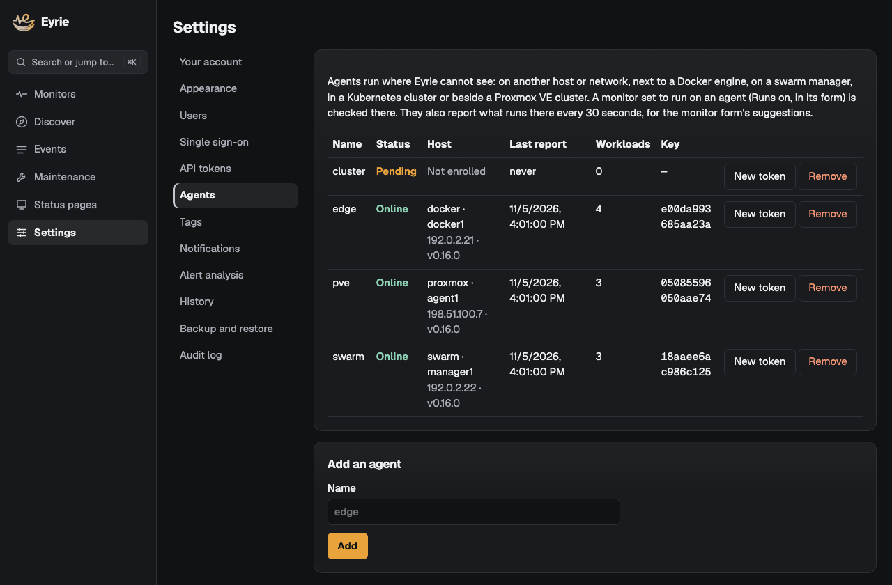
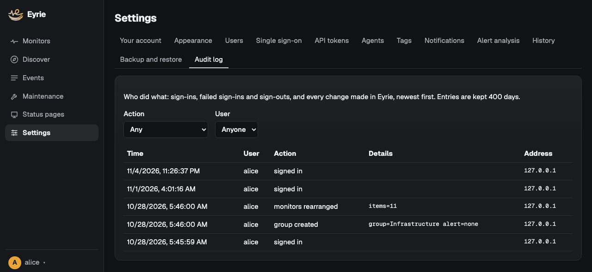
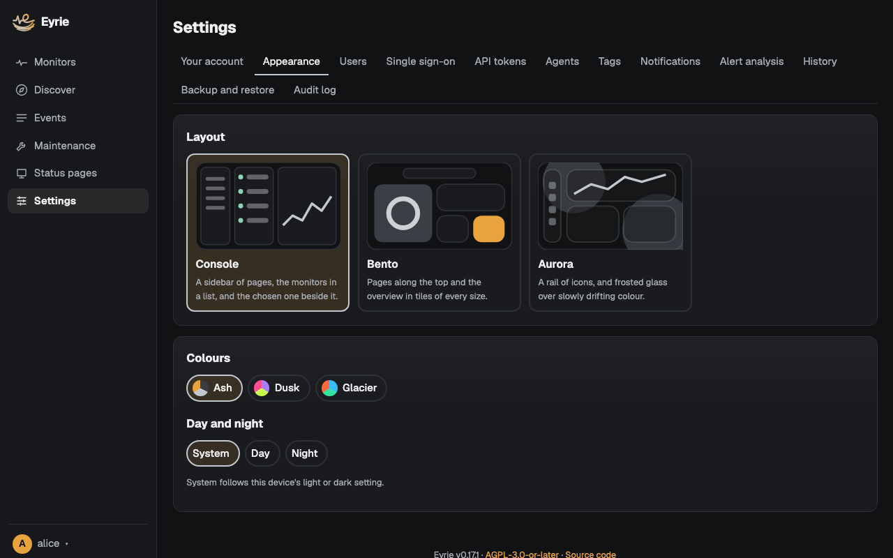
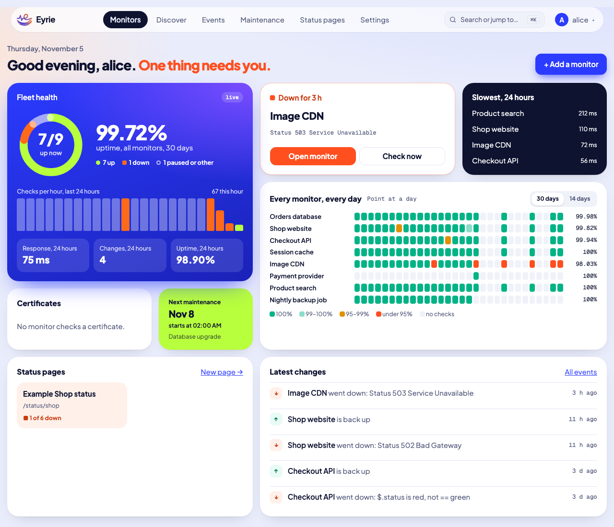
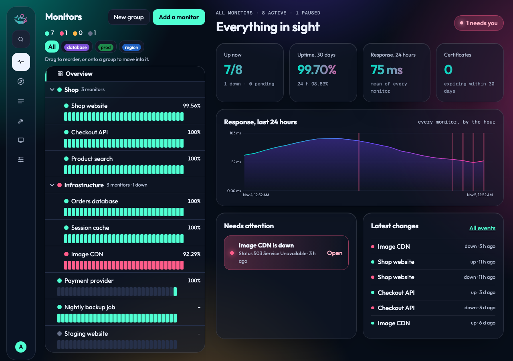
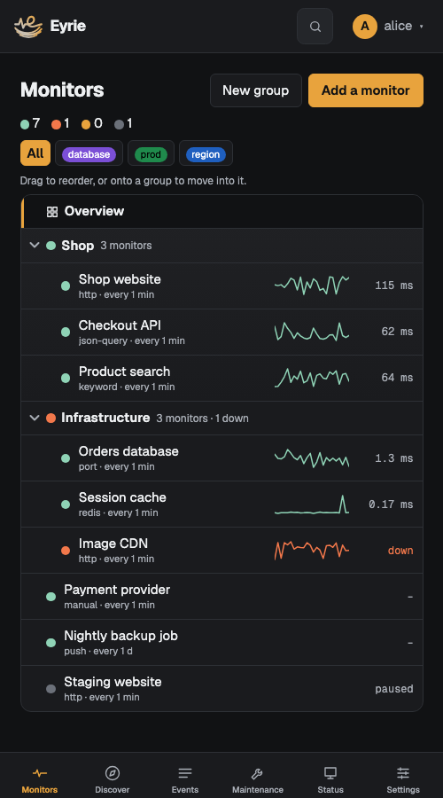

# Using the web app

Open Eyrie in a browser at the address it runs on, `http://<host>:8080` by
default.

## First start: setup

Before any account exists, every page shows **Set up Eyrie**, in three
steps:

1. **Your account**: enter a username and a password of at least 12
   characters, twice, and click **Create the admin account**. That account
   is an admin and is signed in at once. Do this right after the first
   start: until then anyone who can reach Eyrie could do it.
2. **How Eyrie looks**: the [layout, colours and day or night](#appearance)
   for this account, shown at once as they are chosen.
3. **Updates**: whether Eyrie [checks for updates](updates.md) (off unless
   ticked), and how often. Notifying channels about a new release and a
   proxy are set later, in **Settings → Updates**.

**Finish** opens the dashboard. Leaving after the first step keeps the
account, with the default look and update checks off.

Below it, **Or restore a backup** brings back the accounts, monitors and
settings of a backup file instead; then sign in with an account from it. See
[Backup and restore](backup-and-restore.md#restoring-at-setup).

## Signing in

The sign-in page asks for your username and password. Usernames ignore
case: `Alice` and `alice` are the same account. When single sign-on is set
up, a **Sign in with …** button comes first (see
[Single sign-on](single-sign-on.md)); when an admin made single sign-on the
only way in, the password fields are not shown.

- A wrong username and a wrong password get the same message: "Wrong
  username or password." So does a disabled account.
- After 5 failed sign-ins within 15 minutes, from one address or for one
  username, sign-ins are refused for a while: "Too many failed sign-ins. Try
  again in 15 minutes."
- With [two-factor sign-in](#two-factor-sign-in), a second step asks for a
  code.
- A session lasts 7 days from the last time you used Eyrie. **Sign out**,
  in the menu under your name, ends it: at the top right in the Bento
  layout, and at the bottom of the sidebar or rail in Console and Aurora.
  The menu also has **Your account** and **Appearance**; on a phone it
  stays at the top right, with the pages in a bar along the bottom.

If you opened a page while signed out, you land on it after signing in.

## Monitors

The start page is the dashboard of monitors: the list of groups and
monitors on the left, and the monitor or group chosen in it on the right
(in the Bento [layout](#appearance), the overview first and the list below
it).
Admins drag monitors and groups in the list to arrange it, and add a group
with **New group**. See [Monitors](monitors.md) for the dashboard, groups,
each monitor's page, adding monitors and every type.

## Discover

**Discover**, in the menu (admins), lists a Docker engine's containers,
what an agent's platform runs, or a network device's interfaces, and opens
a monitor of what you choose in the monitor form. See
[Discovery](discovery.md).

## Events

**Events**, in the menu, lists every monitor's status changes, newest
first, under the day they happened (Today, Yesterday, then the date). Each
says what happened and when: "**Image CDN** went down · 10:42". A monitor
went down, came up, started failing (pending: a check failed and Eyrie is
retrying it) or went into maintenance. Choose one to see its details: the
full date and time, the check's message, the response time and a link to
the monitor (on a phone, they slide up from the bottom). It shows 25
changes a page; **Show** picks 25, 50, 100 or all, and
**Newer** and **Older** move between pages. New changes appear on the
first page as they happen. They are kept as long as heartbeats (**Settings → History**). Viewers see
it too.

## Status pages

**Status pages**, in the menu, lists the status pages; each opens on its
settings, sections, logo, incidents and badges (admins change them; viewers
see the incidents). A published page is public at `/status/<address>`. See
[Status pages, incidents and badges](status-pages.md).

## Maintenance

**Maintenance**, in the menu, lists the maintenance windows, when each is on
and what it covers; admins add, change, turn off and delete them there. See
[Maintenance windows](maintenance.md).

## Settings

**Settings**, in the menu, has tabs in groups. Everyone has **You**:
**Your account** and **Appearance**. Admins also have:

- **Access**: **Users**, **Single sign-on** and **API tokens**.
- **Monitoring**: **Agents** (see [Agents](agents.md)), **Tags** (see
  [Tags](monitors.md#tags)) and **History** (how long heartbeats are kept;
  see [Monitors](monitors.md#uptime-and-history)).
- **Alerts**: **Notifications** (see [Notifications](notifications.md))
  and **Alert analysis** (see [Alert analysis](alert-analysis.md)).
- **System**: **Backup and restore** (see
  [Backup and restore](backup-and-restore.md)), **Updates** (see
  [Checking for updates](updates.md)) and **Audit log**.

The tabs are a menu down the left of the page; on a phone, rows above
it, one per group.

### Your account

- **Profile picture**: upload a PNG, JPEG, GIF or WebP image of up to 1 MB
  (SVG and other types are refused). It shows at the top right and, for
  admins, in Users. **Remove picture** deletes it. Without a picture, the
  first letter of your username is shown. Accounts linked to single sign-on
  also get the provider's picture; see
  [Profile pictures](single-sign-on.md#profile-pictures).
- **Password**: your current password, then the new one (at least 12
  characters) twice. Changing it signs you out everywhere else; this browser
  stays signed in. Accounts that sign in only with single sign-on have no
  password and do not see this.
- **Two-factor sign-in**: below.
- **Single sign-on**: when it is set up, **Link my … account** or
  **Unlink**; see [Linking an existing account](single-sign-on.md#linking-an-existing-account).

### Two-factor sign-in

An account with a password can also require a code from an authenticator
app (any app for time-based one-time passwords: 2FAS, Aegis, Google
Authenticator, 1Password, Bitwarden and others). It is offered only when
the account has a password, password sign-in is allowed, and the account is
**not** linked to single sign-on: a linked account uses the provider's own
second factor. Linking turns it off.

To turn it on, in **Settings → Your account → Two-factor sign-in**:

1. Click **Set up**. Scan the QR code with the app, or type in the key.
2. Enter the code the app shows and your current password, then **Turn on**.
3. Save the 10 **recovery codes** shown, somewhere other than your phone.
   They are shown once. Each works once instead of a code from the app.

From then on, signing in with your password asks for **Code from your
authenticator app**:

- The code has 6 digits and changes every 30 seconds. The code before and
  the code after the current one also work, for a clock that is slightly
  off. A code that was used, or an older one, is refused.
- A recovery code works too (`k3f9-x2pq-7hwd`; with or without dashes or
  spaces, in any case). Using one is logged with how many are left.
- The second step lasts 5 minutes and allows 5 tries; then sign in again.
  Wrong codes count toward the limit on failed sign-ins.
- Single sign-on is not affected.

While it is on, the card shows how many recovery codes are left, with **New
recovery codes** (replaces all of them) and **Turn off**, both after your
current password.

Lost your phone and your recovery codes? Another admin can click **Turn off
2FA** for you in Users. If you are the only admin, run
`docker compose exec eyrie /eyrie reset-2fa <user>` on the host (see the
[command line](../technical/configuration-reference.md#command-line)).

### Users

Admins only. The table lists every account: its role, how it signs in
(password, "password + code", single sign-on, or both), its last sign-in,
and whether it is disabled. For other accounts:

- **Role**: viewer or admin. Viewers can use Eyrie and change their own
  account; admins can also change users and settings. Accounts that sign in
  only with single sign-on show "(from the SSO admin group)" instead while
  an admin group is set: the group decides their role.
- **Disable** signs the account out everywhere and stops it signing in;
  **Enable** undoes it.
- **Reset password** sets a new password and signs the account out. Only for
  accounts with a password.
- **Turn off 2FA**, for accounts with two-factor sign-in.
- **Delete** removes the account with its sessions, single sign-on links,
  recovery codes and picture, after asking. It cannot be undone.

**Add a user** creates an account with a password and a role.

You cannot disable, delete or change the role of yourself, and the last
enabled admin cannot be disabled, deleted or made a viewer.

### API tokens

Admins only. A token lets a script read Eyrie without signing in, with the
header `Authorization: Bearer <token>`: the monitors, their history, the
event stream, tags, maintenance windows, status pages and incidents (the
**read** routes of the [HTTP interface](../technical/http-interface.md#conventions)).
It can only read: it cannot sign in or change anything.

**New token** asks for a name (up to 64 characters, such as `ci`) and shows
the token, which starts with `eyt_`, once: copy it then. The list shows who
made each token, when, and when it was last used. **Revoke** stops a token
at once.

### Agents

Admins only. Eyrie's [agents](agents.md) on other hosts: each one's status
(**pending** until it enrolls, then **online** while it reports, or
**offline** after 90 seconds without a report), where it runs (platform,
host name, address and version), its last report, how many workloads it
reports, and its key's fingerprint. When an agent cannot list its
workloads, the reason is under its status. The list updates every 15
seconds.

**Add an agent** asks for a name (up to 64 characters, such as `edge`) and
shows the agent's one-time enrollment token, which starts with `eya_` and
is valid for an hour, once. Below it, **Where it runs** shows the file or
commands that run the agent there (Docker, Docker Swarm, Kubernetes or
Proxmox VE), with Eyrie's address and the token filled in.

**New token** makes a new enrollment token and forgets the agent's key:
the agent is refused until it enrolls again with the new token. **Remove**
deletes the agent; the monitors that run on it go down.

### Audit log

Admins only. Who did what, newest first, 25 entries a page (**Show**
picks 25, 50, 100 or all; **Newer** and **Older** move between pages):
every sign-in (password, two-factor or single sign-on), failed
sign-in and sign-out, and every change made in Eyrie (monitors, **Check
now**, tags, maintenance windows, status pages and incidents, notification
channels, users, API tokens, agents, settings, backups and restores), and
agents enrolling, rotating their keys and being refused. Each entry
has the time, the user (for a failed sign-in, the username tried), the
action, its details (such as `monitor=Shop`) and the address it came from.
Filter by **Action** and **User**. Changes made by single sign-on, such as
an account it created, show the account's user and `via=sso`.

The same lines are in Eyrie's log. Entries are kept 400 days, like the
daily totals, and a backup with history includes them.

### Appearance

How Eyrie looks for you, on every device you sign in on (the account menu
has it too). Each choice applies at once.

- **Layout**:
  - **Console** (the default): the pages in a sidebar, the monitors in a
    list (each with its type, a line of its recent response times and the
    latest) with the chosen one beside it.
  - **Bento**: the pages in a bar along the top, and a start page of tiles:
    the fleet's health (a ring of up, down and the rest, the 30-day uptime
    and the checks of each of the last 24 hours), what is down, the agents
    (admins; others see the slowest monitors), every monitor's uptime for
    each of the last 30 or 14 days, certificates, the next maintenance,
    the status pages and the latest changes, with the list below them.
  - **Aurora**: the pages as a rail of icons, and frosted-glass panels over
    slowly drifting colour (still for those who ask their device for
    reduced motion). Its start page has the figures in the scheme's
    colours, every monitor's response time by the hour for the last 24
    hours, what needs attention and the latest changes.

  A monitor's page, in every layout, has its status, four figures
  (response time, uptime, last check, certificate), the response-time
  chart (point at it for the time and value) and its last 24 hours of
  changes; with its uptime for each of the last 90 days in Console and
  Bento, and where it is checked from and what else is down in Aurora.
- **Colours**: three schemes for each layout. Every layout has **Ash**
  (charcoal, silver and amber; the default). Console also has **Dusk**
  (violet, lime and magenta) and **Glacier** (cyan, mint and orange);
  Bento has **Cobalt** (cobalt, tangerine and lime) and **Lagoon** (teal,
  coral and yellow); Aurora has **Borealis** (teal, violet, magenta and
  amber) and **Ember** (gold, orange and crimson). Changing the layout
  keeps Ash, and picks the layout's first scheme otherwise.
- **Day and night**: **System** (the default) follows your device's light
  or dark setting; **Day** and **Night** keep one.

**Search or jump to** (or ⌘K, Ctrl+K on Windows and Linux), in every
layout, finds a monitor, group or page by name, and for admins the
actions to add a monitor, a status page or a maintenance window, or to
discover; ↑ and ↓ choose, Enter opens, Escape closes.

The sign-in page uses Console with Ash. Public status pages keep their own
theme and accent colour.

## Dark mode and phones

Eyrie follows your device's light or dark setting unless you choose Day or
Night in [Appearance](#appearance), and its pages fit a phone's screen.
On a screen narrower than 48rem (768 px at the usual text size), the pages
move to a tab bar along the bottom, in reach of your thumb: a flat bar
with names in Console, a dark floating pill in Bento, and floating frosted
glass in Aurora (icons only in those two). The logo, search and your
account menu stay at the top. The browser's bar takes the colour scheme's
background.

### On the home screen

Eyrie can be added to a phone's home screen, where it opens full screen
like an app, with its own icon and no browser bar:

- **iPhone and iPad:** in Safari, **Share → Add to Home Screen**.
- **Android:** in Chrome, **⋮ → Add to Home screen** (or **Install app**).

It is the same Eyrie as in the browser. On an iPhone it keeps a sign-in
of its own, so you sign in once more the first time. The pages stay in the
bottom bar; on Android the back gesture goes back a page, and on an iPhone
you use the app's own links and back buttons. Android installs it as an
app only when Eyrie is served over HTTPS (or on `localhost`).
