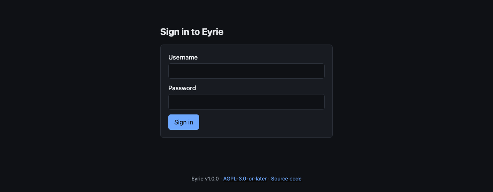
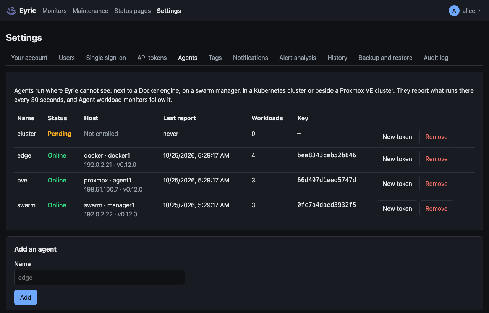
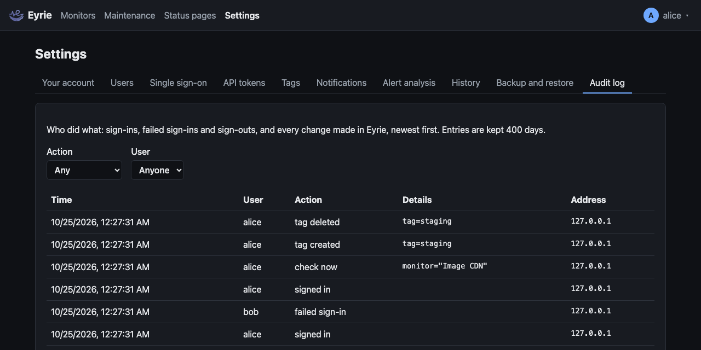
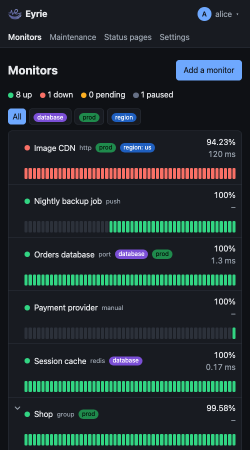

# Using the web app

Open Eyrie in a browser at the address it runs on, `http://<host>:8080` by
default.

## First start: setup

Before any account exists, every page shows **Set up Eyrie**. Enter a
username and a password of at least 12 characters, twice, and click
**Create the admin account**. That account is an admin and is signed in at
once. Do this right after the first start: until then anyone who can reach
Eyrie could do it.

Below it, **Or restore a backup** brings back the accounts, monitors and
settings of a backup file instead; then sign in with an account from it. See
[Backup and restore](backup-and-restore.md#restoring-at-setup).

## Signing in

The sign-in page asks for your username and password. Usernames ignore
case: `Alice` and `alice` are the same account. When single sign-on is set
up, a **Sign in with …** button comes first (see
[Single sign-on](single-sign-on.md)); when an admin made single sign-on the
only way in, the password fields are not shown.

- A wrong username and a wrong password get the same message: "Wrong
  username or password." So does a disabled account.
- After 5 failed sign-ins within 15 minutes, from one address or for one
  username, sign-ins are refused for a while: "Too many failed sign-ins. Try
  again in 15 minutes."
- With [two-factor sign-in](#two-factor-sign-in), a second step asks for a
  code.
- A session lasts 7 days from the last time you used Eyrie. **Sign out**,
  in the menu under your name at the top right, ends it. The menu also
  has **Your account**; on a phone it stays at the top right, with the
  page menu on its own line below.

If you opened a page while signed out, you land on it after signing in.

## Monitors

The start page is the dashboard of monitors; see [Monitors](monitors.md)
for the dashboard, each monitor's page, adding monitors and every type.

## Status pages

**Status pages**, at the top, lists the status pages; each opens on its
settings, sections, logo, incidents and badges (admins change them; viewers
see the incidents). A published page is public at `/status/<address>`. See
[Status pages, incidents and badges](status-pages.md).

## Maintenance

**Maintenance**, at the top, lists the maintenance windows, when each is on
and what it covers; admins add, change, turn off and delete them there. See
[Maintenance windows](maintenance.md).

## Settings

**Settings**, at the top, has tabs. Everyone has **Your account**; admins
also have **Users**, **Single sign-on**, **API tokens**, **Agents** (see
[Agents](agents.md)), **Tags** (see
[Tags](monitors.md#tags)), **Notifications** (see
[Notifications](notifications.md)), **Alert
analysis** (see [Alert analysis](alert-analysis.md)), **History**
(how long heartbeats are kept; see [Monitors](monitors.md#uptime-and-history))
**Backup and restore** (see [Backup and restore](backup-and-restore.md))
and **Audit log**.

### Your account

- **Profile picture**: upload a PNG, JPEG, GIF or WebP image of up to 1 MB
  (SVG and other types are refused). It shows at the top right and, for
  admins, in Users. **Remove picture** deletes it. Without a picture, the
  first letter of your username is shown. Accounts linked to single sign-on
  also get the provider's picture; see
  [Profile pictures](single-sign-on.md#profile-pictures).
- **Password**: your current password, then the new one (at least 12
  characters) twice. Changing it signs you out everywhere else; this browser
  stays signed in. Accounts that sign in only with single sign-on have no
  password and do not see this.
- **Two-factor sign-in**: below.
- **Single sign-on**: when it is set up, **Link my … account** or
  **Unlink**; see [Linking an existing account](single-sign-on.md#linking-an-existing-account).

### Two-factor sign-in

An account with a password can also require a code from an authenticator
app (any app for time-based one-time passwords: 2FAS, Aegis, Google
Authenticator, 1Password, Bitwarden and others). It is offered only when
the account has a password, password sign-in is allowed, and the account is
**not** linked to single sign-on: a linked account uses the provider's own
second factor. Linking turns it off.

To turn it on, in **Settings → Your account → Two-factor sign-in**:

1. Click **Set up**. Scan the QR code with the app, or type in the key.
2. Enter the code the app shows and your current password, then **Turn on**.
3. Save the 10 **recovery codes** shown, somewhere other than your phone.
   They are shown once. Each works once instead of a code from the app.

From then on, signing in with your password asks for **Code from your
authenticator app**:

- The code has 6 digits and changes every 30 seconds. The code before and
  the code after the current one also work, for a clock that is slightly
  off. A code that was used, or an older one, is refused.
- A recovery code works too (`k3f9-x2pq-7hwd`; with or without dashes or
  spaces, in any case). Using one is logged with how many are left.
- The second step lasts 5 minutes and allows 5 tries; then sign in again.
  Wrong codes count toward the limit on failed sign-ins.
- Single sign-on is not affected.

While it is on, the card shows how many recovery codes are left, with **New
recovery codes** (replaces all of them) and **Turn off**, both after your
current password.

Lost your phone and your recovery codes? Another admin can click **Turn off
2FA** for you in Users. If you are the only admin, run
`docker compose exec eyrie /eyrie reset-2fa <user>` on the host (see the
[command line](../technical/configuration-reference.md#command-line)).

### Users

Admins only. The table lists every account: its role, how it signs in
(password, "password + code", single sign-on, or both), its last sign-in,
and whether it is disabled. For other accounts:

- **Role**: viewer or admin. Viewers can use Eyrie and change their own
  account; admins can also change users and settings. Accounts that sign in
  only with single sign-on show "(from the SSO admin group)" instead while
  an admin group is set: the group decides their role.
- **Disable** signs the account out everywhere and stops it signing in;
  **Enable** undoes it.
- **Reset password** sets a new password and signs the account out. Only for
  accounts with a password.
- **Turn off 2FA**, for accounts with two-factor sign-in.
- **Delete** removes the account with its sessions, single sign-on links,
  recovery codes and picture, after asking. It cannot be undone.

**Add a user** creates an account with a password and a role.

You cannot disable, delete or change the role of yourself, and the last
enabled admin cannot be disabled, deleted or made a viewer.

### API tokens

Admins only. A token lets a script read Eyrie without signing in, with the
header `Authorization: Bearer <token>`: the monitors, their history, the
event stream, tags, maintenance windows, status pages and incidents (the
**read** routes of the [HTTP interface](../technical/http-interface.md#conventions)).
It can only read: it cannot sign in or change anything.

**New token** asks for a name (up to 64 characters, such as `ci`) and shows
the token, which starts with `eyt_`, once: copy it then. The list shows who
made each token, when, and when it was last used. **Revoke** stops a token
at once.

### Agents

Admins only. Eyrie's [agents](agents.md) on other hosts: each one's status
(**pending** until it enrolls, then **online** while it reports, or
**offline** after 90 seconds without a report), where it runs (platform,
host name, address and version), its last report, how many workloads it
reports, and its key's fingerprint. When an agent cannot list its
workloads, the reason is under its status. The list updates every 15
seconds.

**Add an agent** asks for a name (up to 64 characters, such as `edge`) and
shows the agent's one-time enrollment token, which starts with `eya_` and
is valid for an hour, once. Below it, **Where it runs** shows the file or
commands that run the agent there (Docker, Docker Swarm, Kubernetes or
Proxmox VE), with Eyrie's address and the token filled in.

**New token** makes a new enrollment token and forgets the agent's key:
the agent is refused until it enrolls again with the new token. **Remove**
deletes the agent; the monitors of its workloads go down.

### Audit log

Admins only. Who did what, newest first, 100 at a time (**Older** for the
next): every sign-in (password, two-factor or single sign-on), failed
sign-in and sign-out, and every change made in Eyrie (monitors, **Check
now**, tags, maintenance windows, status pages and incidents, notification
channels, users, API tokens, agents, settings, backups and restores), and
agents enrolling, rotating their keys and being refused. Each entry
has the time, the user (for a failed sign-in, the username tried), the
action, its details (such as `monitor=Shop`) and the address it came from.
Filter by **Action** and **User**. Changes made by single sign-on, such as
an account it created, show the account's user and `via=sso`.

The same lines are in Eyrie's log. Entries are kept 400 days, like the
daily totals, and a backup with history includes them.

## Dark mode and phones

Eyrie follows your device's light or dark setting, and its pages fit a
phone's screen.

